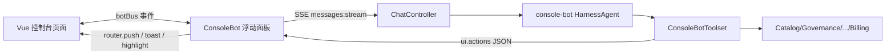

# 右下角智能机器人 · 设计说明

## 目标

在 AI 中台控制台右下角增加一个**浮动智能机器人**：

1. **本身是智能体**（`console-bot`，走同一套 Agent 目录 / 会话 / 工具 / 权限体系）
2. **具备本系统全部能力**（查询目录、治理、技能、知识、编排、运营、配额、健康）
3. **与 UI 深度互操作**（导航、打开详情、Toast、预填、高亮、页面上下文注入）

## 视觉锚点

- 风格锚点：Linear / Vercel 控制台的 floating assistant + Element Plus 现有壳层
- 背景：`#0f1419` / 面板 `#1a2332`，墨色 `#e8eef7`，强调色 `#3b82f6`（与现有 shell 一致）
- 字体：系统 UI 栈；标题 15/600，正文 13/400，等宽 mono 用于 ID
- 密度：对话气泡紧凑，工具卡片折叠；操作芯片（chips）一行

## 架构

## 后端

| 组件 | 职责 |
| --- | --- |
| `ConsoleBotToolset` | 平台查询 + UI 意图工具（返回 JSON，含 `ui.actions`） |
| `CatalogBootstrap` | 播种 `console-bot` agent + 系统提示词 + 权限 ALLOW |
| `AgentInstanceFactory` | 为 agent 注册 ConsoleBotToolset（console-bot 必注册） |

### 工具面（能力覆盖）

**平台查询（只读）**
- `platform_status` — 就绪/副本/配置源
- `list_agents` / `agent_detail`
- `list_skills` / `list_knowledge` / `search_knowledge`
- `list_permissions` / `list_business_tools` / `list_mcp_servers`
- `list_workflows` / `list_runs` / `list_teams`
- `list_sessions`（近似：inbox + runtime） / `list_audit` / `usage_summary`
- `list_quotas`

**UI 深度交互**
- `ui_navigate(path, params?)` — 路由跳转
- `ui_focus(entityType, entityId)` — 打开详情/高亮
- `ui_notify(level, message)` — Toast
- `ui_ask_user(prompt, options?)` — 在面板中追问
- `ui_suggest(actions)` — 生成可点击快捷操作

工具结果统一带 `ui` 字段时前端自动执行动作。

## 前端

| 文件 | 职责 |
| --- | --- |
| `stores/botBus.js` | 全局事件总线：页面 ↔ 机器人 |
| `components/bot/ConsoleBot.vue` | 浮动球 + 面板 + 流式对话 + 工具卡 + UI 动作执行 |
| `layouts/AppShell.vue` | 挂载 ConsoleBot |

### 深度交互约定

1. **Bot → UI**：工具返回 `ui.actions[]`，面板解析后 `router.push` / ElMessage / 打开详情
2. **UI → Bot**：任意页面 `botBus.emit('ask', { text, context })` 自动打开面板并提问
3. **上下文注入**：`botBus.emit('context', { route, title, data })` 附加到下一轮消息
4. **快捷芯片**：首页/当前页相关 action chips

## 鉴权

- 对话走 open scope Key（与现有 ChatView 相同）
- 平台查询工具在**服务端进程内直调 Service**，不二次鉴权（机器人是系统组件）
- 危险写操作（若有）仍走 HITL ASK
