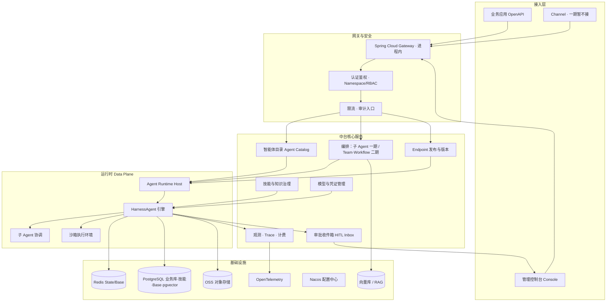
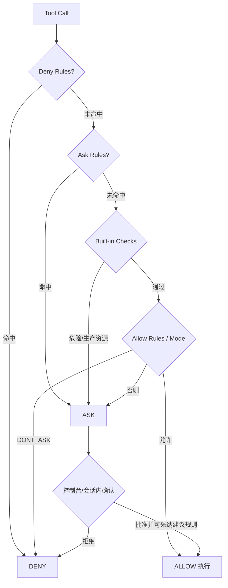
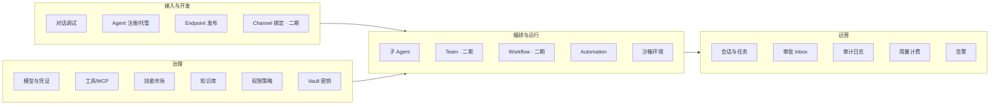
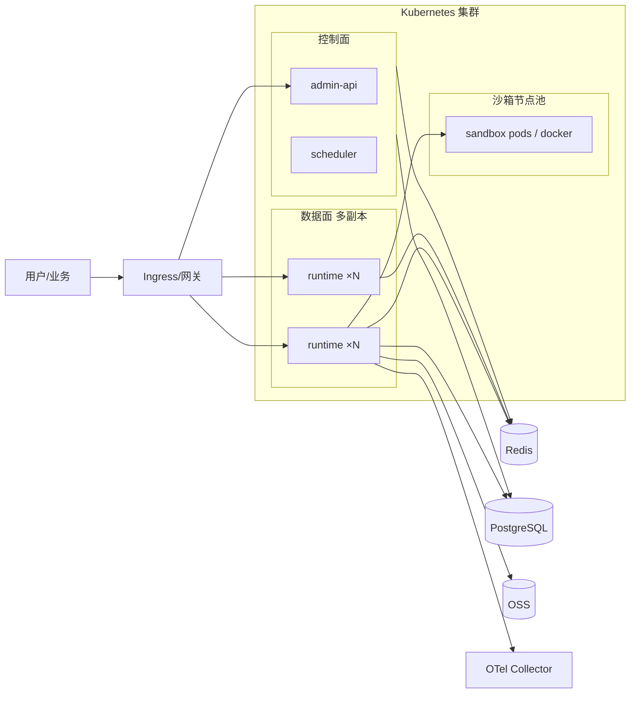
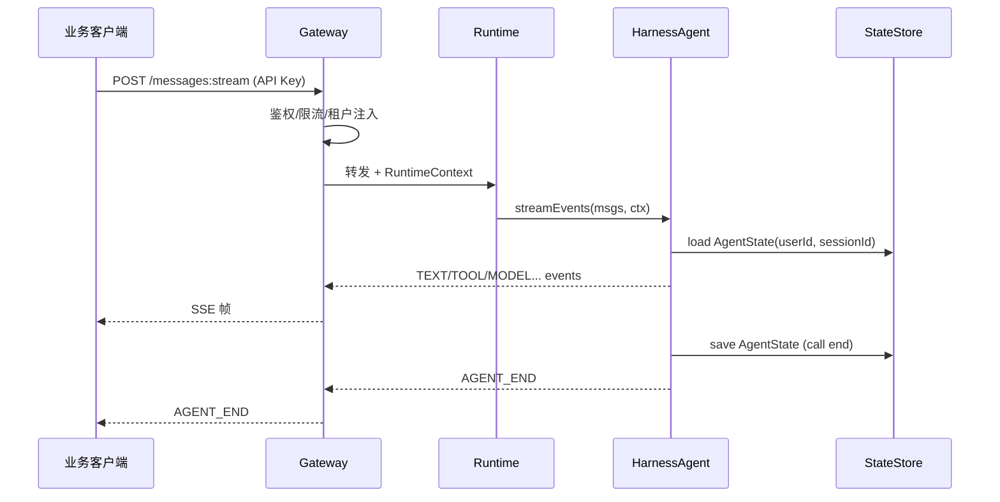
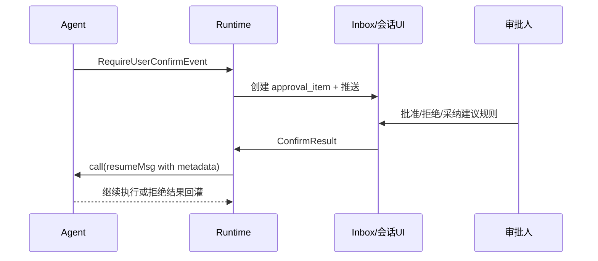

# 基于 AgentScope Java 2.0 的 AI 中台设计文档

| 项目 | 内容 |
| --- | --- |
| 项目名称 | 江苏二期 · 基于 Java 的智能体应用平台（AI 中台） |
| 技术底座 | AgentScope Java 2.0（Harness + Service 参考架构） |
| 文档版本 | v1.2 |
| 文档状态 | 选型已定稿；路线图为敏捷竖切（S0 起步）；待终审后开工 |
| 适用读者 | 架构师、后端开发、平台运维、业务接入方 |
| 修订摘要 | 关系统一 PG；**§14 改为敏捷路线：S0 最小样例 → 波次竖切迭代（2 周 Sprint）** |

---

## 1. 项目背景与目标

### 1.1 背景

AgentScope Java 2.0 已从「构建单个智能体的工具箱」演进为「面向生产环境运行智能体的完整平台」，核心能力包括：

1. **Harness 工程化** —— 工作区、分层记忆、技能仓库、子智能体、上下文压缩、Plan Mode、沙箱执行；
2. **企业级分布式部署** —— 多租户隔离、无状态水平扩展、`AgentStateStore` 跨副本恢复、权限闸门与 HITL；
3. **底层框架重构** —— 类型化消息/事件流、Middleware 五阶段、HITL 一等公民。

在此底座之上，本项目要建设统一的 **AI 中台**：让业务系统以标准 API 接入智能体能力，实现智能体的统一注册、配置、编排、运行、审计与运营，避免各业务线重复造轮子。

### 1.2 建设目标

| 目标 | 说明 |
| --- | --- |
| G1 统一接入 | 提供 OpenAPI / SSE / Channel，业务应用一次接入即可调用平台智能体 |
| G2 统一治理 | 模型、工具、技能、知识、权限、密钥集中配置与版本管理 |
| G3 统一编排 | 一期：单 Agent + 子 Agent；二期：Team 协作、固定 Workflow |
| G4 生产就绪 | 多副本、会话恢复、沙箱隔离、可观测、灰度发布 |
| G5 可扩展 | 模型 Provider、RAG、Skill Repository、Channel、协议均可插拔 |

### 1.3 一期 / 二期范围（评审决议）

| 范围 | 一期（本设计落地） | 二期（接口预留） |
| --- | --- | --- |
| 托管形态 | Managed 为主；**External 最小集已定：做**（注册/心跳/Chat 转发） | External 完整编排、Hosted |
| 编排 | 单 Agent、子 Agent（`agent_spawn`） | Team、Workflow revision、Issue/Run；**路径倾向部署对接 AgentScope Service** |
| 接入 | OpenAPI 非流式 + SSE、管理台调试；**Channel 暂不接** | Channel 按需、A2A/AG-UI、`chat/completions` 兼容 |
| 治理 | 模型凭证、技能只读市场、基础权限、会话内 HITL | 技能灰度全链路、计费账单、完整 RBAC 矩阵 |
| 沙箱 | 一期 test：**Docker**（已定）；prod 默认不开，按需 Docker | 默认开启 + 快照 |

### 1.4 非目标（本期不做）

- 自研大模型训练/微调平台（仅预留 Online Training 生态对接位）；
- 通用低代码流程画布的完整 BPM 能力；
- **自研 Team/Workflow/Issue 编排引擎**（二期路径已定方向：对接 AgentScope Service，见 T12）；
- Hosted Coding Agent（Codex 类 Runtime Host）；
- 跨云多活容灾（本期单区域双可用区/双副本）；
- 进程内任意第三方 Tool Plugin 热加载（一期工具走 MCP/HTTP/静态打包）。

---

## 2. 设计原则

1. **底座复用、中台增值**：推理循环、状态、权限、沙箱等全部复用 AgentScope 2.0；中台聚焦「目录、编排、API、运营」。
2. **无状态运行时 + 分布式状态**：Agent 实例单例化，会话状态一律走 `AgentStateStore`（生产 Redis）；关系数据统一 **PostgreSQL**。
3. **定义即数据**：人格/知识/技能/子 Agent 以 Workspace 文件或管理台配置表达，不写死在业务代码。
4. **默认安全**：权限三态（ALLOW/ASK/DENY）、危险路径不可绕过、密钥进 Vault、不可信代码进沙箱。
5. **事件驱动对外**：对外统一暴露 `AgentEvent` 流（SSE），消息可由事件重建。

---

## 3. 总体架构

### 3.1 架构分层图



### 3.2 控制面 / 数据面划分

| 平面 | 职责 | 主要组件 |
| --- | --- | --- |
| 控制面 Control Plane | 智能体注册、配置版本、Endpoint 发布、技能审核、审批流、权限；（二期）Team/Workflow 定义 | Agent Catalog、Orchestration（二期）、Skill Admin、Vault、IAM |
| 数据面 Data Plane | 实际 ReAct/Harness 执行、工具调用、沙箱、状态读写、事件流出 | Agent Runtime、HarnessAgent、Sandbox、Channel Router |
| 数据层 | 会话状态、业务元数据、技能、审计、大对象 | Redis、**PostgreSQL（含 pgvector）**、OSS |

> 设计对齐 AgentScope Service 参考架构（概念映射）；**一期不部署 Service 产品，也不自研 Team/Workflow**（见决议 B1）。

### 3.3 架构决议（评审关闭）

| 编号 | 决议 | 说明 |
| --- | --- | --- |
| **B1 编排边界** | **一期不自研 Team/Workflow/Issue**；一期编排 = 单 Agent + 子 Agent。Team/Workflow 二期；**路径倾向（已定方向）：部署对接 AgentScope Service**，立项时可再确认。 | 避免 Phase 2 模块与工期在实现中途分叉。 |
| **B2 运行时实例** | 采用下文 **4.1.1 Agent 实例生命周期**：按「已发布 (tenant, agentId, version)」懒构建单例，版本切换 = 新实例就绪后切 Endpoint 指针，旧实例排空下线。 | 关闭「多租户多版本单例从哪来、何时销毁」缺口。 |

### 3.4 Agent 托管形态

| 形态 | 一期 | 二期 | 执行位置 |
| --- | --- | --- | --- |
| Managed | ✅ 完整 | 增强 | 中台 Data Plane |
| External | ✅ **最小集（已定：做）**：注册、心跳、仅 Chat 转发（无中台侧编排调度） | 任务下发、Team 成员 | 业务进程 |
| Hosted | ❌ | 评估 | 外部 Runtime Host |

**External 最小协议（一期）：**

| 能力 | 约定 |
| --- | --- |
| 注册 | `POST /admin/external-agents`：baseUrl、能力声明（stream 支持的事件子集）、回调密钥 |
| 心跳 | `GET` 心跳或 `updatedAt` 超时标 unhealthy，目录只读展示 |
| 调用 | 中台对业务侧 **HTTP 转发** Chat/SSE，**不做**任务队列与多步调度 |
| 状态 | 会话状态由 **业务侧自管**；中台不写入该 Agent 的 AgentState |
| 失败 | 超时/5xx 返回标准错误码，不自动重试业务副作用（幂等键由调用方传） |

---

## 4. 核心能力设计

### 4.1 智能体引擎（Harness）

中台 Runtime 统一以 `HarnessAgent` 为默认执行体（需要完整工程能力时），简单问答类可用 `ReActAgent`。

```text
HarnessAgent
├── Workspace          → AGENTS.md / knowledge / skills / subagents / tools.json
├── AgentStateStore    → Redis（跨副本）
├── Memory             → MEMORY.md + memory/YYYY-MM-DD.md
├── Compaction         → 对话压缩 + 大工具结果落盘
├── SkillRepository    → PostgreSQL SkillRepository（只读分发）为主，Git/Nacos 为辅
├── Filesystem         → Remote / Sandbox / Local 三模式
├── Permission         → DEFAULT / EXPLORE / DONT_ASK + 规则
├── PlanMode           → 只读规划 + HITL 批准后执行
├── Channel/Gateway    → 会话、并发、路由、SSE
└── Middleware          → OTel / 限流 / 审计 / 自定义
```

**关键运行语义（中台必须遵守）：**

| 语义 | 实现要点 |
| --- | --- |
| 无状态单例 | 每个 **已发布** `(tenantId, agentId, version)` 构建 1 个 HarnessAgent 单例（见 4.1.1） |
| 会话隔离 | 每次 `call` 必传 `RuntimeContext(userId, sessionId)`，网关缺失则拒绝 |
| 租户/会话编码 | **统一规范见 4.1.2**（禁止两套 sessionId 并存） |
| 并发 | 同 `(userId, sessionId)` FIFO 串行；不同会话并行 |
| 中断 | `agent.interrupt(userId, sessionId)` 按会话精确中断 |
| 状态写回 | call 结束整包写入 StateStore，非每消息落盘 |

#### 4.1.1 Agent 实例生命周期（决议 B2）

```text
draft → publish(version N) → 注册表标记 ready
         │
         ▼
   Runtime 懒构建实例 Cache
   key = tenantId:agentId:version
         │
         ▼
   Endpoint release 指针 → version N（新流量）
   version N-1 → drain（in-flight 结束 / 超时强停）→ evict
```

| 环节 | 规则 |
| --- | --- |
| 构建时机 | 首次路由到该发布版本时懒加载；或管理台「预热」接口主动 build |
| 单例范围 | **进程内**单例；跨副本各自持有相同配置的实例（状态在 StateStore，不在实例字段） |
| 版本切换 | 新版本实例 `build()` 成功且自检通过后，原子更新 Endpoint → version 指针；失败则保持旧版本 |
| 下线 | 旧版本停止接新；`GracefulShutdownManager` / 排空超时（默认 120s）后释放 |
| 容量 | 单 Runtime 默认上限「活动 Agent 版本实例数」（如 50，可配），超限拒绝新预热并告警 |
| 失败 | `IllegalStateException`（如 StateStore 未分布式）视为发布失败，不切流 |

#### 4.1.2 RuntimeContext 与 sessionId 规范（评审修订）

**唯一规范（覆盖文中所有历史表述）：**

| 字段 | 规则 | 示例 |
| --- | --- | --- |
| `userId` | 对外 `endUserId`；内部作用域 `tenantId + "_" + endUserId`（Windows 路径禁止 `:`）；禁止空串 | `acme_u_1001` |
| `sessionId` | **中台网关生成并原样透传**，格式 `agt_{agentId}_{ulid}`（或业务显式传入且经校验：长度 ≤128、字符集 `[A-Za-z0-9_-]`） | `agt_a01_01J…` |
| 派生键 | 存储与审计一律使用上述二元组 + **agentId 作用域**（State key 见 4.9） | — |

约束：

1. **禁止**业务各传一套 `gw-*` / `agentId:sessionRef` 混用；Gateway 若生成 id，必须满足上表格式。  
2. 历史/confirm/interrupt API 路径必须带 `agentId`（或使用已绑定 Agent 的 Endpoint），防止跨 Agent 误操作同一 `sessionId`。  
3. `Metadata` 不参与 session key 计算（与 Channel 文档一致，业务属性放 `RuntimeContext` 字符串/类型化属性）。  
4. 网关中间件 **强制注入**；解析失败返回 `400 SESSION_CONTEXT_INVALID`。

### 4.2 消息与事件

- **Msg**：对话持久单元；`ContentBlock` 统一 Text/Data/Thinking/ToolUse/ToolResult。
- **AgentEvent**：流式对外单元；start → delta → end；同一次回复共享 `replyId`。
- **中台对外协议**：SSE（`text/event-stream`），事件 JSON 结构与 `AgentEvent` 对齐，便于前端重建消息。

**SSE 事件类型白名单（对外）：**

```text
AGENT_START / AGENT_END
TEXT_BLOCK_START / TEXT_BLOCK_DELTA / TEXT_BLOCK_END
THINKING_BLOCK_*（可配置是否透出）
TOOL_CALL_START / TOOL_CALL_DELTA / TOOL_CALL_END
TOOL_RESULT_START / TOOL_RESULT_TEXT_DELTA / TOOL_RESULT_END
MODEL_CALL_START / MODEL_CALL_END（可脱敏）
REQUIRE_USER_CONFIRM / REQUIRE_EXTERNAL_EXECUTION
USER_CONFIRM_RESULT / EXTERNAL_EXECUTION_RESULT
SUBAGENT_EXPOSED
ERROR / INTERRUPTED
```

### 4.3 权限与 HITL



中台侧配套：

- **Inbox 审批中心**：承接 `RequireUserConfirmEvent`，支持会话内确认与异步审批；
- **规则来源**：平台策略（projectSettings）、租户策略、会话建议规则（suggested）；
- **无人值守**：定时任务/CI 使用 `DONT_ASK`，ASK 降级 DENY。

**HITL 多副本与挂起语义（评审补录）：**

| 项 | 约定 |
| --- | --- |
| 挂起位置 | 暂停发生在 **某次 in-flight `call`/`streamEvents`** 内；未完成上下文已随上一轮 State 落库，本轮以「事件流出 `REQUIRE_USER_CONFIRM` 后流结束」为准（SSE 模式不长期占住一条不可恢复的裸连接语义） |
| 恢复入口 | 业务/控制台 `POST .../confirm` → 网关按 `(userId, sessionId)` **串行门** 发起 **新的 `call(resumeMsg)`**，metadata 携带 `ConfirmResult` 列表；**不依赖必须打回原 JVM 线程** |
| 状态 | `replyId` / 待确认 `ToolUseBlock` 由客户端或中台临时表 `approval_item` 持久化；State 中权限规则在确认采纳后写回 |
| 超时默认 | **超时 = 拒绝（DENY 回灌）**，可按 Agent 配置为「保持挂起 + Inbox 仍可见」（最长默认 24h 后 DENY） |
| 重复提交 | `confirm` 带幂等键；已处理则返回 `409 APPROVAL_ALREADY_RESOLVED` |
| 跨副本 | 任意副本可执行 resume（状态在 Redis）；**无需粘性**；同会话并发 confirm 由框架 per-session 门串行化 |

### 4.4 模型与凭证管理

| 能力 | 设计 |
| --- | --- |
| Provider 目录 | OpenAI 兼容、DashScope、Anthropic、Gemini、Ollama、自定义 OpenAI-compatible |
| 创建方式 | 管理台录 Credential → `listModels()` 得 ModelCard → 用户选模型 |
| 运行时解析 | `ModelRegistry.resolve(provider:model, ModelCreationContext)`；租户自备 Key 时 `CachePolicy` 按 `cacheId` 缓存或不缓存 |
| 容错 | `maxRetries` + `fallbackModel` + failover 监听上报中台指标 |
| 密钥 | 统一 Vault 存储，运行时注入，禁止明文进日志 |

**模型配置示例（管理台落库后生成）：**

```yaml
agentscope:
  model:
    provider: dashscope
  dashscope:
    api-key: ${VAULT:dashscope/key}
    model-name: qwen-plus
    stream: true
```

### 4.5 工具与 MCP

| 来源 | 接入方式（一期） | 治理 |
| --- | --- | --- |
| 平台内置 | Harness 内置 read/write/shell/memory/subagent 等 | `tools.json` allow/deny |
| 业务工具 | **优先 MCP（HTTP/Streamable）或平台 HTTP 工具**；`@Tool` 仅允许打进 Runtime 镜像的 **白名单静态依赖** | 登记 + 审核；**不做**任意 JAR 热加载 |
| MCP | STDIO / SSE / StreamableHttp | 平台统一登记 server，白名单下发 |
| 外部执行工具 | `externalTool=true` | 强制走外部执行事件 + 审批 |

> **评审修订**：原「Tool Plugin JAR 热插拔」一期取消——涉及 classloader 隔离与依赖冲突，成本高。动态扩展统一走 MCP；进程内工具随 Runtime 版本发布。

**约束：**

- `allow` 白名单必须保留 `read_file` / `memory_search` / `agent_spawn` 等内置关键工具；
- 危险路径（`.env`、`.ssh`、`.gitconfig` 等）不可被 BYPASS 关闭；
- 生产沙箱默认 `IsolationScope.USER` 或 `SESSION`，禁止 `GLOBAL` 混跑不可信代码。

### 4.6 技能（Skill）治理

四层优先级（低 → 高）：

1. 项目全局目录  
2. Marketplace（中台主推 **PostgreSQL SkillRepository，writeable=false**）  
3. `workspace/skills/`  
4. `<userId>/skills/` 覆盖  

**管理台流程：**

```text
草稿(_drafts) → 人工/规则审核(PromotionGate) → 灰度/环境可见性过滤 → 正式发布 → 使用计数 → stale/归档(Curator)
```

生产禁止 `autoPromote=true`；自学习起草必须挂审核闸门。

### 4.7 知识与 RAG

| 模式 | 选型 | 场景 |
| --- | --- | --- |
| Workspace 知识 | `knowledge/KNOWLEDGE.md` + 索引 | 随 Agent 定义走的小型领域知识 |
| 外置 RAG | **一期 Simple（自建 embedding + 向量库，已定）**；后续可换百炼/Dify/RAGFlow | 中台级共享知识库，多 Agent 复用 |

中台知识库模块负责：文档导入、切片、索引、检索 API；Agent 侧通过 `Knowledge` 接口或工具调用检索。一期同步落地 Simple 依赖：embedding 服务 + **pgvector**（与 BaseStore 共用 PostgreSQL）。

### 4.8 编排：子 Agent / Team / Workflow

| 形态 | 期 | 机制 | 中台落点 |
| --- | --- | --- | --- |
| 子 Agent | **一期** | `subagents/*.md` + `agent_spawn` / `agent_send`，同步/后台 | Workspace 声明 + 管理台表单 |
| Team | 二期 | Leader 动态委派、汇总（对齐 Service Team；实现路径见 B1） | 控制台创建 Team、角色与策略 |
| Workflow | 二期 | 固定步骤、条件、人工关口、按 revision 执行 | 控制台编排定义 + 发布版本 |
| Channel 路由 | **一期不接 Channel（已定）** / 二期按需 | `GatewayBootstrap` 预留注册多 Agent |

**执行模型（二期展开）：**

- Chat 类（一期）：同步/流式会话；
- Issue 类（二期）：目标、负责人、验收，映射 AgentTask/Attempt；
- Automation（二期）：Cron / Webhook 触发，`DONT_ASK` 或预授权规则。

### 4.9 会话与状态

| 数据 | 存储 | 寻址 |
| --- | --- | --- |
| AgentState（上下文/摘要/权限/Plan/todo） | Redis AgentStateStore（生产） | StateStore 按 `(userId, sessionId)`；**key 前缀含 `agentId`**（`keyPrefix = amp:{agentId}:`）防跨 Agent 冲突 |
| 工作区文件（记忆/技能/日志/计划） | Remote BaseStore（**PostgreSQL JdbcStore**） | 路径段 `agents/{agentId}/` + `IsolationScope` 桶（如 `users/{userId}/`） |
| 沙箱快照 | OSS SnapshotSpec | `agents/{agentId}/{scopeKey}` |
| 业务元数据（目录/版本/审计）/技能/向量 | **PostgreSQL**（含 pgvector；可与 Base 同实例、分 database/schema） | 中台自有表 + 技能 + 向量 |

**键空间示例（与官方 Remote 路由一致）：**

```text
State:   amp:{agentId}:session → (userId, sessionId)
Base:    agents/{agentId}/users/{userId}/memory/MEMORY.md
         agents/{agentId}/users/{userId}/sessions/{sessionId}.log.jsonl
Snapshot: agents/{agentId}/users/{userId}/sandbox/{slot}.tar
```

同会话是否需要粘性：**否**（State 远端共享）；仅当使用「进程内 WorkspaceIndex 缓存」时允许非粘性弱一致，索引以 best-effort 为准。

滚动发布：`GracefulShutdownManager` 保存 in-flight → 新副本从 Store 恢复 → 同 sessionId 对话不中断。

### 4.10 可观测与运营

| 层级 | 内容 |
| --- | --- |
| 链路 | `OtelTracingMiddleware` + OTel SDK → OTLP Collector |
| 指标 | QPS、P95 延迟、Token 用量、工具失败率、failover 次数、沙箱时长 |
| 日志 | 结构化访问审计（谁在何时调了哪个 Agent、哪把工具、结果状态） |
| 会话 | 工作区 `sessions/*.log.jsonl` 只追加，可检索回放 |
| 计费 | 按租户/Agent/模型聚合 `ChatUsage` |

---

## 5. 业务架构与功能模块

### 5.1 功能地图



### 5.2 模块职责

| 模块 | 职责 | 主要依赖 AgentScope 能力 |
| --- | --- | --- |
| Agent Catalog | Agent 元数据、版本、托管类型、启停 | Workspace / Builder |
| Agent Builder | 人格、模型、工具、技能、子 Agent 配置表单 → 生成 Workspace/Builder | Workspace 对等 API |
| Chat Playground | 调试对话、事件流、确认交互 | streamEvents / Channel |
| Endpoint 服务 | 发布 REST + SSE，密钥、限流、版本 release | Gateway / Channel |
| Orchestration | 一期子 Agent 配置；二期 Team、Workflow revision、Automation | Subagent +（二期）Service/自研 |
| Skill Admin | 技能 CRUD、审核、灰度、归档 | SkillRepository + Gate/Curator |
| Knowledge Admin | 文档、索引、库绑定 | RAG Knowledge |
| Model & Vault | 凭据、模型目录、环境变量 | Credential / ModelRegistry |
| Permission Admin | 租户/Agent 级规则与 Mode | PermissionContextState |
| Inbox | ASK/外部执行/验收 | HITL 事件 |
| Observability | Trace、指标、审计、计费 | OTEL + sessions log |

---

## 6. 集成 API 设计

### 6.1 对外 OpenAPI（业务系统）

Base Path：`/api/v1`。**路径一律含 `agentId`**（与 sessionId 规范配套）。

| 方法 | 路径 | 一期 | 说明 |
| --- | --- | --- | --- |
| POST | `/agents/{agentId}/messages` | ✅ | 非流式 call，返回最终 Msg |
| POST | `/agents/{agentId}/messages:stream` | ✅ | SSE 流式事件 |
| POST | `/agents/{agentId}/sessions/{sessionId}/confirm` | ✅ | 提交 HITL ConfirmResult（幂等） |
| POST | `/agents/{agentId}/sessions/{sessionId}/interrupt` | ✅ | 中断当前会话 |
| GET | `/agents/{agentId}/sessions/{sessionId}/history` | ✅ | 会话消息/摘要；**SSE 断线兜底** |
| POST | `/chat/completions` | 二期 | 兼容式对话 |
| POST | `/workflows/{workflowId}/runs` | 二期 | 触发 Workflow（决议 B1） |
| GET | `/runs/{runId}` | 二期 | 查询编排执行 |

**认证：** `Authorization: Bearer <api-key>`；Key 绑定租户与可访问 Agent 列表。

**SSE 重连与回放（评审补录）：**

| 场景 | 约定 |
| --- | --- |
| 事件 id | 每条 SSE 帧带 `id: {replyId}:{seq}` |
| 断线重连 | 客户端带 `Last-Event-ID`；Runtime 若仍有该 `replyId` 的可重放缓冲（默认仅内存、短窗 30s）则续传，否则结束流并推 `ERROR{code:SSE_RESUME_MISS}` |
| 兜底 | 重连失败后客户端调 `GET .../history` 拉取已持久化消息重建（**至少保证最终 Msg 可取**） |
| 取消 | 客户端断开连接 **不**自动 cancel Agent；需显式 `interrupt`（避免代理层闪断杀任务） |
| 心跳 | 空闲时 `:ping` 注释帧，默认 15s |

**非流式请求示例：**

```json
{
  "userId": "u_1001",
  "sessionId": "optional-explicit",
  "messages": [
    { "role": "user", "content": "帮我查一下昨天的订单异常" }
  ],
  "metadata": { "channel": "openapi", "bizId": "ORD-1" }
}
```

**SSE 响应示例：**

```text
event: TEXT_BLOCK_DELTA
data: {"type":"TEXT_BLOCK_DELTA","replyId":"r-1","delta":"正在"}

event: TOOL_CALL_START
data: {"type":"TOOL_CALL_START","toolCallId":"c1","toolCallName":"query_orders"}

event: REQUIRE_USER_CONFIRM
data: {"type":"REQUIRE_USER_CONFIRM","replyId":"r-1","toolCalls":[...]}
```

### 6.2 管理台 API（内部）

| 域 | 示例 |
| --- | --- |
| 目录 | `POST /admin/agents`、`POST /admin/agents/{id}/versions/{v}:publish` |
| 技能 | `POST /admin/skills`、`POST /admin/skills/{id}:approve` |
| 模型 | `POST /admin/models/credentials`、`GET /admin/models/cards` |
| 审批 | `GET /admin/inbox`、`POST /admin/inbox/{itemId}:decide` |
| 审计 | `GET /admin/audit?from=&to=&agentId=` |

### 6.3 与 AgentScope Service / External 的关系

- **External Agent**：业务侧独立部署 AgentScope 应用，通过 SDK 注册到中台，中台只做目录与调度，不接管进程；
- 若二期直接部署开源 AgentScope Service，则中台控制面可与 Service Control 对接，本设计预留接口契约（Agent、Issue、Run、Endpoint）。**路径倾向已定（T12）：对接 Service。**

---

## 7. 数据架构

### 7.1 核心实体（PostgreSQL）

| 实体 | 关键字段 | 说明 |
| --- | --- | --- |
| tenant | id, code, name, status | 租户 |
| user | id, tenant_id, name | 终端用户（或对接 IAM） |
| agent | id, tenant_id, name, mode(managed/external), status | 智能体 |
| agent_version | id, agent_id, version, workspace_snapshot, model_config, status | 配置版本 |
| endpoint | id, agent_id, path, api_key_hash, release_version | 发布入口 |
| model_credential | id, tenant_id, provider, vault_ref | 凭证引用 |
| mcp_server | id, name, transport, endpoint, status | MCP 登记 |
| skill | id, name, source, status, version | 技能元数据 |
| skill_review | id, skill_id, result, reviewer | 技能审核 |
| knowledge_base / document | … | 知识库 |
| team / team_member / workflow / workflow_revision / run / task / attempt | … | 编排 |
| approval_item | id, type, payload, status, assignee | HITL 收件箱 |
| audit_log | id, tenant, actor, action, resource, ts, detail | 审计 |
| usage_metric | id, ts, tenant, agent, model, tokens, cost | 用量 |

> 会话正文不进 PostgreSQL 主路径（避免大字段拖垮）；以 Redis AgentState + 工作区 JSONL 为准，PG 仅存索引/摘要可选冷备。

### 7.2 存储选型

| 用途 | 选型 | 理由 |
| --- | --- | --- |
| AgentState | **Redis**（已定） | 生产多副本首选，低延迟 |
| BaseStore（工作区） | **PostgreSQL（JdbcStore）**（已定） | 事务与 SQL 审计友好；与 State 分离 |
| 沙箱快照 | OSS | 大对象 |
| 业务元数据 | **PostgreSQL**（已定，去掉 MySQL） | 与 Base/技能/向量同一关系库体系 |
| 技能市场 | **PostgreSQL SkillRepository（只读）** | 平台治理；官方扩展 `postgresql-repository` |
| 向量（RAG Simple） | **pgvector（已定）** | 挂在 PostgreSQL 上，不引入独立向量中间件 |
| 配置 | **Nacos**（已定） | 动态配置与 AgentScope Nacos 扩展对齐 |

**混合 DistributedStore 示例（State=Redis，Base=PostgreSQL）：**

```java
// State → Redis；BaseStore → PostgreSQL（JdbcStore，dialect 自动识别 PG）
DistributedStore redisStore = RedisDistributedStore.fromJedis(jedis);
DistributedStore store = DistributedStore.builder()
    .agentStateStore(redisStore.agentStateStore())
    .baseStore(JdbcStore.create(postgresDataSource))   // PostgreSQL
    .sandboxSnapshotSpec(ossStore.sandboxSnapshotSpec())
    .sandboxExecutionGuard(redisStore.sandboxExecutionGuard())
    .build();
```

> 技能：`PostgreSQLSkillRepository.builder(dataSource)...writeable(false).build()`  
> 控制面 ORM 指向同一 PG 实例（可分 schema：`amp_meta` / `amp_base` / `amp_skills` / `amp_vectors`）。

---

## 8. 部署架构

### 8.1 逻辑部署



### 8.2 生产组件清单（对照 Going to Production）

| 关注点 | 推荐组合 |
| --- | --- |
| AgentState | `RedisDistributedStore` |
| 工作区 | `RemoteFilesystemSpec` + `IsolationScope.USER` + WorkspaceIndex；BaseStore=**PostgreSQL** |
| 快照 | `OssDistributedStore.sandboxSnapshotSpec()` |
| 沙箱 | **一期 test：`DockerFilesystemSpec`**；prod 默认关，开启时同 Docker/K8s + ExecutionGuard |
| 技能 | `PostgreSQLSkillRepository(writeable=false)` |
| 观测 | `OtelTracingMiddleware` + OTLP |
| 停机 | SIGTERM + `GracefulShutdownManager` |
| 限流 | `onModelCall` Middleware + 网关层限流 |

### 8.3 环境规划

| 环境 | Filesystem | StateStore | BaseStore | 权限 Mode | 说明 |
| --- | --- | --- | --- | --- | --- |
| dev | Local | JsonFile | 本地/PG | ACCEPT_EDITS | 本地开发 |
| test | Remote（可选本地 Docker 沙箱） | Redis | PostgreSQL | DEFAULT | 集成测试 |
| prod | Remote（沙箱默认关，按需 Docker） | Redis | PostgreSQL | DEFAULT / DONT_ASK（任务） | 多副本 |

**严禁**：prod 使用本地 `JsonFileAgentStateStore` + Remote/Sandbox 文件系统（build 会抛 `IllegalStateException` 或状态单点）。

---

## 9. 安全设计

| 域 | 措施 |
| --- | --- |
| 认证 | 控制台 SSO/OIDC；OpenAPI API Key；内部服务 mTLS/网络策略 |
| 授权 | Namespace 级 RBAC；Agent 可见/可调用 ACL；Endpoint Key 粒度 |
| 租户隔离 | RuntimeContext 强制 tenant 编码；IsolationScope；State key 含 userId 与 agentId 前缀 |
| 工具安全 | 权限三态 + 危险路径 + MCP 白名单 + 沙箱执行 |
| 密钥 | Vault；K8s Secret；禁止写入 Workspace 明文；日志脱敏 |
| 数据 | 传输 TLS；状态与快照静态加密（可选）；审计不可篡改留存 |
| **出网（评审补录）** | 模型 API / MCP / 工具 HTTP 出网默认走 **Egress 代理 + 域名白名单**；沙箱独立 NetworkPolicy，默认拒出网，按 Agent 显式放行；禁止直连未登记地址 |
| 内容 | 提示注入基础缓解：工具结果消毒、外部网页/邮件内容降权标记（增强项） |

---

## 10. 关键技术选型

### 10.1 选型决议（v1.2 · 已关闭的多选一）

| # | 议题 | **已定** | 否决/备选 | 影响章节 |
| --- | --- | --- | --- | --- |
| T1 | 后端 Web 栈 | **Spring MVC** | WebFlux；混合双栈 | §10、工程骨架（SSE 用 `SseEmitter`/异步 Servlet） |
| T2 | 配置中心 | **Nacos** | K8s ConfigMap 单用；Spring Cloud K8s | §7.2、§10、部署 |
| T3 | 任务调度 | **Spring `@Scheduled` + DB 锁** | Quartz；XXL-Job（二期可升级） | Automation 二期、控制面 job |
| T4 | API 网关 | **Spring Cloud Gateway（进程内）** | Higress；企业现有网关；Nginx+应用鉴权 | 接入层、鉴权限流实现位置 |
| T5 | 管理台前端 | **Vue3** | React；公司既有栈 | `platform-console-ui` |
| T6 | 外置 RAG | **Simple（自建 embedding + 向量库）**；向量库 **已定：pgvector**（复用 PostgreSQL BaseStore 同实例/同集群） | 百炼/Dify/RAGFlow/HayStack；Milvus | §4.7；§7.2 |
| T7 | 沙箱 | **test：Docker；prod 默认关** | K8s 沙箱；prod 强制沙箱 | §1.3、§8.2、§8.3 |
| T8 | 日志检索 | **Loki** | Elasticsearch/OpenSearch | §4.10、§10 |
| T9 | 关系库与 BaseStore | **全部 PostgreSQL**（Base=JdbcStore/PG；控制面/技能同库系）；State 仍为 **Redis** | MySQL 混用；Base 用 Redis | §4.9、§7.2、DistributedStore |
| T10 | 一期 External | **做最小集** | 不做只留接口 | §1.3、§3.4、Phase1 |
| T11 | Channel | **一期暂不接** | 钉钉/飞书/企微（二期再选） | §1.3、§4.8 |
| T12 | 二期编排路径 | **倾向部署对接 AgentScope Service** | 全自研；保持未定 | B1、Phase2 立项 |

**存储拓扑（定稿）：**

```text
AgentState          → Redis
Workspace BaseStore → PostgreSQL (JdbcStore)
控制面业务元数据      → PostgreSQL（同实例，分 schema）
技能市场            → PostgreSQL SkillRepository
RAG 向量            → pgvector（同 PostgreSQL，扩展 vector）
沙箱快照            → OSS
配置                → Nacos
```

> **单关系库说明（v1.2 修订）**：去掉 MySQL，关系型一律 PostgreSQL；State 保持 Redis 与快照保持 OSS 的分工不变（T9）。

### 10.2 技术栈总表

| 层 | 技术 |
| --- | --- |
| 语言/运行时 | JDK 17+，**Spring Boot 3.x + Spring MVC（T1）**；Agent 调用侧仍使用框架 Reactor（`Mono/Flux`），在 MVC 中以异步方式收尾 |
| SSE | MVC 异步 `SseEmitter` / `StreamingResponseBody`，事件源仍为 `streamEvents` |
| Agent 框架 | `agentscope-harness` + `agentscope-core` + 扩展模块 |
| 构建 | Maven 3.9+，多模块 |
| 注册/配置 | **Nacos（T2）** |
| API 网关 | **Spring Cloud Gateway 进程内（T4）**（可与 open-api 同 JVM 或独立 deployable） |
| 数据 | **Redis（State）+ PostgreSQL（Base/控制面/技能/pgvector）**、OSS（快照） |
| 消息/任务 | **`@Scheduled` + DB 锁（T3）**；二期评估 XXL-Job |
| 前端 | **Vue3 + SSE 渲染（T5）**；对话 UI 支持工具卡片与确认 |
| RAG | **Simple + pgvector（T6 已定）** |
| 沙箱 | **Docker（T7）**，prod 默认关 |
| 观测 | OpenTelemetry + Prometheus + Grafana + **Loki（T8）** |
| 协议 | SSE 主推；Channel 一期不接（T11）；A2A / AG-UI 二期按需 |

### Maven 依赖骨架（示意）

```xml
<dependency>
  <groupId>io.agentscope</groupId>
  <artifactId>agentscope-harness</artifactId>
  <version>${agentscope.version}</version>
</dependency>
<dependency>
  <groupId>io.agentscope</groupId>
  <artifactId>agentscope-extensions-model-dashscope</artifactId>
  <version>${agentscope.version}</version>
</dependency>
<dependency>
  <groupId>io.agentscope</groupId>
  <artifactId>agentscope-extensions-redis</artifactId>
  <version>${agentscope.version}</version>
</dependency>
<!-- 可选：openai / oss / skill-postgresql / spring-boot-starter；PostgreSQL 用 agentscope-extensions-skill-postgresql-repository -->
```

---

## 11. 工程结构（建议 monorepo 模块）

```text
ai-middle-platform/
├── docs/
│   └── AI中台设计文档.md
├── platform-common/           # 通用 DTO、错误码、租户上下文
├── platform-infra/            # Redis/PostgreSQL/OSS/OTel 封装
├── platform-runtime/          # HarnessAgent 装配、RuntimeContext 过滤器
├── platform-connector/        # OpenAPI、SSE、External SDK（Channel 二期）
├── platform-catalog/          # Agent 目录与版本
├── platform-orchestration/    # 一期子 Agent；二期对接 AgentScope Service
├── platform-governance/       # 模型、技能、知识(Simple RAG)、权限、Vault
├── platform-ops/              # Inbox、审计、计费、指标
├── platform-admin-api/        # 管理台后端（Nacos 注册）
├── platform-open-api/         # 对外 OpenAPI（含 Spring Cloud Gateway 装配）
└── platform-console-ui/       # 管理台前端（Vue3）
```

---

## 12. 核心时序

### 12.1 流式对话（OpenAPI SSE）



### 12.2 HITL 确认



---

## 13. 非功能需求

| 项 | 指标（一期目标，可调） |
| --- | --- |
| 可用性 | 控制面 99.9%；数据面 99.5% |
| 延迟 | 首 Token P95 < 2s（**不含**模型供应商波动；压测口径需固定 prompt） |
| 并发（容量假设） | 单 Runtime 默认支撑 **约 200 并发活跃会话**（经验值，M1 压测校准）；同会话串行由框架保证；超限水平扩容 |
| 实例上限 | 单 Runtime 活动 Agent 版本实例 ≤ 50（可配） |
| 会话恢复 | 节点故障后同 sessionId 可在其他副本继续（State 在 Redis） |
| 发布 | 滚动发布不断会话（State 持久化 + graceful shutdown + 版本排空） |
| 数据保留 | 审计 ≥ 180 天；会话 JSONL 按租户策略 |
| RTO / RPO | **会话状态**：同城 Redis 主从 + AOF，演练目标 **RPO ≤ 5s、RTO ≤ 5min**（非数学意义 0）；**控制面** RTO < 30min（PostgreSQL 恢复） |

**容量估算假设（写入压测计划）：** 平均会话轮次、工具调用占比、沙箱并发占比——在 **S4+** 可用压测切片上给出基准，避免 NFR 虚标。

---

## 14. 实施路线图（敏捷 · 最小样例优先）

### 14.0 敏捷原则

| 原则 | 落地方式 |
| --- | --- |
| **先竖切、后横铺** | 每个 Sprint 交付「能演示的端到端切片」，不按分层堆代码再联调 |
| **最小样例 (Walking Skeleton)** | Sprint 0 只求：一次真实模型调用 + 一条 SSE + 会话能接上；UI/治理可极简 |
| **时间箱** | 迭代 = **2 周 Sprint**；每 Sprint 末 Demo + 回顾；范围用 Product Backlog 滚动取用 |
| **DoD（每个故事）** | 有自动化测试（单测/关键路径）、可本地 Compose 一键起、有演示脚本、文档同步 |
| **变更控制** | 1.3 一期范围仍是基线；加需求进 Backlog 估点，不默认塞进当前 Sprint |

**推荐角色：** PO（范围优先级）、1 名 Tech Lead、2–4 名开发、1 名测试（可兼职）、运维对接 0.5 人。

**Backlog 优先级约定：** `P0` 阻塞演示 → `P1` 一期必需 → `P2` 一期增强 → `P3` 二期/可延后。

### 14.1 最小样例 · Sprint 0（约 1–2 周）— Walking Skeleton

**目标一句话：** 本地 `docker compose up` 后，能用 curl 调通一个 HarnessAgent，流式吐字，第二轮还记得第一轮。

| ID | 故事（垂直切片） | P | 验收 |
| --- | --- | --- | --- |
| S0-1 | 单模块或极薄多模块：`open-api` + 内嵌 Runtime | P0 | `POST /agents/demo/messages:stream` 返回 SSE 文本 |
| S0-2 | 只读 Agent 定义（代码/YAML 写死 1 个） | P0 | 无需管理台也能跑 |
| S0-3 | Redis AgentState + RuntimeContext 强制注入 | P0 | 同 sessionId 第二轮有上下文；缺 userId/sid → 400 |
| S0-4 | Compose：Redis + PG（可先空库）+ 应用 | P0 | 一键起、一键停 |
| S0-5 | 健康检查 + 结构化日志 + CI（编译+测试） | P1 | PR 必过 pipeline |

**明确不做（S0）：** 管理台、Nacos、网关完整鉴权、技能、RAG、External、沙箱、多版本。

**Demo 脚本：** curl 流式两句对话 → 杀进程重启 → 同 sessionId 仍记得昵称。

```text
S0 完成定义
├── 代码仓库 + CI 绿
├── Compose 文档（README 10 分钟可跑通）
├── 事件流可用（MVC SseEmitter 或先 Blocking 流式占位，S1 换标准）
└── 已知债务清单（写入 Backlog，不假装完成）
```

### 14.2 迭代波次（每波 = 1–2 个 Sprint，均可独立演示）

> 思路：**每一波只加一条主线能力**，旧 Demo 始终可回归；避免「大 Phase 做完再联调」。

```text
波次0  S0     最小样例：curl 对话 + 会话恢复
波次1  S1–S2  产品化接入：API Key、版本发布、Vue3 调试台（可用）
波次2  S3–S4  运行时完备：多 Agent 实例、HITL、工具/MCP、history
波次3  S5–S6  治理闭环：技能 PG 市场、Simple RAG+pgvector、审计
波次4  S7–S8  生产硬化：Nacos、观测 Loki、双副本、External、沙箱
波次5  S9+    按需：对接 AgentScope Service / Channel / 计费…
```

| 波次 | Sprint | 主题（唯一主线） | 本波必交付 User Story 示例 | 演示验收（DoD for wave） |
| --- | --- | --- | --- | --- |
| **0 最小样例** | S0（1–2 周） | Walking Skeleton | 见 14.1 | curl SSE + 重启续聊 |
| **1 可接入** | S1 | 鉴权与会话 API 完备 | API Key 发放；messages/confirm/interrupt/history 骨架；sessionId 规范中间件 | 业务方用 Key 调 5 个 API，断线可 history 兜底 |
| | S2 | **薄管理台** | Vue3：Agent 列表（读库）、启停、Playground 单页对话 | 点击页面完成一次流式对话（仍可后端写死配置） |
| **2 运行时** | S3 | 目录与版本 | agent/agent_version 表；懒加载实例缓存；Endpoint 指针切流（B2 最小实现） | 发布 v2、流量切换、旧版排空日志可见 |
| | S4 | HITL + 工具 | 权限 Mode/规则落库；会话内确认；MCP 登记 + 1 个业务工具 | 危险操作弹确认 → 批准后继续；拒绝则回灌 |
| **3 治理** | S5 | 技能市场 | PostgreSQL SkillRepository 只读；管理台上传/审核（可先人工 SQL 审） | 未审技能不可见；审后下轮生效 |
| | S6 | Simple RAG | 文档入库 → pgvector 检索工具 → 引用回答 | 问知识库能引用原文片段 |
| **4 生产** | S7 | 配置与观测 | Nacos 配置；OTel+Prometheus+Loki；限流中间件 | 仪表盘见 QPS/延迟/Token；日志可查会话 |
| | S8 | 多副本+硬化 | Remote FS + 双副本压测；按需 Docker 沙箱；External 最小集；OSS 快照（若开沙箱） | 杀一副本会话不丢；N4 上线检查单 |
| **5 扩展** | S9+ | 按 PO 排序 | 对接 Service、Channel、计费配额、灰度… | 逐 Story 进 Sprint |

### 14.3 Product Backlog 骨架（进入 Sprint 前由 PO 排序）

**P0（没有则无产品）**

1. SSE 对话流；2. 会话状态恢复；3. RuntimeContext 强制；4. Compose/CI；5. API Key（S1）

**P1（一期定义内）**

6. 五个 OpenAPI；7. Vue3 Playground；8. 版本发布与实例生命周期；9. HITL 会话内确认；10. MCP 工具登记；11. 技能只读市场；12. Simple RAG+pgvector；13. 观测最小集（S7）；14. 双副本演练（S8）

**P2（有余力再进 Sprint）**

15. External 最小集；16. 沙箱 Docker；17. 异步 Inbox；18. 配额与计费雏形

**P3（明确二期 / 不默认排入）**

19. Team/Workflow（对接 Service）；20. Channel；21. Hosted；22. chat/completions 兼容；23. 完整 RBAC 矩阵

### 14.4 Sprint 模板（每 2 周）

| 时刻 | 活动 |
| --- | --- |
| D1 上午 | Sprint Planning：从 Backlog 取 **不超过团队速度** 的故事；定义本波 Demo 脚本 |
| 每日 | 站会 15min；阻塞当天升级 |
| 中间 | 主干开发 + Feature 分支短命合入；每日可部署到 dev |
| D9 | 冻结功能；修 Bug、补测试、写演示 |
| D10 | **Sprint Demo（对着验收标准）** + Retrospective；更新路线图剩余波次 |

**速度假设（可调）：** 团队 3–4 人 · 每 Sprint 约 **15–25 故事点**；竖切故事按 3/5/8 估点。

### 14.5 里程碑（由「波次完成」定义，而非大 Phase）

| 里程碑 | 对应 | 验收标准 |
| --- | --- | --- |
| **M0 样例跑通** | 波次 0 | Compose + curl 流式 + 重启续聊；CI 绿 |
| **M1 可给业务试用** | 波次 1 结束 | API Key 调通 5 接口；Playground 页面对话 |
| **M2 可配置发布** | 波次 2 结束 | 控制台发布版本切流；HITL 闭环；MCP 工具可用 |
| **M3 可治理** | 波次 3 结束 | 技能需审核；RAG 可引用；审计/指标有数 |
| **M4 可上线** | 波次 4 结束 | 双副本、观测、检查单、（可选）沙箱与 External |

### 14.6 与旧 Phase 对照（便于评审过渡）

| 旧 Phase 0–3 | 敏捷对应 |
| --- | --- |
| Phase 0 脚手架 | **S0 最小样例**（刻意更薄，不含 Nacos/PG 全套可延后到 S7） |
| Phase 1 MVP 4–6 周一次交付 | **拆成波次 1–2（S1–S4）**，每两周可演示 |
| Phase 2 治理编排 | **波次 3** + 服务对接进 S9+ |
| Phase 3 生产强化 | **波次 4**，与可观测/多副本同波，不单独「最后大爆炸」 |

### 14.7 工程落地顺序（给开发排期用）

```text
第 1 周     ── S0：仓库 + Compose(Redis先) + Harness 最小 call/stream
第 2 周     ── S0 收尾：State 恢复 + CI + Demo；并行开 S1 API 设计评审
第 3–4 周   ── S1 API/Key/sessionId + （后半）S2 Vue3 骨架
第 5–6 周   ── S2 完成 Playground；开 S3 表结构与实例缓存
第 7–8 周   ── S3 版本切流；开 S4 HITL/MCP
…           ── 按波次推进；每双周 Demo
```

**本周即可开工的最小任务包（S0 backlog 粘贴板）：**

1. 初始化 Maven 多模块（可先 `platform-common` + `platform-open-api` 两个模块，不必一次 10 个）  
2. `application.yml`：模型 API Key、Redis URI  
3. 写死一个 `HarnessAgent` bean + `POST /messages:stream`  
4. `docker-compose.yml`：redis + app  
5. README：3 条 curl  

---

## 15. 风险与对策

| 风险 | 影响 | 对策 |
| --- | --- | --- |
| 忘记传 RuntimeContext | 会话串台 | 网关强制注入；缺失 `400` |
| sessionId 规范不统一 | 跨 Agent 撞会话、历史错乱 | 唯一规范 4.1.2；API 强制 agentId |
| 版本切换未排空 | 旧版本仍写状态/双实例 | B2：指针切换 + drain 超时 |
| HITL 超时无人批 | 任务挂死 | 默认超时 DENY；Inbox 逾期告警 |
| SSE 断线丢增量 | 前端残缺 | 短窗续传 + history 兜底 |
| 本地 StateStore 上生产 | 无法多副本 | 启动校验 + 部署检查单 |
| 技能 autoPromote | 未审内容进生产 | 平台配置封死，强制 Gate |
| 模型供应商抖动 | 对话失败 | fallbackModel + 重试 + 熔断指标 |
| 沙箱/工具出网失控 | 数据外泄 | Egress 白名单 + NetworkPolicy |
| 沙箱并发写 | 状态错乱 | ExecutionGuard + USER/SESSION scope |
| Token 成本失控 | 预算超支 | 配额、限流 middleware、计费告警 |
| 提示注入/数据外泄 | 安全事件 | 权限 ASK、只读 EXPLORE、DLP 审计增强 |
| 一期范围回涨（Team 等提前插入） | 工期失控 | 1.3 范围表作变更基线，出一期走变更评审 |

---

## 16. 附录

### 16.1 AgentScope 能力映射表

| 中台能力 | AgentScope 2.0 对应 |
| --- | --- |
| 智能体执行 | `HarnessAgent` / `ReActAgent.call/streamEvents` |
| 会话状态 | `AgentState` + `AgentStateStore` |
| 租户上下文 | `RuntimeContext` |
| 工作区配置 | Workspace 文件与 Builder 等价 API |
| 权限/HITL | Permission System + ConfirmResult |
| 事件流 | `AgentEvent` / SSE |
| 技能 | SkillRepository 四层 + Gate/Curator |
| 子 Agent | `subagents/` + agent_spawn |
| 沙箱 | SandboxFilesystemSpec + Snapshot |
| 多副本 | DistributedStore + RemoteFilesystem |
| 观测 | OtelTracingMiddleware |
| 多入口 | Channel / GatewayBootstrap |
| 服务化参考 | AgentScope Service（Control/Scheduler/Managed/External/Hosted） |

### 16.2 参考文档

- 总览：https://java.agentscope.io/v2/zh/docs  
- Harness 架构：https://java.agentscope.io/v2/zh/docs/harness/architecture  
- 上下文与状态：https://java.agentscope.io/v2/zh/docs/building-blocks/context  
- 上生产：https://java.agentscope.io/v2/zh/docs/others/going-to-production  
- Service：https://java.agentscope.io/v2/zh/service/index  
- 集成总览：https://java.agentscope.io/v2/zh/integration/overview  

### 16.3 评审与选型跟踪

| 批次 | 项 | 处理 |
| --- | --- | --- |
| v1.0→v1.1 评审 | B1 编排边界 | 一期不做 Team/Workflow；v1.2 路径倾向 **对接 Service** |
| | B2 实例生命周期 | 已关闭：§4.1.1 |
| | sessionId 双轨 | 已收敛：§4.1.2 |
| | HITL 多副本 / SSE / External / Tool JAR / NFR / 出网 / 键空间 | 已补（见 v1.1） |
| v1.2 选型 | T1–T12 | **已全部关闭**，见 §10.1 |
| | T6 向量库细项 | **已定 pgvector**（关闭） |
| | T9 关系库 | **已统一 PostgreSQL**（去掉 MySQL）；State 仍 Redis |

### 16.4 实现现状对照（文档 ↔ 代码，只增不改设计）

> 以代码/配置为准；本表仅作交付对照，不替代各章设计。

| 设计章节 | 实现现状（截至 S9） | 备注 |
| --- | --- | --- |
| §4.1 会话/鉴权 | **已落地**：API Key + scopes（`open` / `admin`）、sessionId 校验、五接口 | `ApiKeyAuthFilter` |
| §4.2 目录与版本 | **已落地**：PG 表 + `AgentInstanceCache` + 发布切流/drain | B2 |
| HITL / 工具 / MCP | **已落地**（S4）：permission_rule、approval_item、MCP 登记+演示连通 | 生产 MCP Server 仍待 |
| 技能市场 / RAG | **已落地**（S5/S6）：审核 Gate、hash/http embedding | pgvector ANN 仍待 |
| 配置与观测 | **已落地**（S7）：限流、Prometheus、Nacos/OTel/Loki 可选桥 | 完整对接可选组件 |
| 多副本 / External | **已落地**（S8/S9）：ready、External 注册/心跳、Chat 与 **SSE 流式透传** | 约定 `POST {base}/api/v1/messages[:stream]` |
| 配额计费 | **S9 雏形已落地**：`tenant_quota` + `usage_ledger` + `QUOTA_EXCEEDED` | 账单导出/Channel/Service 仍待 |
| `chat/completions` 兼容 | **规划中**（设计 §接入二期；代码暂无 `OpenAiCompat`） | **以代码为准** |

运维/演示脚本：`scripts/n4-check.ps1`、`scripts/smoke-load.ps1`、`scripts/demo-external-stream.ps1`、`scripts/external-sse-mock.py`。

### 16.5 决策记录（Decision Trace）

| # | 决策 | 原因 | 备选 | 代价 |
| --- | --- | --- | --- | --- |
| D1 | 运行时以 HarnessAgent 为默认 | 中台需要工作区/记忆/技能/沙箱整套工程能力 | 仅 ReActAgent | Harness 依赖更重 |
| D2 | State 用 Redis，快照用 OSS | 对齐官方生产矩阵：高频 KV 与大对象分离 | 全 PG / 全 Redis | 混合运维略增 |
| D3 | 对外主协议 SSE 而非 WS | 与 AgentEvent 模型匹配，实现简单，够用于对话流 | WebSocket | 双向需 WS 时二期再加 |
| D4 | 技能市场 PostgreSQL 只读分发 | 平台治理与审核闭环；去掉 MySQL | Git 仓库 | 失去 PR 式审核习惯，改用管理台审核 |
| D5 | 租户键拼进 userId；sessionId 中台分配 + agentId 进 key | StateStore 二元组寻址 + 防跨 Agent 冲突 | 业务自造 sessionId | 需网关规范与校验 |
| D6 | 一期不做 Hosted；Team/Workflow 不自研（B1） | 范围可控，先交付可靠 Chat 中台 | 全上 Service / 全自研编排 | 二期再做协作编排 |
| D7 | 管理台配置生成 Workspace/Builder | 定义即数据，支持按用户覆盖与热更新 | 全硬编码 Java | 需管理表单与快照版本 |
| D8 | 工具动态扩展走 MCP，不热加载任意 JAR（v1.1） | 规避 classloader/依赖冲突与供应链风险 | 插件 JAR 热部署 | 进程内工具需发版 |
| D9 | HITL resume 任意副本新 call，不粘性 | State 在 Redis，符合无状态数据面 | 会话粘性网关 | 依赖 Confirm 幂等与 approval_item |
| D10 | Web 栈 MVC、网关进程内 SCG、配置 Nacos（v1.2） | 与已选团队习惯/中间件对齐 | WebFlux+Higress 等 | MVC 下 SSE 用异步 Emitter |
| D11 | 关系统一 PostgreSQL（Base+控制面+技能+pgvector），State=Redis（v1.2） | 单一关系库体系，去掉 MySQL | MySQL+PG 双库；Base 用 Redis | 仍需 Redis+PG+OSS 三类有状态组件 |
| D12 | 一期 External 最小集 + 不接 Channel；二期对接 Service（v1.2） | 范围与 B1 一致 | 一期全上 | 协作编排等二期 |
| D13 | RAG 向量库用 pgvector | 与 Base/控制面同库，少一个中间件 | Milvus、独立向量云服务 | 大规模高 QPS 检索再迁出 |

---

**文档结束。** 选型与范围已定稿；开发按 §14 敏捷路线执行：**S0 最小样例 → 双周 Sprint 竖切迭代**。下一步：按 14.7 开工任务包启动 S0。
