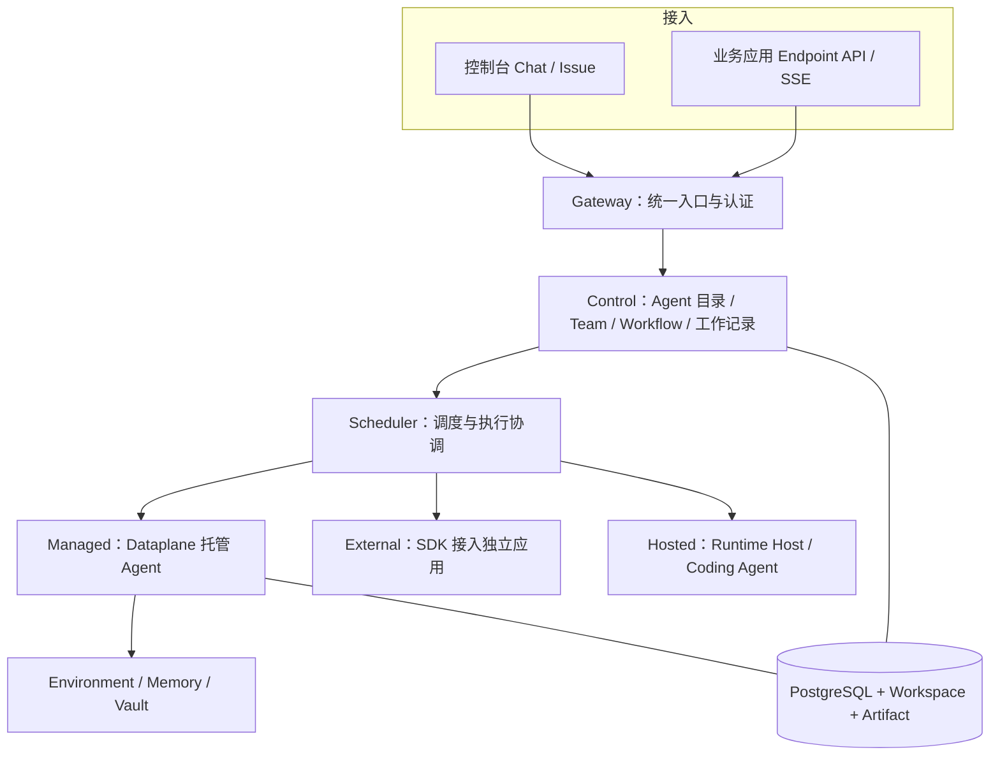
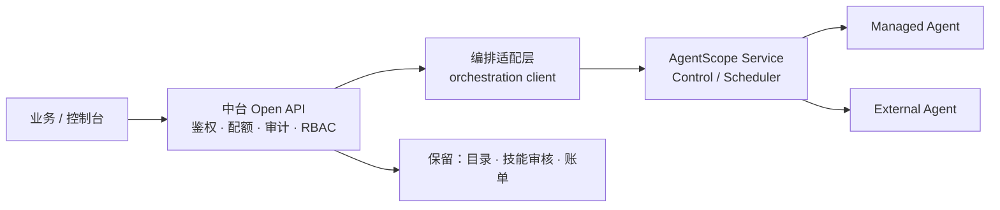

# AgentScope Service 对接评估报告

| 项目 | 内容 |
| --- | --- |
| 评估对象 | AgentScope Service（Control / Scheduler / Dataplane / Gateway） |
| 评估目的 | 确认二期编排路径（设计决议 **B1 / T12**）是否落地为「部署对接 Service」 |
| 上游依据 | [`AI中台设计文档.md`](./AI中台设计文档.md) §1.3、§3.3 B1、§4.8、§6.3、§10 T12 |
| 同期交付 | 自研降级路径已落地：`LocalWorkflowRunner`（S9–S15） |
| 文档版本 | v1.0 |
| 结论摘要 | **建议「双轨并行」**：Service 走 PoC，自研 Runner 保留为降级；正式版发布后再决策切换 |

---

## 1. 评估结论（先看这里）

| 项 | 结论 |
| --- | --- |
| **是否现在切换到 Service** | **否**。官方文档明确标注「此为预览文档，正式版本尚未发布」，接口仍有变更风险 |
| **是否现在做 PoC** | **是**。S16 用 1 个 Sprint 完成 Compose 部署 + Endpoint job 调用 + External 注册验证 |
| **自研 `LocalWorkflowRunner` 是否废弃** | **不废弃**，保留为降级（Service 不可达时 `ORCH_SERVICE_UNAVAILABLE` 回退） |
| **推荐终态** | Service 作**编排执行面**（Issue/Run/Node/Team/Workflow）；中台保留**接入、治理、计费、目录、审核** |
| **切换门槛（Go/No-Go）** | ① 正式版发布 ② ASDP 可用（如需实时事件）③ 契约冻结 ④ 有 2 人可承接多栈运维 |

一句话：**架构方向与 B1/T12 一致，但时机未到；先 PoC、后切换，避免把生产押在预览版上。**

---

## 2. Service 能力画像

### 2.1 组件与职责



| 组件 | 职责 |
| --- | --- |
| **Gateway** | 统一入口与认证（默认宿主 `127.0.0.1:18080`） |
| **Control**（8081） | Agent 目录、Team、Workflow 定义与发布、Issue/Run 记录 |
| **Dataplane**（8082） | Managed Agent 的模型与工具循环 |
| **Scheduler**（8083） | 执行协调与任务派发 |
| **PostgreSQL**（5432） | 产品库 `cp` schema / 运行状态 `rt` schema / Dataplane `dp` schema |

### 2.2 三种 Agent 形态

| 形态 | 说明 | 与本项目关系 |
| --- | --- | --- |
| **Managed** | 控制台零代码创建，Service 跑模型循环、存会话状态 | 与我们现有 `HarnessAgent` 托管**重叠** |
| **External** | 自有进程 + SDK 注册（`agentscope-extensions-aistio`），保留框架控制权 | 与一期 External 最小集**演进关系**（我们目前只做 Chat 转发） |
| **Hosted** | 连接 Runtime Host，复用 Codex / Claude Code 等 provider | 设计明确列为「评估 / 非目标」 |

### 2.3 核心概念映射（Service 概念 → 我们现状）

| Service 概念 | 作用 | 中台现状 |
| --- | --- | --- |
| Agent | 可复用职责与运行配置 | ✅ `agent` / `agent_version` / 发布切流 |
| Team | Leader + 成员按目标动态协作 | ⚠️ `team` / `team_member` 仅登记，无调度 |
| Workflow | 步骤/依赖/分支/人工关口，按 revision 执行 | ⚠️ `workflow_def` / `revision` / `LocalWorkflowRunner`（固定步骤） |
| Endpoint | 把 Agent/Team/Workflow 发布为带认证 API | ✅ `endpoint_release`（但无 slug/schema/凭据体系） |
| Issue | 工作目标、负责人、讨论、验收 | ❌ 无 |
| Run / Node | 一次编排及其步骤 | ⚠️ `workflow_run` / `workflow_step_run` |
| AgentTask / Attempt | 派给 Agent 的工作 / 某次实际执行（重试产生新 Attempt） | ❌ 无（无重试分层） |
| Approval | 确认操作是否可继续 | ✅ `approval_item` + HITL confirm |
| Automation / Channel | 计划或事件触发 / 消息平台发起 | ⚠️ `automation_trigger` + `channel_binding`（骨架） |
| Workspace / Memory / Vault | 指令与能力、共享知识、凭据 | ⚠️ 远程 FS + 技能市场 + RAG + `model_credential` |
| Namespace / RBAC | 资源与权限组织范围 | ✅ 自研 `IamService` / `RbacGuard` |

### 2.4 Workflow 节点能力（Service 有、我们缺）

| 节点 | 用途 | 我们现状 |
| --- | --- | --- |
| `agent` | 交给一个 Agent 执行 | ✅ AGENT |
| `team` | 交给 Team 协作 | ❌ |
| `condition` | CEL 条件分支 | ❌ |
| `join` | 汇合分支 | ❌ |
| `approval` | 等待指定人员审批 | ✅ HUMAN_GATE（但无指定审批人） |
| `timer` | 等待指定时长 | ❌ |
| `signal` | 等待具名外部信号 | ❌ |
| `subrun` | 调用已发布子流程 revision | ❌ |

> 另：Service Workflow 强制**无环图**、服务端校验、CEL 受限表达式、revision 不可变、Pause/Resume/Cancel/Rerun 语义完整 —— 我们的 Runner 是线性 `next` 链，差距明显。

---

## 3. 三条候选路径

### Path A：Service 作编排执行面（推荐终态）

中台保留接入/治理/计费/审核；编排（Issue/Run/Team/Workflow）代理到 Service。



- ✅ 复用成熟执行模型（Attempt 重试、Run 状态机、幂等、事件游标）
- ✅ 符合 B1「不自研 Team/Workflow」与 T12
- ⚠️ 引入 Control/Dataplane/Scheduler/Gateway + PG 多 schema 的运维面

### Path B：保持自研 + 仅互操作（当前状态）

- ✅ 无新增运维面，交付节奏不受预览版影响
- ⚠️ 编排能力长期落后（无 Issue/Task/Attempt、无 DAG）
- ⚠️ 与官方执行语义分叉，后续迁移成本随时间增长

### Path C：中台 Agent 反向注册为 External

把我们 `HarnessAgent` 通过 `Aistio.instrument(...)` 注册进 Service，由 Service 做调度，中台只做目录与治理。

- ✅ 进程与模型凭据仍在我们手中，改造面小
- ⚠️ **Compose/Helm standalone HTTP 不提供 ASDP listener**；需启用 ASDP 的 K8s-native 部署才能接实时事件与 ExecutionAttempt 派发
- ⚠️ 仍需 Service 全栈部署

### 路径对比

| 维度 | Path A | Path B | Path C |
| --- | --- | --- | --- |
| 编排能力 | ★★★★ | ★★ | ★★★ |
| 新增运维面 | 高 | 无 | 高（+ASDP） |
| 改造量（中台侧） | 中 | 无 | 低 |
| 预览版风险敞口 | 高 | 无 | 高 |
| 与设计 B1/T12 一致 | ✅ | ❌ | ✅ |

---

## 4. 契约映射（落地时直接用）

### 4.1 资源与发布

| 中台 | Service | 备注 |
| --- | --- | --- |
| `workflow_def` | `GET/POST /api/v1/orchestration-definitions` | 定义 JSON ↔ CEL 图 |
| `workflow_revision` | `POST /api/v1/orchestration-definitions/{id}/publish` | body 用 `expectedVersion`，409 需重读 |
| `workflow_run` | `GET /api/v1/orchestration-runs/{id}/graph` | Run mode = `declared` |
| `workflow_step_run` | `GET /api/v1/orchestration-runs/{id}/events` | 事件游标续传 |
| `team` / `team_member` | `GET/POST /api/v1/teams` | |
| `approval_item` | `GET /api/v1/inbox` + `POST /api/v1/approvals/{id}/decide` | 我们已有幂等语义 |
| `endpoint_release` | `GET/POST /api/v1/endpoints` | 发布用 `version`，与 Issue 的 `expectedVersion` 不同 |
| `channel_binding` | Channel + Automation API | |
| `automation_trigger` | `GET/POST /api/v1/automations` | |
| `skill` / `skill_rollout` | Workspace / Skill 资源 | **建议保留中台审核** |
| `tenant_quota` / `usage_ledger` | — | **无对应，保留自研** |

### 4.2 调用契约（Endpoint）

| 形式 | 入口 | 适用 |
| --- | --- | --- |
| `job` | `/invoke/v1/endpoints/{slug}/jobs` | Agent / Team / Workflow |
| `conversation` | `/invoke/v1/endpoints/{slug}/conversations` | 多轮；后续 `/invoke/v1/conversations/{id}/turns` |

必带 `Idempotency-Key`；响应给 `invocationId` / `statusUrl` / `eventsUrl`，**不可自行拼接内部 Run 地址**。终态：`completed` / `failed` / `cancelled` / `timed_out`；`accepted/dispatching/running/waiting` 都不是完成。

### 4.3 认证双轨（需适配）

| 身份 | 用途 |
| --- | --- |
| 用户 Bearer token | 控制台管理、Chat、Issue、Workflow |
| Endpoint `X-API-Key` | 仅对应 Endpoint 调用 |
| Runtime Host credential | Host 注册/心跳/领取执行 |
| Task / Attempt token | 任务范围协作与回报 |
| `X-Builder-Environment-Key` | Worker 工具执行协议 |
| 内部服务令牌 | 组件间调用（不可当用户身份） |

> 我们现有 `Authorization: Bearer <api-key>`（scopes: open/admin）与之**不兼容**，需在中台做凭据转换层，并统一 `X-AgentScope-Tenant` / `X-AgentScope-Namespace`。

---

## 5. 部署与运维成本

### 5.1 本地（PoC）

```bash
tar -xzf agentscope-service-VERSION-compose.tar.gz
cd agentscope-service
./init-env.sh VERSION REGISTRY/NAMESPACE
docker compose pull
docker compose up -d --wait --wait-timeout 600
curl -fsS http://localhost:18080/actuator/health
```

端口：Gateway `18080`（宿主）、Control `8081`、Dataplane `8082`、Scheduler `8083`、PG `5432`（内部）。

### 5.2 关键配置项

| 配置 | 注意事项 |
| --- | --- |
| `POSTGRES_PASSWORD` | 初始化后须稳定；URL-safe |
| `AISTIO_PRODUCT_DSN` | 使用 `cp` schema |
| `AISTIO_STORAGE_DSN` | 设 `search_path=rt` |
| `BUILDER_DB_URL/USER/PASSWORD` | 使用 `dp` schema |
| `BUILDER_JWT_SECRET` | ≥32 字符，各组件一致 |
| `BUILDER_INTERNAL_TOKEN` | ≥32 字符，**不得用于用户登录** |
| `BUILDER_VAULT_MASTER_KEY` | 各组件一致，**必须随数据备份** |
| `AISTIO_BOOTSTRAP_PASSWORD` | 仅空库创建初始 admin，12–72 字节 |
| `BUILDER_ALLOW_LOCAL_ENVIRONMENT` | 默认 `false`，本地体验才开 |

### 5.3 运维增量

| 项 | 影响 |
| --- | --- |
| 技术栈 | +Go（Control）+Java（Dataplane/Scheduler）+PG 多 schema |
| 卷 | PostgreSQL / 共享 Workspace / Artifact 三卷 |
| 升级 | 需先备份与恢复演练；Vault master key 不可随意替换 |
| 网络 | 只暴露 Gateway；内部组件与 DB 留私网 |
| SSE 代理 | 必须及时转发、不缓存、读超时足够长 |

---

## 6. 风险登记

| # | 风险 | 等级 | 影响 | 缓解 |
| --- | --- | --- | --- | --- |
| R1 | **预览版未发布**，接口/配置可能变更 | **高** | 对接层返工 | 只做 PoC；适配层隔离在一个包内；契约变更随版本重评 |
| R2 | ASDP 不可用（standalone HTTP 无 gRPC listener） | **高** | External 实时事件/Attempt 派发做不了 | 走 Java HTTP contract 先满足「目录可见 + 会话可用」；实时事件后置 |
| R3 | **双控制面**（中台目录 vs Service 目录）不一致 | 中 | 数据分叉 | 单一写主：Service 管编排，中台仅存 `service_ref` 映射，不双写业务状态 |
| R4 | 认证双轨冲突 | 中 | 403/401 排障成本 | 中台做凭据转换层；Key=机器身份，Service Token=内部 |
| R5 | 与现有自研 Workflow/Team 表资产重复 | 中 | 沉没成本 | 现表保留为降级；新能力只写 Service |
| R6 | SSE 语义差异（我们 `{sessionId}:{seq}` vs Endpoint 游标） | 中 | 前端需改 | 保留现有 SSE；编排 SSE 单独走 eventsUrl |
| R7 | 多栈运维无人承接 | 中 | 上线受阻 | 立项门槛：至少 2 人可承接；否则维持 Path B |
| R8 | 计费口径不一致 | 低 | 财务对账 | `usage_ledger` 保留为唯一账本，Service 用量按周期导入 |

---

## 7. 建议实施计划

| 阶段 | 周期 | 目标 | 交付 | 点估 |
| --- | --- | --- | --- | --- |
| **Phase 0 PoC** | 0.5–1 Sprint | Compose 拉起 + 打通调用 | `docker-compose.service.yml`、Endpoint job 调用脚本、External 注册验证记录 | 8–13 |
| **Phase 1 适配层** | 1–1.5 Sprint | 编排 API 代理到 Service | `orchestration` 包新增 client + 映射表 `service_ref`；降级开关 | 20–28 |
| **Phase 2 Team/Workflow 迁移** | 1–1.5 Sprint | 定义与 Run 走 Service | 定义转换（我们 JSON → CEL 图）、revision 发布、Run 查询/事件 | 13–20 |
| **Phase 3 生产化** | 1 Sprint | 高可用与运维 | Helm/备份/升级演练、监控告警、SSE 代理验证 | 13 |

### Phase 0 验收清单（可直接跑）

1. `docker compose up -d --wait` 后 `/actuator/health` 健康；
2. 用 bootstrap admin 登录；
3. 创建 1 个 Managed Agent 并完成一次 Chat；
4. 发布 1 个 job Endpoint，用 `Idempotency-Key` 调用成功，`result` 可读；
5. （可选）用 `Aistio.instrument(..., startGrpc(false))` 把我们的 demo Agent 注册为 External，确认**目录可见 + 会话可用**；
6. 记录能力差距：哪些「只有观察」、哪些可接受任务派发。

### Go / No-Go 门槛

- [ ] Service **正式版发布**（非预览）
- [ ] 契约冻结（API 参考页不再标注预览）
- [ ] 如需实时事件：ASDP 可用部署就绪
- [ ] 运维承接人到位（≥2 人）
- [ ] Phase 0 全部验收项通过

四个以上满足 → 进入 Phase 1；否则维持 Path B 并**继续增强自研 Runner**（补齐 condition/approval 指定审批人）。

---

## 8. 对现有代码的影响（最小改造面）

| 现有资产 | 处置 |
| --- | --- |
| `WorkflowService` / `LocalWorkflowRunner` | **保留**，作降级实现；`WorkflowAgentInvoker` 抽象不变 |
| `WorkflowRepository` / `JdbcWorkflowRepository` | 保留；新增 `ServiceBackedWorkflowRepository` 或 client 层 |
| `RuntimeWorkflowAgentInvoker` | 保留（Service Managed 未覆盖我们全部工具/技能前仍需它） |
| `TeamService` | 保留登记表；调度委托 Service |
| `RunEventBus` | 保留；编排事件优先用 Service eventsUrl |
| `IamService` / `RbacGuard` | 保留为前置鉴权；映射到 Service Namespace/角色 |
| `QuotaService` / `usage_ledger` | **不动**（Service 无对应，仍是唯一账本） |
| `approval_item` | 保留；与 Service Approval 做状态同步（单向：Service → 中台展示） |
| `FeishuChannelAdapter` | 保留；Service Channel 可选替换 |

**原则：适配层收敛在一个包（`com.sinosoft.amp.openapi.orchestration.service`），其余模块不感知 Service 存在。**

---

## 9. 参考

- 什么是由 AgentScope Service：https://java.agentscope.io/v2/zh/service/index
- 本地安装（Compose）：https://java.agentscope.io/v2/zh/service/quickstart
- 生产安装（Helm）：https://java.agentscope.io/v2/zh/service/kubernetes
- API 参考（认证/资源/调用）：https://java.agentscope.io/v2/zh/service/api-reference
- Endpoint 与 SSE：https://java.agentscope.io/v2/zh/service/endpoints
- External Agent 接入：https://java.agentscope.io/v2/zh/service/external-agent
- Workflow 编排：https://java.agentscope.io/v2/zh/service/workflows
- 执行参考（Session/Run/Attempt）：https://java.agentscope.io/v2/zh/service/sessions
- 配置参考：https://java.agentscope.io/v2/zh/service/configuration

---

*结论重申：**方向对、时机早**。先 PoC 建立事实，再以 Go/No-Go 门槛决定是否切换；自研 `LocalWorkflowRunner` 在过渡期仍是生产保障。*
