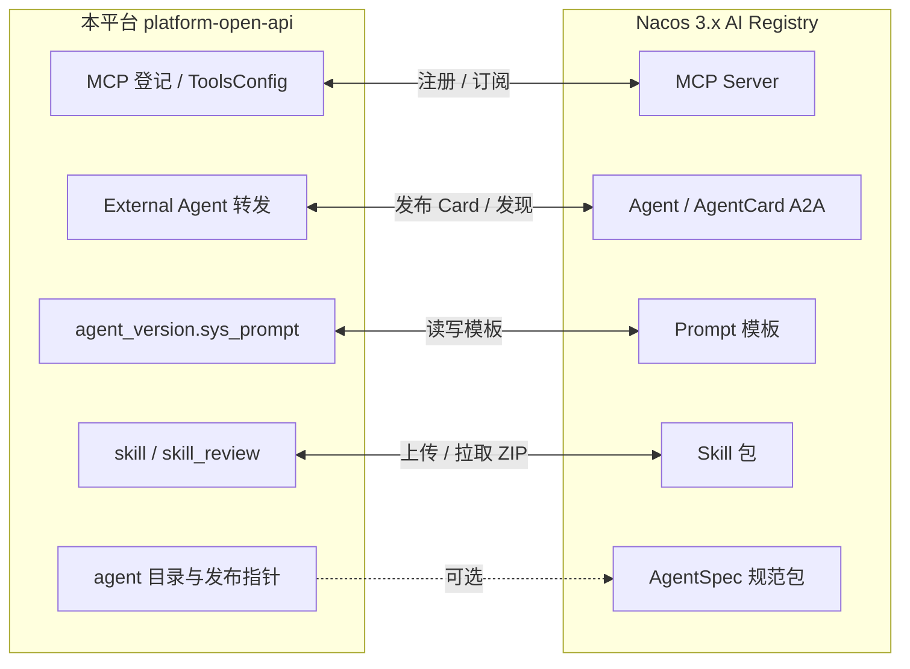

# Nacos AI Registry 接入方案

> 状态：**Go-with-changes**（对抗性评审后修订版 v1.1）  
> 范围：`platform-open-api` 与 Nacos 3.x AI 管理中心（AI Registry）对接  
> 依据：Nacos 官方「AI 管理中心」+ **AgentScope 官方** [Nacos 扩展](https://java.agentscope.io/v2/zh/integration/infrastructure/nacos) + 本仓库现状  
> 优先级：**独立高优先级事件**（与「Coding Agent 接入」设想无关，勿混）

---

## 0. 对抗性评审结论（先读）

| 项 | 结论 |
| --- | --- |
| **总评** | **Go-with-changes** —— 方向可用；按原 Phase0–P3「1.5 周做满」直接开工为 **No-Go** |
| **实现主路径** | **禁止**按本文 v1.0 的自拟 `NacosAiClient` 伪签名开工；**优先 AgentScope 官方扩展**（见 §6） |
| **本期保** | S0 Spike → S1 MCP **单向发现** → S2 External 导入 |
| **本期砍/延后** | 出站双向 register、工具描述热更、Prompt/Skill 全量、AgentSpec/完整 A2A |
| **最大坑** | ① nacos-client 2.4.3→3.x 与 ConfigBridge 耦合 ② 双写无 `source` ③ 空 `enableTools` 默认不注入 ④ 租户↔namespace ⑤ Compose 版本矛盾 |

**P0 阻断（不修不能开工）**

1. **API 以官方扩展为准**：`NacosA2aRegistry` / `NacosAgentCardResolver` / `NacosPromptListener` / `NacosSkillRepository` / `com.alibaba.nacos.api.ai.AiService` 均为官方真实类型；v1.0 伪接口作废。  
2. **依赖地基**：`nacos-client:2.4.3` 与 `NacosConfigBridge` 共 jar，升级必须单独回归 Config 热更，或本期 **HTTP-only 验证资源语义**、SDK 升级另立任务。  
3. **双写主从写死为 `nacos→local`**：`McpServerRecord` 当前**无 `source` 字段**，双向冲突无法仲裁；须加 `source` 列后才能说出站。  
4. **enableTools**：`amp.mcp.require-explicit-tools=true` 时空列表**跳过注入**；Nacos 映射必须产出非空 `tools[].enabled`，或本开关策略显式调整；`enable_tools VARCHAR(512)` 有截断风险。  
5. **租户↔namespace 与 Compose**：AI 侧独立 `NacosAiProperties`（勿绑死进程级单 namespace）；镜像明确 **≥3.1**（AI 管理中心），禁止 v3.0.2 与「≥3.1」并存于文档。

**与 v1.0 的关键修正**：见 §6 选型表；阶段改为 §11 S0–S3。

---

## 1. 目标与非目标

### 1.1 目标

把本平台沉淀的 **MCP / Agent / Prompt / Skill** 等 AI 资源，接入 Nacos AI 管理中心，实现：

| 能力 | 说明 |
| --- | --- |
| **统一登记** | MCP Server、可对外调用的 Agent（A2A AgentCard）、系统/工具 Prompt、Skill 包进入 Nacos 命名空间与版本体系 |
| **运行时发现** | 平台从 Nacos 拉取/订阅 MCP、外部 Agent，替换/补充现有手填 `external_agent`、手填 `mcp_server` |
| **版本与治理** | 借助 Nacos 草稿→审核→发布→上下线生命周期，支持 Prompt / Skill 灰度与回滚 |
| **生态互通** | 与 Spring AI Alibaba、Nacos MCP Router、Dify、Higress 等共享同一注册面 |

### 1.2 非目标（本期不做）

- **不**把 LLM API Key / 模型凭证迁到 Nacos（继续走 `model_credential` + 环境变量回退，见 `ModelCredentialService`）。
- **不**替换现有 `NacosConfigBridge` 配置热更（`amp.ops.*`）——两者并存。
- **不**强绑 Spring AI Alibaba 框架（本平台运行时是 AgentScope Java 2.0.3；SAA 仅作可选生态）。
- **不**在 Nacos 内做租户级鉴权替代 API Key / RBAC。

---

## 2. 现状盘点（本仓库）

| 已有 | 位置 | 与 AI Registry 的关系 |
| --- | --- | --- |
| Nacos 配置桥 | `ops/NacosConfigBridge`、`NacosProperties`（`amp.nacos.*`） | 只拉配置热更；`nacos-client` 当前 **2.4.3**，**无** AiService |
| 模型凭证 | `model/ModelCredentialService` | 库内优先 + env 回退；**不**进 AI Registry |
| MCP 登记 | `GovernanceService` / `AdminGovernanceController` `/mcp-servers`、`McpConnectService` | 自有表 + ToolsConfig 注入；适合 **双向同步** |
| External Agent | `ExternalAgentService` / `AdminExternalController`、`external_agent` 表 | 手填 baseUrl + 心跳；适合改为 **Nacos AgentCard 发现** |
| 系统提示词 | `agent_version.sys_prompt`、`CatalogBootstrap` | 适合抽到 Nacos **Prompt Registry** |
| 技能 | `skill` / `skill_review` + `MarketplaceSkillRepository` | 适合 **Skill Registry** 分发（P3） |
| 编排 / External 流 | Workflow / External SSE | 与 AI Registry 正交，本期不动 |

**依赖事实**：`platform-open-api/pom.xml` 中 `nacos-client:2.4.3`。Nacos AI 资源（AgentCard / MCP / Prompt / Skill）需 **nacos-client ≥ 3.1.0**（文档示例 3.2.3）或走 **HTTP Admin/Client API**。

---

## 3. Nacos AI Registry 能力映射

官方 AI 管理中心管五类资源（均按 **namespace 隔离 + 版本 + 生命周期**）：



| Nacos 资源 | 平台落点 | 建议优先级 |
| --- | --- | --- |
| **MCP Server** | `mcp_server` 登记、`McpConnectService`、AgentScope `ToolsConfig.mcpServers` | **P0** |
| **Agent（AgentCard）** | `external_agent`、`ChatController` 外部转发、A2A 端点 | **P0–P1** |
| **Prompt** | `sys_prompt`、console-bot 系统提示词、工具描述 | **P1** |
| **Skill** | 技能市场上传/审批/分发 | **P2** |
| **AgentSpec** | agent 导出/规范包 | **P3（可选）** |

> 注意：Nacos AI Registry **不是** LLM 模型市场；模型凭证仍由平台管理。Nacos 管的是「可被发现的 AI 能力面」。

---

## 4. 总体架构

```text
                    ┌─────────────────────────────────────┐
                    │           Nacos 3.x (≥3.1)          │
                    │  Config API          AI Registry    │
                    │  amp.ops.*  ·  MCP / Agent / Prompt │
                    └───────┬─────────────────┬───────────┘
                            │                 │
              nacos-client ConfigService   AiService / HTTP Admin API
                            │                 │
                    ┌───────▼─────────────────▼───────────┐
                    │     NacosAiBridge（新建，可开关）     │
                    │  · 复用 amp.nacos.* 连接参数          │
                    │  · 失败回退 local（与 ConfigBridge 一致）│
                    └───────┬─────────────────┬───────────┘
                            │                 │
              ┌─────────────▼───┐   ┌─────────▼──────────────┐
              │ NacosConfigBridge│   │ AiResourceSyncService  │
              │ （已有，保持）    │   │ MCP / Agent / Prompt   │
              └─────────────────┘   └─────────┬──────────────┘
                                              │
                    ┌─────────────────────────┼────────────────────┐
                    ▼                         ▼                    ▼
             GovernanceService         ExternalAgentService   AgentInstanceFactory
             (mcp_server 登记)         (external_agent)       (sys_prompt 装配)
```

**设计原则（对齐本仓库风格）**

1. **可选接入**：`amp.nacos.ai.enabled` 默认 `false`；关闭时行为与今天完全一致。  
2. **失败降级**：连不上 Nacos → `source=local(fallback)`，沿用库内 MCP/External/Prompt。  
3. **库仍是运行时真源**：Nacos 同步后 **upsert 进 PG**，Agent 构建仍读现有表/服务（少改 AgentScope 装配路径）。  
4. **密钥不进 Nacos 明文**：callbackKey、MCP auth、API Key 仍存库/密管；Nacos 只放端点与元数据。  
5. **与 ConfigBridge 并列**，不合并职责。

---

## 5. 分阶段实施

> **修订**：原 Phase1「双向」改为 **默认单向 `nacos→local`**；出站 register 独立后置。实现对齐 §6 官方扩展。

### Phase 0 / S0 — Spike + 地基（0.5–1 天，阻断项）

| 项 | 说明 |
| --- | --- |
| **Spike** | 真机 Nacos **≥3.1**：跑通 AI 资源 list/get；验证 `NacosA2aRegistry` / `NacosPromptListener` / `NacosSkillRepository` 依赖是否与 `agentscope 2.0.3` 兼容 |
| **选型锁定** | MCP 同步走 **HTTP-only** 或 **nacos-client 3.x**（见 §6）；二选一写进任务 |
| **依赖** | 若升 `nacos-client`：单独 PR，**先回归 `NacosConfigBridgeTest` + 真机 `amp.ops.*` 热更** |
| 配置 | `NacosAiProperties`：`enabled`、`mode`、`tenantNamespace`（identity\|prefix\|shared）、`publicBaseUrl` |
| 状态 | `GET /api/v1/admin/nacos` 增加 `ai: {enabled, mode, syncDirection, lastSyncAt, resources, lastError}` |
| Compose | 镜像明确 **≥3.1**（AI 管理中心）；删除「v3.0.2」表述 |
| 验收 | 默认 `ai.enabled=false` 行为与今天一致；`mvn -B verify` 全绿 |

### Phase 1 / S1 — MCP 单向发现（P0，2–3 天）

| 方向 | 行为 |
| --- | --- |
| **入（本期限定）** | 订阅/拉取 Nacos MCP → upsert `mcp_server`（**增加 `source` 列**，`nacos`\|`local`）→ `evictTenant` → `ToolsConfig.mcpServers` |
| **出（延后 S3）** | 本地 `registerMcp` 推 Nacos；须 dry-run / 冲突策略后再开 |
| **enableTools 硬约束** | 映射必须产出**非空**工具列表，或临时放宽 `require-explicit-tools` 仅对 `source=nacos`；验收用例覆盖空 tools 失败路径 |
| **容量** | `enable_tools` 加长或改 JSON/多行表，禁止静默截断 |

**字段映射（不变方向，主从单向）**

```text
Nacos MCP                          平台 mcp_server
─────────────────────────────────────────────────
server.name                 →      name
server.version              →      config.version
transport                   →      transport
endpoint / command+args     →      url 或 command/args
tools[].enabled（非空）      →      enableTools
namespace                   →      见租户映射
（系统）                    →      source=nacos
```

**租户映射（先简化）**：`shared` 单 namespace + 平台白名单；或 `identity`（租户=ns）。`prefix` 规则与非法字符清洗放 S3。

**API（admin scope）**

```http
GET  /api/v1/admin/nacos/mcp
POST /api/v1/admin/nacos/mcp/sync
POST /api/v1/admin/nacos/mcp/import   # 手动导入单条，便于验收
```

**验收**

1. Nacos 建 MCP（含非空 tools）→ 平台可见且 `test` 通过；  
2. 空 tools → 明确拒绝或跳过并可观测（不进 Toolkit）；  
3. `ai.enabled=false` / Nacos 宕机 → 本地表可用，对话不中断；  
4. 种子/console-bot 行不被 Nacos 回写覆盖（`source=nacos` 不覆盖 `local` 种子，或名冲突告警）。

### Phase 2 / S2 — External Agent 导入（P1，1–2 天，自动化可后）

- **导入 API**：`POST .../external-agents/import` 或 `POST /admin/nacos/agents/import`  
- 用官方 `NacosAgentCardResolver` / AgentCard HTTP API 读卡 → `ExternalAgentService`  
- **校验**：`name` 须 `[A-Za-z0-9_-]{1,64}`（`ExternalAgentService` 限制）；非法则改写或拒绝；`baseUrl` 必须 http(s)  
- **密钥**：callbackKey **永不**来自 Nacos 元数据；无 key 则只读导入或拒绝  
- AgentCard.url 若是中台 Bearer REST，**元数据必须标协议**（非 A2A JSON-RPC）；禁止误导消费方  
- 订阅自动下线可后置

**验收**：导入成功 → `POST .../messages` 走 External 链路；非法 name 被拒并有错误码。

### Phase 3 / S3 — 可选出站 / Prompt / Skill（稳定后）

- 出站 MCP register（双写，`source` + lastWriter + dry-run）  
- Prompt：`NacosPromptListener` + 优先级写死（见 P1 风险）+ 发布态 pin version  
- Skill：`NacosSkillRepository` 与 PG 市场并存，**仍过 APPROVED**  
- namespace `prefix` 映射

### Phase 5（backlog）— AgentSpec / 完整 A2A JSON-RPC

仅当需要外部 A2A 互操作。

---

## 6. 技术选型（评审后定稿）

### 6.1 优先复用 AgentScope 官方 Nacos 扩展

> 参考：https://java.agentscope.io/v2/zh/integration/infrastructure/nacos  
> 与本栈 `agentscope.version=2.0.3` 对齐引入，**不要**另造 Prompt/Skill/A2A 协议。

| 子模块 | 官方类型 | 平台用途 | 备注 |
| --- | --- | --- | --- |
| `agentscope-extensions-nacos-a2a` | `NacosA2aRegistry`、`NacosAgentCardResolver` | AgentCard 注册/发现 | 可与 `AgentScopeA2aServer.builder().agentRegistry(...)` 配合 |
| `agentscope-extensions-nacos-prompt` | `NacosPromptListener`（接 `com.alibaba.nacos.api.ai.AiService`） | Prompt 热更 | 本地缓存 + 推送；**P3/延后** |
| `agentscope-extensions-nacos-skill` | `NacosSkillRepository` | Skill ZIP 仓库 | 可与 `MarketplaceSkillRepository` **并存**；须过平台审批策略 |
| （无官方模块） | — | **MCP 登记/发现** | 官方扩展**不覆盖**，平台自建薄适配 |

### 6.2 MCP 与防腐层

| 方案 | 优点 | 缺点 | 建议 |
| --- | --- | --- | --- |
| **A. AgentScope `extensions-nacos-*`** | 与 Harness 同源；Skill/Prompt/A2A 少漂移 | **无 MCP**；仍依赖 nacos-client 版本 | **A2A/Prompt/Skill 首选** |
| **B. 本平台薄 `NacosAiClient` 仅包 MCP/AI Admin API** | 隔离业务；可 mock | 签名以 spike 真机为准，禁止伪接口 | **MCP 必要时自建** |
| **C. 纯 HTTP（MVP）** | 不升 `nacos-client`，ConfigBridge 零回归 | 订阅/重试自研 | **S0–S1 推荐起步** |
| **D. 升 nacos-client 3.x + AiService** | 官方 SDK 完整 | 2.4.3→3.x 与 ConfigBridge 同 jar，风险高 | **独立任务，勿与 S1 绑死** |
| **E. spring-ai-alibaba-starter-*** | 开箱 | 叠第二套 AI 框架 | **否** |

**定稿**：

1. A2A / Prompt / Skill → **只走官方 `extensions-nacos-*`**。  
2. MCP → 薄适配（`McpNacosSync`），**默认仅 `nacos→local`**；实现用 HTTP 或升级后的 `AiService`，由 S0 spike 选定。  
3. **配置桥兼容**：连接参数可复用；**namespace/认证主体拆开**（`NacosAiProperties`）；失败 `local(fallback)` 保留。  
4. v1.0 大而全 `NacosAiClient` 伪代码**作废**；若需防腐层，方法集以真机 spike 导出的为准。

---

## 7. 配置与部署

### 7.1 application.yml（增量）

```yaml
amp:
  nacos:
    enabled: ${AMP_NACOS_ENABLED:false}
    server-addr: ${AMP_NACOS_SERVER:127.0.0.1:8848}
    namespace: ${AMP_NACOS_NAMESPACE:}
    group: ${AMP_NACOS_GROUP:DEFAULT_GROUP}
    data-id: ${AMP_NACOS_DATA_ID:amp-platform.properties}
    username: ${AMP_NACOS_USERNAME:}
    password: ${AMP_NACOS_PASSWORD:}
    ai:
      enabled: ${AMP_NACOS_AI_ENABLED:false}
      mode: ${AMP_NACOS_AI_MODE:SDK}          # SDK | HTTP
      # 租户 → Nacos namespace 映射：identity | prefix
      tenant-namespace: ${AMP_NACOS_AI_TENANT_NS:prefix}
      shared-namespace: ${AMP_NACOS_AI_SHARED_NS:amp-shared}
      mcp:
        sync-on-start: false
        register-local: false                 # 是否把本地 mcp_server 推到 Nacos
      agent:
        publish-enabled: false
        public-base-url: ${AMP_PUBLIC_BASE_URL:}  # AgentCard.url 用
      prompt:
        enabled: false
        # agent 版本钉住：published=钉 version，dev=latest
        pin-published: true
```

### 7.2 Compose

```yaml
  nacos:
    image: nacos/nacos-server:v3.0.2   # 需 ≥3.1 才有完整 AI 管理中心；按实际镜像标签调整
    ports:
      - "8848:8848"
    environment:
      MODE: standalone
      NACOS_AUTH_ENABLE: "true"
      # ... 按环境补 JWT/密钥
```

（现有 compose 中 `nacos/nacos-server:v2.3.2` 仅够 Config，**不能**作 AI Registry。）

### 7.3 环境变量对照

| Env | 用途 |
| --- | --- |
| `AMP_NACOS_ENABLED` | 配置桥总开关（已有） |
| `AMP_NACOS_AI_ENABLED` | AI Registry 开关（新） |
| `AMP_NACOS_SERVER` | 服务器地址（已有） |
| `AMP_PUBLIC_BASE_URL` | AgentCard 对外 URL |
| `AMP_NACOS_AI_TENANT_NS` | `identity` / `prefix` |

---

## 8. 关键类改动清单（评审后）

| 类型 | 路径 | 动作 |
| --- | --- | --- |
| 依赖 | `pom.xml` | 可选 `agentscope-extensions-nacos-{a2a,prompt,skill}`（与 `agentscope.version` 对齐）；**MCP 用 HTTP 或另任务升 nacos-client** |
| 新 | `ops/NacosAiProperties` | AI 配置（namespace 映射、mode、publicBaseUrl） |
| 新 | `ops/McpNacosSync`（名可议） | **仅 MCP** 单向发现；薄封装，签名以 spike 为准 |
| 新 | `ops/AiResourceSyncService` | 编排 upsert + `evictTenant` + 幂等/去抖 |
| 新 | `ops/AdminNacosAiController` | `/api/v1/admin/nacos/...` |
| 改 | `db/schema.sql` + `McpServerRecord` | **`source` 列**（local\|nacos）；`enable_tools` 加长或改 TEXT |
| 改 | `ops/AdminNacosController` | status 增加 `ai` 块 |
| 改 | `governance/GovernanceService.registerMcp` | 出站推送延后；导入不覆盖 `source=local` 种子 |
| 改 | `external/ExternalAgentService` | import 校验 name/url；callbackKey 白名单拒绝 Nacos 值 |
| 改 | `agent/AgentInstanceFactory` | （S3）Prompt 源 + `NacosPromptListener`；Skill 可挂 `NacosSkillRepository` 且仍经审核 |
| 改 | `docker-compose.yml` | Nacos **≥3.1** |
| 文 | `AGENTS.md` / README | 同步约定 |

**明确不做（本期）**：自研完整 `NacosAiClient` 大接口、工具描述热更、AgentSpec、完整 A2A JSON-RPC 暴露。

**包边界**：继续放在 `com.sinosoft.amp.openapi.ops`（或 `ops.nacos` 子包），不引入 Spring Cloud Alibaba。

---

## 9. 风险与对策

| 风险 | 影响 | 对策 |
| --- | --- | --- |
| nacos-client 2→3 兼容 | ConfigBridge 行为变化 | 单测保 `NacosConfigBridgeTest`；灰度只开 `amp.nacos.enabled`，AI 先关 |
| Nacos 无「模型注册」 | 期望落差 | 方案明确：模型凭证不进 Nacos |
| 双写冲突（本地改 vs Nacos 改） | 数据漂移 | 定主从：`sync-direction`（默认 **nacos→local** 只读发现；出站仅 register-local 显式开启） |
| 租户/namespace 爆炸 | 运维成本 | 默认 `prefix` 一个 shared + tenant prefix；文档写清映射 |
| 密钥误推 Nacos | 泄密 | 同步层字段白名单，拒绝 callbackKey/apiKey |
| AgentCard URL 不可达 | 外部调不通 | 必配 `AMP_PUBLIC_BASE_URL`；发布前探测 |
| 版本钉住复杂度 | Prompt 热更与发布一致性 | Phase 3 强制 `pin-published`，开发态才用 latest |
| A2A 协议完整实现成本高 | 工期 | Phase 5 拆出，本期只做 Card 注册/发现 |

---

## 10. 测试与验收

| 层级 | 内容 |
| --- | --- |
| 单测 | `NacosAiClient` mock；`AiResourceSyncService` 映射与失败回退；`registerMcp` 可选推送开关 |
| 契约 | `AdminNacosAiController` JSON 形状；`GET /admin/nacos` 含 `ai` |
| 集成（可选） | Testcontainers Nacos 3.x：注册 MCP → 同步 → `McpConnectService.probe` |
| 手工 | 控制台 AI 管理中心可见资源；断 Nacos 后对话仍可用 |
| 回归 | `mvn -B verify`；`scripts/n4-check.ps1` 不受影响 |

**完成定义（DoD）**

1. 默认配置行为与接入前一致；  
2. 开启 AI 后 MCP 至少完成「平台→Nacos」或「Nacos→平台」一条通路；  
3. 文档含配置项、运维步骤、故障回退；  
4. 状态接口可观测 `ai.source` / `lastError`。

---

## 11. 工期与里程碑（评审后）

| 阶段 | 工作量 | 产出 |
| --- | --- | --- |
| **S0 Spike+地基** | 0.5–1d | 真机 API 验证、选型锁 HTTP/SDK、配置与 status |
| **S1 MCP 单向发现** | 2–3d | source 字段、enableTools 策略、导入/同步、验收 |
| **S2 External 导入** | 1–2d | Card→external_agent、校验、密钥拒绝 |
| S3 出站/Prompt/Skill | 按需 3–5d | 双写、热更、NacosSkillRepository |
| **MVP（S0–S2）** | **约 4–6 人日** | 可演示「Nacos 发现→中台可用」 |

原「P0–P3 做满 1.5 周」**不作为本期承诺**。

---

## 12. 决策点（**已锁定 · 2026**）

| # | 决策 | 结论 |
| --- | --- | --- |
| 1 | Nacos 环境 | **上 ≥3.1** 完整 AI 管理中心 |
| 2 | nacos-client | **升 3.x**，并承担 `NacosConfigBridge` 回归 |
| 3 | 同步方向 | **仅 nacos→local**（本期不做出站 register） |
| 4 | namespace | **后置 prefix**；本期 `shared` 默认 + 可配 `identity` |
| 5 | AgentCard | **仅可发现**（不做 A2A JSON-RPC 可调承诺；url/元数据标明协议） |

**默认配置（落地）**：`amp.nacos.ai.enabled=false`；开启后 `sync-direction=nacos-to-local`、`tenant-namespace=shared`、`agent-card-mode=discover-only`。

---

## 附录 A — 参考

- **AgentScope Java · Nacos 集成（实现主路径）**：https://java.agentscope.io/v2/zh/integration/infrastructure/nacos  
- **AgentScope Java · A2A**：https://java.agentscope.io/v2/zh/integration/protocol/a2a  
- [Nacos AI 管理中心概述](https://nacos.io/docs/latest/manual/user/ai/ai-registry-overview/)  
- [Agent 管理 / A2A Registry](https://nacos.io/docs/latest/manual/user/ai/agent-registry/)  
- [MCP Server 自动注册与发现](https://nacos.io/docs/latest/manual/user/ai/mcp-auto-register/)  
- [Prompt 管理](https://nacos.io/docs/latest/manual/user/ai/prompt-registry/)  
- [AI 资源生命周期](https://nacos.io/docs/latest/manual/user/ai/ai-resource-lifecycle/)  
- 本仓库：`AGENTS.md`（Nacos/MCP/External 约定）、`docs/AI中台设计文档.md` §7.2 配置中心

## 附录 B — 与现有「Nacos 配置桥」边界

| | NacosConfigBridge（已有） | NacosAiBridge（本方案） |
| --- | --- | --- |
| 职责 | `amp.ops.*` 运行时配置热更 | AI 资源注册/发现 |
| Data | `amp-platform.properties` | AI 管理中心资源 API |
| 失败 | 回退 local RuntimeConfig | 回退 PG 表 |
| 开关 | `amp.nacos.enabled` | `amp.nacos.ai.enabled` |
| 代码 | `ops/NacosConfigBridge` | `ops/AiResourceSyncService` 等 |

两者共享 serverAddr/namespace/认证，**不共享**数据模型与热更语义。
