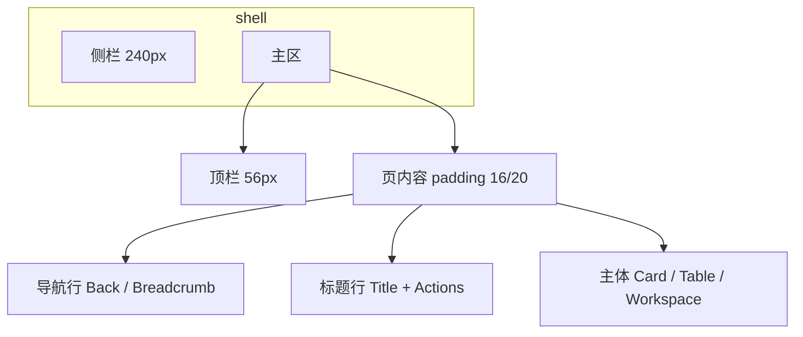

# AI 中台 Console · UI 设计语言 v1

> 目标：全站一套语言——页头、导航、表格、表单、状态、弹层，不再一页一风格。  
> 基线：方向 B 智能工作台（Stripe / Notion），Token 见 `src/styles/tokens.css`。

---

## 1. 设计原则

| 原则 | 含义 |
| --- | --- |
| **安静的骨架** | 结构靠留白和弱边框，不用大色块抢戏 |
| **一屏一任务** | 页头说清「这是哪」，工具栏给「能做什么」，主体只放数据 |
| **层级三级** | 标题 → 区块 → 行；字号/字重递进，不靠加粗堆砌 |
| **状态即语义** | 颜色只表达成功/警告/危险/信息，不作装饰 |
| **密度可预期** | 列表页 40px 行高；表单 12px 间距；卡片 padding 统一 16px |

---

## 2. 信息架构与页面解剖

### 2.1 三种页型

```text
A. 列表页     Breadcrumb/Title → 工具栏(查询行 + 操作行) → Table → 分页
B. 详情页     ← 返回 · Title → 主操作 → Tabs → 内容区
C. 工作台页   Title(可选) → 主工作区(多栏) + 侧栏
```

### 2.2 页头骨架（统一）



**导航行（返回）— 新标准**

不要：裸 `← 返回列表` 大按钮占一行。

要：

```text
┌──────────────────────────────────────────┐
│  ← Agent 列表     |     Agent · demo     │
│  （ghost icon+短文案）  （页标题，同基线）  │
└──────────────────────────────────────────┘
```

| 项 | 规范 |
| --- | --- |
| 形态 | 图标按钮 `ArrowLeft` + 父级短名（如「Agent 列表」） |
| 样式 | `text` 按钮，高 28px，色 `--ink-2`，hover `--brand` |
| 位置 | 与标题**同一行**左侧，标题前；小屏可换行 |
| 行为 | `router.push(back)`；无 back 时 `history.back()` |
| 不要 | 独占一行、大号字、边框按钮、文案「返回列表」加图标重复 |

**标题行**

- 左：`h1` 24/650，可带 `· 子资源`
- 右：主操作 1 个（primary）+ 次操作（default/text）≤3 个
- 描述：可选，12/400 `--ink-2`，最多一行

### 2.3 列表页工具栏（两行标准）

```text
┌────────────────────────────────────────────────┐
│ [搜索框…………] [搜索]  [状态下拉▾]                 │  ← 查询行
│ [批量修改] [批量删除] [新建]        已选 n · 共 m │  ← 操作行
├────────────────────────────────────────────────┤
│ ☑ │ 列…                              操作(右) │
└────────────────────────────────────────────────┘
```

- 查询行：输入 + 筛选 + 显式「搜索」
- 操作行：批量/新建；右侧计数
- **操作列固定右侧**，文本按钮，顺序：主流程 → 编辑 → 危险（红）

---

## 3. 视觉 Token（已落地，执行时以此为准）

| Token | 值 | 用途 |
| --- | --- | --- |
| `--bg-app` | `#F4F6FA` | 页面底 |
| `--bg-surface` | `#FFFFFF` | 卡片/表格 |
| `--ink-1/2/3` | `#0F172A / #475569 / #94A3B8` | 文字层级 |
| `--line` | `#E2E8F0` | 边框 |
| `--brand` | `#4F46E5` | 主操作/链接/选中 |
| `--ok/warn/danger` | `#059669 / #D97706 / #DC2626` | 语义色 |
| 圆角 | 6 / 10 / 14 | 控件 / 卡片 / 弹层 |
| 阴影 | sm 列表，md 弹层，不用重阴影 |

字体：`Inter + PingFang SC`；代码/ID `JetBrains Mono`。

---

## 4. 组件规范

### 4.1 PageHeader

```
props: title, desc?, back?, backLabel?
slots: actions
```

- 有 `back` → 渲染**导航行**（见 §2.2），不是独立大按钮
- 无 `back` → 仅标题行（列表页可选 `compact`：标题 16px）

### 4.2 Card

- 圆角 `--radius-lg`，边框 1px `--line`
- 有 header：标题 14/600 + 右侧操作；内容 padding 16

### 4.3 Table

| 项 | 规范 |
| --- | --- |
| 表头 | 12/600 `--ink-3`，底 `--bg-subtle` |
| 行高 | ≥ 44px，hover `--bg-hover` |
| 空态 | EmptyState，带 CTA |
| 行操作 | 右侧文本按钮；危险操作红字 + 二次确认 |
| 选择 | 首列 checkbox；批量条在工具栏操作行 |

### 4.4 表单 / 弹窗

- 标签在上，必填标 `*`
- 帮助文案 12px `--ink-3` 紧贴控件下
- Dialog 宽：表单 480–560；含 MD 编辑器 720
- 破坏性确认：标题动作化（「删除 Agent」），按钮「删除」红 primary-danger

### 4.5 状态

统一 `StatusTag`：`ACTIVE/UP/ALLOW` 绿 · `ASK/PENDING` 橙 · `DENY/FAILED` 红 · `DISABLED` 灰。

### 4.6 空态 / 加载 / 错误

- 空态：图标 56 圆角方 + 标题 + 一句说明 + 一个 CTA
- 加载：表格用 skeleton/v-loading，不用全屏 spinner
- 错误：行内 `el-alert`（含 code），可重试；toast 只做短成功提示

---

## 5. 导航与返回（本方案重点）

```text
列表页 ──点击行/详情──▶ 详情页 ──版本──▶ 版本页
   ▲                      │                │
   └────── ← Agent 列表 ───┘  ← Agent 详情 ─┘
```

| 页面 | backLabel | back 路径 |
| --- | --- | --- |
| Agent 详情 | Agent 列表 | `/agents` |
| 版本与发布 | Agent 详情 | `/agents/:id` |
| Workflow 编辑器 | Workflow 列表 | `/workflows` |
| 技能/知识等一级页 | 无 | — |

**顶栏面包屑**可保留「组 / 页」，但**返回以页内导航行为主**，避免与侧栏 active 重复造导航。

---

## 6. 迁移清单（按优先级）

| 优先级 | 项 | 说明 |
| --- | --- | --- |
| P0 | PageHeader 重做导航行 | 返回改同行 ghost，统一所有子页 |
| P0 | Agent 列表工具栏 | 已对齐两行规范 |
| P0 | 统一 empty / dialog 宽度 | 按 §4 |
| P1 | 详情 Tabs 样式 | 14px，下划线 2px brand |
| P1 | 工作台（对话）页头压缩 | 减少与工具栏重复的按钮 |
| P1 | 行操作按钮顺序/间距 | 统一 4px gap、danger 色 |
| P2 | Dark 主题回归 | Token 已有，抽检各页 |
| P2 | 设计走查清单 | 每页 5 分钟：对齐/圆角/空态/焦点环 |

---

## 7. 示例：推荐返回交互（视觉）

```svg
<svg xmlns="http://www.w3.org/2000/svg" viewBox="0 0 680 160" font-family="PingFang SC, Microsoft YaHei, sans-serif">
  <rect width="680" height="160" fill="#f4f6fa"/>
  <rect x="24" y="28" width="632" height="104" rx="14" fill="#fff" stroke="#e2e8f0"/>
  <!-- back -->
  <text x="48" y="68" fill="#475569" font-size="13">←</text>
  <text x="68" y="68" fill="#475569" font-size="13">Agent 列表</text>
  <!-- divider -->
  <line x1="150" y1="56" x2="150" y2="80" stroke="#e2e8f0"/>
  <!-- title -->
  <text x="166" y="72" fill="#0f172a" font-size="20" font-weight="650">Agent · demo</text>
  <!-- actions -->
  <rect x="420" y="52" width="88" height="36" rx="8" fill="#fff" stroke="#e2e8f0"/>
  <text x="440" y="74" fill="#334155" font-size="13">版本发布</text>
  <rect x="520" y="52" width="112" height="36" rx="8" fill="#4f46e5"/>
  <text x="538" y="74" fill="#fff" font-size="13">设为当前对话</text>
  <text x="48" y="110" fill="#94a3b8" font-size="12">导航行与标题同行 · 右侧主次操作 · 描述可选</text>
</svg>
```

---

## 8. 验收标准

1. 任意子页：**3 秒内**能识别层级并点回上级  
2. 列表页工具栏固定两行，无「刷新」散落  
3. 所有危险操作二次确认  
4. 空态都有下一步 CTA  
5. 同一操作在不同页按钮样式一致（primary/default/text/danger）

---

拍板后按 §6 迁移清单改代码；建议 **P0 当天合入**。
