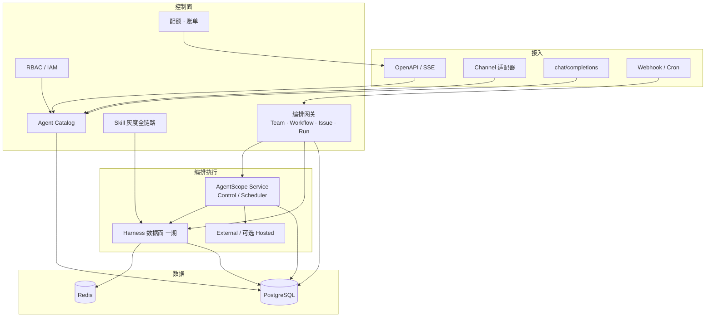

# 项目开发文档 · 二期（Phase 2）

| 项目 | 内容 |
| --- | --- |
| 项目名称 | 江苏二期 · 基于 Java 的智能体应用平台（AI 中台） |
| 文档类型 | **项目开发文档**（立项 / 排期 / 研发实施用） |
| 阶段 | **二期 Phase 2**（一期 S0–S8 walking skeleton 已交付） |
| 文档版本 | v1.0 |
| 状态 | 待评审立项 |
| 上游文档 | [`AI中台设计文档.md`](./AI中台设计文档.md) v1.2（架构与选型基线）、[`项目总体架构总结.md`](./项目总体架构总结.md) |
| 适用读者 | 项目经理、架构师、后端/前端开发、测试、运维、业务接入方 |

---

## 0. 如何使用本文档

- **设计原则与技术底座**仍以《AI中台设计文档》为准；本文档只定义**二期要做什么、怎么拆、何时交、如何验收**。
- 与设计文档冲突时：**架构/选型以设计文档为准**；**范围与排期以本文档为准**（变更走 §12 变更控制）。
- 敏捷节奏沿用一期：**2 周 Sprint**，竖切交付，每 Sprint 末 Demo。

---

## 1. 一期基线（二期起点）

### 1.1 已交付能力（S0–S8 / S9 雏形）

| 能力域 | 状态 | 关键落点 |
| --- | --- | --- |
| OpenAPI Chat 非流式 + SSE 流式 | ✅ | `POST .../messages` / `messages:stream` |
| 会话上下文与恢复 | ✅ | Redis `AgentStateStore`，强制 `userId`+`sessionId` |
| API Key 鉴权 | ✅ | `ApiKeyAuthFilter`，scopes=`open`/`admin` |
| 目录 / 版本 / 发布切流 | ✅ | `agent`/`agent_version`/`endpoint_release` + `AgentInstanceCache` + drain |
| HITL 审批 | ✅ | `permission_rule`/`approval_item`，`place_order` 默认 ASK |
| 工具与 MCP | ✅ | 业务工具 + MCP 登记/连通测试 + 工具策略 allow/deny |
| 技能市场 | ✅ | DRAFT→审核→只读分发；灰度 canary 雏形 |
| RAG | ✅ | 文档/分块 + hash/http Embedding + `knowledge_search` 引用 |
| 限流 / 指标 / 审计 | ✅ | RateLimitFilter、Prometheus、audit_log |
| Nacos / OTel / Loki 桥 | ✅（可选） | 热更配置、追踪、会话日志检索 |
| 多副本与 External 最小集 | ✅ | ready、注册/心跳、Chat/SSE 转发 |
| Docker 沙箱 / 远程 FS | ✅（默认可关） | `sandbox_exec`、PG BaseStore |
| 配额与用量 | ✅（雏形） | `tenant_quota`/`usage_ledger` + `QUOTA_EXCEEDED` |
| `chat/completions` 兼容 | ✅（基础） | `OpenAiCompatController`（`/api/v1/chat`、`/v1/chat`） |
| 管理台 | ✅（薄） | Vue3 + Element Plus，`App.vue` + `api.js`/`api-extra.js` |

### 1.2 一期明确遗留到二期的项（设计 §1.3 / P3 Backlog）

1. **Team / Workflow / Issue / Run 编排**（决议 B1：不自研引擎，**倾向对接 AgentScope Service**，T12）
2. **Channel 接入**（钉钉 / 飞书 / 企微等，二期再选）
3. **External 完整编排**（任务下发、Team 成员，而非仅 Chat 转发）
4. **Hosted 托管形态评估**（外部 Runtime Host）
5. **技能灰度全链路**、**计费账单产品化**、**完整 RBAC 矩阵**
6. **A2A / AG-UI** 等协议扩展（按需）
7. Automation：Cron / Webhook 触发、Issue 类异步任务

### 1.3 二期仍不做的非目标（建议维持）

- 自研大模型训练/微调平台；
- 自研完整 BPM 低代码画布（Workflow 以 Service 能力 + 简单编排定义为主）；
- 跨云多活容灾；
- 进程内任意第三方 Tool Plugin / JAR 热加载（继续走 MCP）；
- Hosted Coding Agent（Codex 类）产品化。

---

## 2. 二期目标与成功标准

### 2.1 建设目标

| 编号 | 目标 | 说明 |
| --- | --- | --- |
| P2-G1 | **协作编排** | 支持 Team 多智能体协作与固定 Workflow（revision 发布），可查询 Run |
| P2-G2 | **多端 Channel** | 至少 1 个 IM/办公 Channel 端到端可用（建议飞书或企微，PO 定） |
| P2-G3 | **企业级治理** | 完整 RBAC、技能灰度全链路、账单/配额产品化 |
| P2-G4 | **协议与生态** | `chat/completions` 达生产可用；评估 A2A/AG-UI 与 Hosted |
| P2-G5 | **运营就绪** | Automation 触发、Issue/任务视图、告警与成本看板 |

### 2.2 成功标准（Exit Criteria）

| # | 验收项 | 通过标准 |
| --- | --- | --- |
| E1 | Team Demo | 控制台创建 Team → 下发目标 → Leader 委派 ≥2 成员 → 汇总结果；全程可回放 |
| E2 | Workflow Demo | 定义 ≥3 步骤（含 1 个人工关口）→ 发布 revision → 触发 Run → 成功/失败分支均可演示 |
| E3 | Channel Demo | 业务用户在选定 IM 中 @机器人多轮对话 + HITL 确认闭环 |
| E4 | RBAC | 自定义角色（只读运维 / 审核员 / 租户管理员）权限矩阵测试全绿 |
| E5 | 计费 | 按租户/Agent/模型出月账单 CSV/页面；超配额拒绝符合策略 |
| E6 | 回归 | 一期全部契约测试与演示脚本仍通过；双副本杀进程会话不丢 |
| E7 | 性能基线 | 详见 §10；编排 Run 与 Chat 不互相饿死 |

---

## 3. 二期范围与优先级

### 3.1 范围总表

| 模块 | 范围 | 优先级 | 依赖 |
| --- | --- | --- | --- |
| A. Service 编排对接 | Team / Workflow / Issue / Run；API + 控制台只读/最小编辑 | **P0** | AgentScope Service 可部署性评审 |
| B. Channel 路由 | 1 个 Channel 适配 + 会话映射 + HITL 回调 | **P0** | Channel 选型 |
| C. 完整 RBAC | 用户/角色/资源 ACL、管理台管理界面、审计 | **P0** | 现有 Auth 升级 |
| D. 计费账单产品化 | 账期账单、导出、配额策略、成本看板 | **P1** | usage_ledger 已有 |
| E. 技能灰度全链路 | 按环境/租户/百分比发布、回滚、效果对比 | **P1** | Skill canary 雏形 |
| F. Automation | Cron/Webhook 触发 Workflow/Agent | **P1** | A 或轻量异步 Run |
| G. External 完整编排 | 任务下发、Team 成员调度 | **P1** | A |
| H. `chat/completions` 生产化 | 流式、tool_calls、错误兼容、配额 | **P1** | 已有 Controller |
| I. Hosted 形态评估 | 可行性报告 + 最小 PoC（可选） | **P2** | 调研 |
| J. A2A / AG-UI | 评估或最小适配 | **P2** | 按业务需求 |
| K. 沙箱快照 / OSS | 开沙箱场景下的快照恢复 | **P2** | 沙箱默认策略 |
| L. 管理台二期 UI | 编排、RBAC、账单、Channel、Automation 页 | **P0**（随 A–F） | 前端排期 |

### 3.2 建议一期不做、二期「也不默认做」

- 多 Channel 一次接齐（先 1 个，抽象 Channel SPI 后再扩）；
- 自研可视化拖拽 BPM；
- 跨区域容灾、全链路灰度网关（与技能灰度区分）。

---

## 4. 二期架构演进

### 4.1 目标架构增量

在一期「Open API + Harness 数据面 + PG/Redis」之上，二期增加：



### 4.2 关键架构决策（二期立项确认）

| 编号 | 议题 | **建议决议** | 备选 | 说明 |
| --- | --- | --- | --- | --- |
| **P2-B1** | Team/Workflow 实现路径 | **部署并对接 AgentScope Service**（关闭 T12「倾向」为「确认」） | 自研轻量编排 | 与设计 B1/D12 一致；若 Service 不可用则降级为「固定步骤 Workflow 引擎」最小实现 |
| **P2-B2** | 中台与 Service 边界 | 中台保留 **Catalog / API / 治理 / 计费**；Service 负责 **Issue/Run/Team 调度** | 全在中台 | 避免重复造轮子 |
| **P2-B3** | Channel 选型 | PO 在 S9 内锁定 **1 个**（建议飞书或企微） | 同时多选 | SPI 抽象，避免绑死 |
| **P2-B4** | Hosted | **评估报告 + 可选 PoC**，不承诺二期交付 | 直接做 / 不做 | 设计二期为「评估」 |
| **P2-B5** | 调度升级 | Automation 默认 **`@Scheduled`+DB 锁**；Run 量大再评估 XXL-Job | 直接上 XXL-Job | 与 T3 一致 |
| **P2-B6** | RBAC 模型 | **RBAC + 资源 ACL**（租户/Agent/Endpoint/管理域） | ABAC 全量 | 可落地矩阵 |
| **P2-B7** | 向量检索 | 启用 **pgvector ANN** 索引优化（替代纯暴力检索） | 迁 Milvus | 一期已定 pgvector |

### 4.3 控制面 / 数据面职责（二期后）

| 平面 | 一期 | 二期增量 |
| --- | --- | --- |
| 控制面 | Catalog、技能审核、权限、模型凭证、配额雏形 | **Orchestration 定义/发布、RBAC、Channel 绑定、账单、Automation** |
| 数据面 | Harness Chat / 工具 / HITL / SSE | **Team 成员执行、Workflow Step、Run 状态机、Channel 消息进出** |
| 编排执行 | 无 | **AgentScope Service（推荐）** 或轻量 Workflow Runner |

---

## 5. 模块开发说明

### 5.A Service 编排对接（P0）

**目标：** 业务可用「Team / Workflow」完成多步智能体任务，并可查询进度。

**范围：**

| 子项 | 说明 | 交付物 |
| --- | --- | --- |
| A1 Service 部署 | 本地 Compose / dev 环境拉起 AgentScope Service | `docker-compose.service.yml`、README |
| A2 契约适配 | 中台 → Service：Agent、Issue、Run、Endpoint 概念映射 | 适配层 `platform-open-api` 包 `orchestration` |
| A3 Team API | 创建 Team、角色、成员 Agent、策略 | REST + 表结构 + 单测 |
| A4 Workflow API | 定义步骤/条件/人工关口；revision 发布 | 同上 |
| A5 Run 查询 | `GET /runs/{runId}`、列表、事件流（能接则 SSE） | API + 控制台页 |
| A6 HITL 贯通 | Workflow 人工关口复用一期 `approval_item` / confirm | 集成测试 |
| A7 降级方案 | Service 不可用时的错误码与熔断；评估最小 Workflow Runner | 设计附录 + 开关 |

**不在范围：** 自研分布式任务队列、可视化 BPM 全功能。

**验收脚本（Demo）：**

1. 控制台创建 Team「订单排查」：Leader=demo，成员=analyst、reporter；
2. 下达目标「排查昨日异常订单并出报告」；
3. 观察 Run：成员调用 → 中间结果 → Leader 汇总；
4. 中断 / 失败重试至少一条路径可演示。

**工作量粗估：** 20–28 点 / 1.5–2 Sprint（含联调）。

---

### 5.B Channel 接入（P0）

**目标：** 用户在 IM 中使用平台智能体，HITL 可确认。

**范围：**

| 子项 | 说明 |
| --- | --- |
| B1 Channel SPI | 入站消息 → `RuntimeContext` + 会话映射；出站文本/卡片 |
| B2 首选适配器 | 选型后实现 1 个（消息、@提及、卡片确认、错误回执） |
| B3 会话映射 | `(channel, externalUserId, thread/chatId)` → `userId`/`sessionId` 规则 |
| B4 安全 | 签名校验、限流、租户绑定、敏感操作仍走 HITL |
| B5 管理台 | Channel 绑定 Agent、密钥配置、启停 |

**建议选型输入：** 内部主要办公 IM；机器人审核流程；是否支持卡片回调。

**验收脚本：** IM 中 @机器人提问 → SSE 语义的渐进回复（或分段发送）→ 触发 ASK → 卡片批准 → 工具执行结果回传。

**工作量粗估：** 13–20 点 / 1 Sprint（不含多 IM）。

---

### 5.C 完整 RBAC（P0）

**目标：** 多角色管理员与业务方最小权限，满足审计。

**角色模型（建议）：**

| 角色 | 权限摘要 |
| --- | --- |
| `tenant_admin` | 本租户全部管理 + 成员管理 |
| `ops` | 发布、排空、配置、只读审计 |
| `skill_reviewer` | 技能审核/灰度 |
| `auditor` | 只读审计与账单 |
| `developer` | Agent/工具/知识开发，不可审核自己的技能 |
| `agent_caller` | 仅 OpenAPI 调用被授权 Agent |

**范围：** 用户与角色、资源 ACL（Agent/Endpoint/知识库/技能）、管理 API、管理台页、与 API Key scopes 兼容（Key 仍表示机器身份）。

**验收：** 权限矩阵自动化测试（角色 × 接口 × 期望 200/403）。

**工作量粗估：** 13–20 点 / 1 Sprint。

---

### 5.D 计费账单产品化（P1）

**目标：** 可运营成本与配额，而非仅雏形拦截。

| 子项 | 说明 |
| --- | --- |
| D1 计量完善 | Token/工具/沙箱/编排 Run 统一记入 `usage_ledger` |
| D2 价格表 | 按模型单价、工具调用单价配置 |
| D3 账期 | 月账单汇总、导出 CSV/Excel |
| D4 配额策略 | 租户/Agent 维度软/硬限额、告警阈值 |
| D5 看板 | 用量趋势、Top Agent/模型 |

**验收：** 模拟流量生成账单；超限返回 `QUOTA_EXCEEDED`；导出文件财务可读。

**工作量粗估：** 13 点 / 1 Sprint。

---

### 5.E 技能灰度全链路（P1）

**目标：** 技能可按环境/租户/百分比发布，可回滚、可对比。

| 子项 | 说明 |
| --- | --- |
| E1 发布流水线 | DRAFT → REVIEW → APPROVED → CANARY → GA / ROLLBACK |
| E2 规则 | 环境 + userId 稳定哈希 + 租户白名单 |
| E3 观测 | 灰度组错误率/工具失败率对比 |
| E4 回滚 | 一键回上一版本；实例缓存 evict 与一期一致 |

**工作量粗估：** 8–13 点 / 0.5–1 Sprint。

---

### 5.F Automation（P1）

**目标：** 无人值守触发编排或 Agent。

- 触发器：Cron、Webhook（带签名校验）；
- 动作：启动 Workflow Run / 单 Agent 任务；
- 安全：默认受限工具面；`DONT_ASK` 仅预授权规则内；
- 调度：`@Scheduled` + DB 锁（P2-B5）。

**工作量粗估：** 8–13 点 / 0.5–1 Sprint。

---

### 5.G External 完整编排（P1）

在一期「注册/心跳/Chat 转发」上增加：

- 任务下发（Issue/Run 步骤可调度到 External）；
- 结果回传与超时/失败策略；
- Team 成员可为 External Agent。

**工作量粗估：** 8–13 点 / 0.5–1 Sprint（依赖 A）。

---

### 5.H `chat/completions` 生产化（P1）

现有 `OpenAiCompatController` 补齐：

- SSE `stream=true` 完整 chunk 协议；
- `tool_calls` 与平台工具映射策略；
- 与配额/限流/审计统一；
- 兼容性测试集（常见客户端）。

**工作量粗估：** 5–8 点 / 0.5 Sprint。

---

### 5.I / 5.J Hosted 与 A2A/AG-UI（P2）

- **Hosted：** 调研报告（隔离、计费、安全、运维）± 最小 PoC；**不承诺上线**。
- **A2A/AG-UI：** 仅在业务方提出接入需求时排入；先出适配评估。

---

## 6. 数据模型变更（增量）

> 一期表保持不动；以下为二期新增/扩展（命名可微调，评审锁定）。

| 表 | 用途 | 关键字段（示意） |
| --- | --- | --- |
| `iam_user` / `iam_role` / `iam_user_role` | RBAC | user_id, role_code |
| `iam_role_permission` | 权限点 | role_code, resource_type, action |
| `resource_acl` | 资源授权 | subject, resource_type, resource_id, effect |
| `channel_binding` | Channel↔Agent | channel_type, agent_id, config, status |
| `channel_inbox_message` | 入站去重/审计 | external_msg_id, payload |
| `team` / `team_member` / `team_run` | Team 编排 | 或映射 Service 表 |
| `workflow_def` / `workflow_revision` | Workflow | definition JSON, revision, status |
| `workflow_run` / `workflow_step_run` | Run | run_id, status, input/output |
| `automation_trigger` | Cron/Webhook | type, cron, secret, target |
| `bill_invoice` / `bill_line` | 账单 | period, tenant, amount |
| `skill_rollout` | 灰度策略 | skill_id, percent, env, status |

**映射原则：** 若 AgentScope Service 自带元数据表，中台**只存映射与审计**（`service_ref`），避免双写业务状态。

**Redis：** Run 热状态、Channel 会话映射缓存；State 语义不变。

---

## 7. API 设计（二期增量）

Base：`/api/v1`。鉴权：Bearer Key 或（推荐）用户 Token + RBAC。

| 方法 | 路径 | 优先级 | 说明 |
| --- | --- | --- | --- |
| POST | `/teams` | P0 | 创建 Team |
| GET | `/teams/{teamId}` | P0 | 查询 |
| POST | `/teams/{teamId}/tasks` | P0 | 下发协作任务 |
| POST | `/workflows` | P0 | 创建/更新 Workflow 定义 |
| POST | `/workflows/{workflowId}/revisions` | P0 | 发布 revision |
| POST | `/workflows/{workflowId}/runs` | P0 | 触发 Run |
| GET | `/runs/{runId}` | P0 | Run 详情 |
| GET | `/runs/{runId}/events` | P0 | Run 事件（SSE，可选） |
| POST | `/runs/{runId}/confirm` | P0 | 人工关口（与 HITL 幂等语义一致） |
| POST | `/channels/{channelType}/webhook` | P0 | Channel 入站 |
| CRUD | `/admin/iam/**` | P0 | 用户/角色/ACL |
| GET | `/admin/billing/invoices` | P1 | 账单 |
| GET | `/admin/billing/usage` | P1 | 用量 |
| POST | `/admin/skills/{id}/rollout` | P1 | 灰度 |
| POST | `/automations` | P1 | 创建触发器 |
| POST | `/chat/completions` | P1 | 兼容增强（已有基础实现） |

**错误码扩展（示例）：** `ORCH_SERVICE_UNAVAILABLE` · `WORKFLOW_REVISION_NOT_PUBLISHED` · `CHANNEL_SIGNATURE_INVALID` · `RBAC_DENIED` · `BILLING_PERIOD_CLOSED`。

**兼容承诺：** 一期五接口与 SSE 契约不破坏；`Last-Event-ID` 语义不变。

---

## 8. 工程结构与技术约束

### 8.1 模块策略

**推荐：继续 monorepo 演进，不强制拆设计文档中的多模块全景。**

```text
ai-middle-platform/
├── platform-common/           # DTO、错误码
├── platform-open-api/         # 二期继续主应用；新增包：
│   └── com.sinosoft.amp.openapi
│       ├── orchestration/     # Team/Workflow/Run 适配
│       ├── channel/           # SPI + 首选适配器
│       ├── iam/               # RBAC
│       ├── billing/           # 扩展
│       └── automation/        # Cron/Webhook
├── platform-console-ui/       # 二期页面
├── deploy/ 或 docker-compose*.yml
└── docs/
```

若 Service 对接层过大，再拆 `platform-orchestration-client` 子模块。

### 8.2 技术约束（沿用 + 二期补充）

| 项 | 约束 |
| --- | --- |
| JDK / 框架 | 21 / Spring Boot 3.5.x / Spring MVC |
| AgentScope | Java **2.0.3+**（升级需单独评审） |
| 存储 | State=Redis；业务=PostgreSQL；可选 OSS |
| 构建 | `mvn -B verify` 必须绿；CI 可增加 UI typecheck/build（非必须阻塞） |
| 契约 | 改 API 同步 `platform-console-ui/src/api.js` |
| 安全 | 出网白名单、密钥不进库明文（沿用设计 §9）、Channel 签名校验 |
| 脚本 | 勿把 `scripts/start-open-api.*` 中密钥抄入代码/文档 |

---

## 9. 实施计划（Sprint 路线）

### 9.1 波次划分（每波 1–2 个 2 周 Sprint）

```text
波次 6  S9–S10   编排立住：Service 对接 + Workflow 最小 Run + 控制台只读
波次 7  S11–S12  Channel 首选端到端 + RBAC
波次 8  S13–S14  Team + Automation + External 任务下发
波次 9  S15–S16  计费账单 + 技能灰度全链路 + chat/completions 生产化
波次 10 S17+     Hosted/A2A 评估、性能加固、上线检查
```

### 9.2 里程碑

| 里程碑 | 时点（相对） | 验收 |
| --- | --- | --- |
| **M5 可编排** | S10 末 | E1/E2 的最小路径（可先 Workflow-only） |
| **M6 可多端** | S12 末 | E3 + E4 |
| **M7 可运营** | S14 末 | Automation + Team 完整 + External 成员 |
| **M8 可计费上线** | S16 末 | E5 + E6 + E7 + 上线检查单 |

### 9.3 Sprint 故事骨架（示例）

| Sprint | 主线 | 示例故事（点） |
| --- | --- | --- |
| S9 | 立项与 Service 通路 | 服务 Compose(3)；契约映射评审(3)；Health/连通(2)；Channel 选型结论(2) |
| S10 | Workflow 最小闭环 | 定义/发布(5)；触发 Run(5)；状态查询(3)；HITL 关口(5)；控制台只读(3) |
| S11 | Channel | SPI(3)；首个适配器(8)；会话映射(3)；HITL 卡片(5) |
| S12 | RBAC | 模型与迁移(5)；鉴权切面(5)；管理 API/UI(5)；矩阵测试(3) |
| S13 | Team + Automation | Team CRUD(5)；任务下发(5)；Cron(3)；Webhook(5) |
| S14 | External 任务 | 下发/回传(5)；失败策略(3)；Team 成员 External(5)；联调(3) |
| S15 | 计费 | 计量补全(3)；账单(5)；配额策略(3)；导出(3) |
| S16 | 灰度 + 兼容生产化 | 技能 rollout(5)；completions 流式/tool_calls(5)；回归与检查单(5) |

**速度假设：** 3–4 人开发 × 15–25 点 / Sprint；测试与运维按需嵌入。

### 9.4 人力建议

| 角色 | 人数 | 职责 |
| --- | --- | --- |
| PO | 0.5–1 | 范围、Channel 选型、验收 |
| Tech Lead | 1 | Service 对接、架构决策 |
| 后端 | 2–3 | 编排/IAM/计费/Channel |
| 前端 | 1 | 管理台二期 |
| 测试 | 0.5–1 | 契约/矩阵/E2E |
| 运维 | 0.5 | Service/Channel/监控 |

---

## 10. 非功能与性能

| 项 | 二期目标（可调） |
| --- | --- |
| Chat P95 | 维持一期基线 ±10%（编排开启时） |
| Workflow Run 并发 | ≥ 20 Run/租户（dev 压测给出基线） |
| SSE 稳定性 | Channel/网关代理下断线重连率 < 1% |
| 可用性 | 双副本滚动发布 Run 不丢（状态落库） |
| 审计 | 管理操作 100% 可追溯 |
| 配额 | 超限拒绝延迟 < 50ms（本地） |

压测脚本沿用 `scripts/smoke-load.ps1` 扩展编排场景。

---

## 11. 测试与质量

### 11.1 测试层次

| 层 | 内容 |
| --- | --- |
| 单测 | RBAC 矩阵、账单聚合、灰度哈希、Workflow 校验 |
| 契约 | 一期 API 回归 + 二期 OpenAPI；`api.js` 同步检查 |
| 集成 | Service 联调（testcontainers 或 dev compose）、Channel Mock |
| E2E | §2.2 Demo 脚本自动化（Playwright / curl 脚本） |
| 安全 | Channel 签名、Webhook 重放、越权扫描、出网白名单 |

### 11.2 DoD（故事级）

- 自动化测试覆盖关键路径；
- `mvn -B verify` 绿；
- 可本地 Compose 演示；
- 文档/API 说明更新；
- 无密钥入库/入文档。

### 11.3 回归清单（每波必跑）

1. 一期五接口 + SSE + history；
2. HITL 确认幂等；
3. 技能审核后下轮生效；
4. `knowledge_search` 引用；
5. 杀一副本会话不丢；
6. `QUOTA_EXCEEDED`；
7. External 心跳与转发。

---

## 12. 风险、依赖与变更控制

### 12.1 风险登记

| 风险 | 影响 | 等级 | 缓解 |
| --- | --- | --- | --- |
| AgentScope Service 能力/部署不达预期 | Team/Workflow 延期 | **高** | S9 先做连通与能力差距分析；准备最小 Workflow Runner 降级 |
| Channel 开放平台审核/回调限制 | 二期无法演示 | **高** | 选型尽早；并行准备 HTTP Mock Channel |
| RBAC 与现 API Key 模型冲突 | 鉴权改造返工 | 中 | Key=机器身份，User Token=人；双轨兼容期 |
| 计费口径不一致 | 财务对不上 | 中 | 统一 usage 事件；对账脚本 |
| 范围回涨（一次接齐多 Channel/BPM） | 工期失控 | 中 | §3 范围为基线，变更评审 |
| 性能：编排拖慢 Chat | 体验下降 | 中 | 线程池/队列隔离；压测门禁 |
| 双写状态（中台 vs Service） | 数据不一致 | 中 | 单一写主 + 映射表 |

### 12.2 外部依赖

| 依赖 | 需要时间点 | 负责人 |
| --- | --- | --- |
| AgentScope Service 版本与部署包 | S9 前 | 架构/平台 |
| Channel 开放平台账号与机器人审批 | S11 前 | PO/运维 |
| 模型 API 配额与计费单价表 | S15 前 | PO/财务 |
| OSS（沙箱快照，若开） | S17 前 | 运维 |

### 12.3 变更控制

1. 本文档 §3 范围表为二期基线；
2. 新需求进 Product Backlog 估点，**不默认进入当前 Sprint**；
3. 影响 P2-B1～B7 决议的变更需书面评审并更新本文档版本号；
4. 一期契约破坏性变更需迁移说明并通知业务接入方。

---

## 13. 立项检查单（开工前）

- [ ] 确认 **P2-B1**：对接 AgentScope Service 或降级方案
- [ ] 确认 **Channel 选型**（飞书/企微/其他）与机器人审批路径
- [ ] 确认 RBAC 角色清单与业务管理员名单
- [ ] 确认计费维度与单价责任人
- [ ] Service / Channel 测试环境与密钥申请
- [ ] 二期 Backlog 在项目管理工具建仓并完成相对优先级排序
- [ ] 本开发文档评审通过，版本升为 v1.1「已批准」

---

## 14. 附录

### 14.1 术语

| 术语 | 含义 |
| --- | --- |
| Team | 多 Agent 协作（Leader 动态委派） |
| Workflow | 固定步骤/条件/人工关口，按 revision 执行 |
| Issue / Run | 异步协作任务及其执行实例（对齐 Service 概念） |
| Channel | IM/办公入口适配 |
| Hosted | 业务侧 Runtime 由中台托管进程形态（评估） |
| 灰度全链路 | 技能从 canary 到 GA/回滚的完整发布治理 |

### 14.2 参考

- 设计文档：`docs/AI中台设计文档.md`（§1.3 二期范围、§3.3 B1/B2、§4.8 编排、§6 API、§10 T12、§14 路线）
- 一期架构总结：`docs/项目总体架构总结.md`
- AgentScope Service：https://java.agentscope.io/v2/zh/service/index
- 运维脚本：`scripts/n4-check.ps1`、`scripts/smoke-load.ps1`、`scripts/demo-external-stream.ps1`

### 14.3 文档修订

| 版本 | 日期 | 说明 |
| --- | --- | --- |
| v1.0 | 立项草稿 | 二期项目开发文档首版，待评审 |

---

**文档结束。** 下一步：完成 §13 立项检查单 → 按 §9 召开 S9 Planning。
