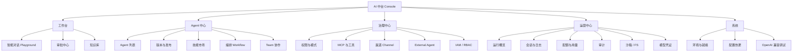

# AI 中台 Console 前端 UI / 交互优化方案

> 版本：v1.1（已按方向 B 全量落地）  
> 范围：`platform-console-ui` 整体重构  
> 目标：把「API 调试台」升级为「可演示、可运维、可协作的智能体中台控制台」

## 拍板结论（已执行）

| 项 | 决定 | 落地 |
| --- | --- | --- |
| 视觉方向 | **B 智能工作台**（Stripe / Notion） | `src/styles/tokens.css` 靛蓝 `#4F46E5` |
| 范围 | 全量 | 壳层 + 全部业务页 + 命令面板 + Dark |
| Workflow | **直接图形画布** | `WorkflowEditorView.vue` 节点拖拽编辑器 |

**本地运行**：`cd platform-console-ui && npm run dev` → http://localhost:5173 （代理 `/api` → 18081）

---

## 1. 现状诊断

### 1.1 实现形态

| 项 | 现状 | 问题 |
| --- | --- | --- |
| 工程结构 | 单文件 `App.vue`（~1100 行）+ `api.js` / `api-extra.js` | 无路由、无组件拆分、无法按角色裁剪 |
| 视觉 | Element Plus 默认壳 + 浅蓝主题 | 像后台表单堆叠，不像产品 |
| 交互 | 表格 + 表单 + 按钮平铺 | 无向导、无详情抽屉、无空态引导 |
| 文案 | 裸字段名（`agentId` / `sessionId` / `ruleContent`） | 业务用户看不懂 |
| 状态 | 仅 `ready` 标签 | 无全局加载、错误、权限态 |

### 1.2 能力未释放（后端已有、前端弱/空）

后端 S0–S10 能力面已经很完整，但 Console 只是「把字段摆出来」：

| 能力域 | 后端 | 前端现状 | 差距 |
| --- | --- | --- | --- |
| 对话 / SSE | 流式、工具生命周期、Thinking、续传、只读事件流 | 纯文本气泡 + 原始事件表 | **核心体验最弱**：无 Markdown、无工具时间线、无思考过程 |
| HITL 审批 | suggestedRules、acceptRule 一键免问、inbox | 表格批准/拒绝 | 无审批卡片、无规则建议可视化 |
| Agent 版本 | 建版、发布、drain、运行时实例 | 简表 + 一键发布 | 无版本对比、无切流可视化、无实例健康 |
| 技能市场 | DRAFT→审核→可见、内容预览 | 上传 + 三按钮 | 无内容 Diff、无审核工作流 |
| 知识 RAG | 文档/分块/引用检索 | 上传两字段 + 搜索表 | 无文档管理、无引用跳转、无分块预览 |
| 治理 | 权限规则、Mode、MCP、业务工具 | 表单堆叠 | 无权限矩阵、无生效链路说明 |
| 编排 Workflow | 定义/Revision/Run/门禁/Team | **JSON 文本域** | 无可视化编排、无 Run 时间轴产品化 |
| 运维 | 指标、OTel、Loki、沙箱、审计、配额 | 卡片大杂烩 | 无仪表盘、无告警态、无用量报表 |
| Channel / OpenAI 兼容 | webhook、chat completions | **完全缺失** | 无法演示渠道接入与兼容协议 |
| 会话管理 | history / clear / interrupt / stream | 按钮 + JSON dump | 无会话列表、无多会话切换 |

### 1.3 交互痛点（用户体感「弱小」的根因）

1. **对话不像对话**：无 Markdown、无代码块、无工具调用折叠卡片、无流式打字效果、无思考链。
2. **一切靠猜**：字段无说明、错误只 toast、空列表无下一步。
3. **没有「主任务路径」**：想「发布一个 Agent 并对话」要跨 3 个 tab 手填字段。
4. **数据不可读**：History / Run steps / MCP probe 全是 `JSON.stringify` 黑框。
5. **身份与上下文裸奔**：API Key 塞在顶栏输入框，agent/user/session 像调试参数。

---

## 2. 设计目标与原则

### 2.1 产品定位

**AI 智能体中台控制台**——同时服务三类角色：

| 角色 | 核心任务 | 首页落点 |
| --- | --- | --- |
| 业务 / 演示 | 对话、审批工具、查知识 | **工作台 / 对话** |
| Agent 开发 | 建 Agent、调 Prompt、发版、技能 | **Agent 工作室** |
| 平台运维 | 权限、配额、观测、审计 | **运营中心** |

### 2.2 设计原则

1. **任务优先于资源**：按「我要完成什么」组织，而不是按「API 域」平铺。
2. **对话是一等公民**：Playground 是产品门面，不是附属调试页。
3. **复杂能力渐进披露**：默认简洁，专家模式 / 抽屉里放完整参数。
4. **状态永远可见**：加载、空、错误、权限不足、审批中、限流中——都有明确下一步。
5. **可演示、可截图**：视觉达到对外 Demo 标准，而不是内部脚手架。

---

## 3. 信息架构（IA）重构

### 3.1 导航结构



### 3.2 全局壳层

```
┌──────────┬──────────────────────────────────────────────┐
│ 品牌     │ 顶栏：租户/环境 · 就绪灯 · 全局搜索 · 通知铃   │
│          │      · API 身份（折叠） · 用户菜单             │
│ 工作台   ├──────────────────────────────────────────────┤
│ Agent    │ 面包屑 / 页标题 / 主操作                       │
│ 治理     │ ──────────────────────────────────────────── │
│ 运营     │ 内容区（卡片/表格/详情抽屉）                   │
│ 系统     │                                              │
│          │                                              │
│ ▼ 收起   │                                              │
└──────────┴──────────────────────────────────────────────┘
```

**关键改动：**

- 侧栏 220px → **可折叠 64/240px**，支持分组标题。
- 顶栏 **API Key 收进「身份」弹层**（记住 localStorage，支持 demo/admin 快捷切换）。
- 增加 **全局命令面板**（`Ctrl/Cmd+K`）：跳转页面、切换 Agent、搜会话。
- 增加 **通知中心**：审批待办、发布完成、配额告警、外部 Agent 异常。

---

## 4. 视觉系统

### 4.1 Design Tokens（与方向绑定，见 §7 选型）

| Token | 用途 |
| --- | --- --- |
| `--bg-app` | 应用底色 |
| `--bg-surface` | 卡片/面板 |
| `--bg-elevated` | 抽屉/弹层 |
| `--ink-1/2/3` | 主/次/弱文字 |
| `--line` | 边框、分割 |
| `--brand` | 主操作、选中 |
| `--brand-soft` | 主色浅底 |
| `--ok / --warn / --danger / --info` | 状态 |
| `radius-sm/md/lg` | 4 / 8 / 12 |
| `space-1..8` | 4 / 8 / 12 / 16 / 24 / 32 / 40 / 48 |
| `font-sans / font-mono` | UI 字体 / 代码 |

### 4.2 字体与排印

- UI：`Inter, "PingFang SC", "Microsoft YaHei", system-ui`
- 代码/ID/JSON：`JetBrains Mono, ui-monospace, Consolas`
- 层级：页标题 24/600 · 区块 16/600 · 正文 14/400 · 辅助 12/400 · 标签 11/500
- 数字与 ID 一律等宽，便于扫读

### 4.3 组件规范（基于 Element Plus 二次封装）

| 组件 | 规范 |
| --- | --- |
| `AppPage` | 标题 + 描述 + 主/次操作 + 内容槽 |
| `AppTable` | 空态插画+CTA、行操作、列设置、批量、加载骨架 |
| `AppDrawer` | 详情/编辑统一抽屉，不再堆长表单页 |
| `StatCard` | 指标 + 趋势 + 点击下钻 |
| `StatusTag` | 就绪/运行/等待确认/失败 统一色语义 |
| `CodeBlock` | JSON/YAML 高亮、复制、折叠 |
| `StreamChat` | 对话核心组件（见 §5.1） |
| `ToolCallCard` | 工具调用生命周期卡片 |
| `EmptyState` | 插画 + 一句说明 + 主按钮 |
| `PermissionGate` | 无 admin scope 时友好降级 |

---

## 5. 核心页面设计

### 5.1 智能对话 Playground（门面页 · P0）

**布局：三栏工作台**

```
┌────────────┬──────────────────────────────┬──────────────────┐
│ 会话列表   │ 对话流                       │ 运行时面板        │
│ · 搜索     │ ┌──────────────────────────┐ │ · 工具调用时间线  │
│ · 新建     │ │ 用户消息                 │ │ · 思考/推理折叠   │
│ · 最近     │ │ 助手 Markdown 流式        │ │ · 权限/审批卡     │
│ · 状态点   │ │ ┌ ToolCallCard ────────┐ │ │ · Token/延迟      │
│            │ │ │ place_order ASK      │ │ │ · SSE 事件（可关）│
│            │ │ │ [批准][拒绝][免问]   │ │ │ · 知识引用        │
│            │ │ └──────────────────────┘ │ │                  │
│            │ └──────────────────────────┘ │                  │
│            │ [输入框 · 工具栏 · 发送]      │                  │
└────────────┴──────────────────────────────┴──────────────────┘
```

**必须做到的交互：**

1. **流式打字** + Markdown 渲染（标题/列表/代码块/表格）。
2. **Thinking 折叠区**：`THINKING_*` 事件可展开，默认摘要一行。
3. **工具调用卡片**：名称、入参 JSON（高亮）、耗时、结果摘要、`state`（成功/失败/等待确认）。
4. **HITL 原地审批**：卡片内「批准 / 拒绝 / 本次允许 / 永久允许（acceptRule）」，支持 `suggestedRules` 一键采纳。
5. **会话操作坞**：中断、清上下文、续传 SSE、导出 History、复制会话 ID。
6. **只读事件流**：`GET .../stream` 多 Tab 同步观察（右侧面板可开关）。
7. **空态**：示例提示词 chips（「查订单」「总结异常」「下单演示」）。

### 5.2 审批中心（P0）

- 列表：待处理 / 我处理的 / 全部，按 Agent、工具、时间筛选。
- **审批卡片**（替代裸表格）：工具名、入参摘要、调用上下文（谁、哪个会话、哪一轮）、建议规则。
- 批量处理 + 处理备注 + 「接受建议规则」勾选。
- 处理后时间轴回放（影响了哪次对话）。

### 5.3 Agent 中心（P0）

| 子页 | 设计要点 |
| --- | --- |
| Agent 列表 | 卡片：名称、模型、release 版本、健康、入口「对话 / 配置」 |
| Agent 详情 | Tab：概览 · Prompt · 工具与技能 · 版本 · 会话 |
| 版本与发布 | **时间轴式版本列表**；详情抽屉对比 sysPrompt/model；「发布」两步确认（build 成功→切流），显示 drain 状态 |
| 运行时实例 | 副本列表、in-flight、驱逐状态 |

**主路径向导（新建 Agent）：**  
基本信息 → 模型与 Prompt → 工具/技能/知识挂载 → 权限模式 → 试运行对话 → 发布

### 5.4 技能市场（P1）

- 市场视图：卡片墙（名称、版本、状态、简介、审核操作）。
- 上传：Markdown 编辑器 + 实时预览。
- 审核：抽屉内全文阅读 + 通过/驳回（必填意见）+ 审核记录时间轴。
- 可见性开关（`/visible`）做成显眼 Toggle。

### 5.5 知识库 RAG（P1）

- **文档库表**：标题、分块数、入库时间、状态；行内「预览分块 / 删除」。
- 上传支持粘贴 / 粘贴 URL 说明；大文本编辑器。
- 检索页：左检索、右命中卡片（引用 `docId#chunkId` 可点击跳回文档）。
- 在对话中的引用：助手消息底部「依据」芯片，点击打开分块抽屉。

### 5.6 治理中心（P1）

| 子页 | 设计要点 |
| --- | --- |
| 权限矩阵 | 行=工具，列=行为（ALLOW/ASK/DENY）；单元格可切换；顶部 Mode 选择器 + 说明「生效链路：规则→Mode→会话重同步」 |
| MCP / 业务工具 | 注册向导、**探测结果结构化展示**（工具列表、耗时、错误）、启用工具 chips |
| Channel | webhook URL 一键复制、Token 管理、最近投递记录、模拟推送 |
| External Agent | 注册、心跳健康灯、超时 unhealthy 高亮、转发试玩 |
| IAM | 用户-角色矩阵、权限点说明、危险操作二次确认 |

### 5.7 编排 Workflow（P1–P2）

**从 JSON 文本域升级为：**

1. **列表页**：Workflow 卡片 + 最近 Run 状态。
2. **编辑器**：左节点库（ECHO / AGENT / HUMAN_GATE）· 中画布（节点+连线）· 右属性面板；JSON 仅作「高级模式」。
3. **Run 详情**：垂直时间轴（步骤状态色）、门禁大按钮、事件流、取消/重试。
4. **Team**：成员 Agent 卡片、下发任务对话入口。

> 若短期不做图形画布，至少把 JSON 折叠成 **步骤卡片列表**（每步 type/输入/下一步），门禁步骤高亮——避免继续裸文本域。

### 5.8 运营中心（P1）

- **运行概览仪表盘**：就绪/副本、QPS、P95、Tokens、待审批数、配额消耗环、外部 Agent 健康。
- 会话与日志：会话搜索、按 sessionId 检索 Loki/本地日志、时间轴查看。
- 配额与用量：配额编辑 + **月度报表**（图表）+ CSV 导出按钮。
- 审计：可筛选时间线（操作、执行人、路径、结果）。
- 沙箱 / FS：命令执行终端风结果、FS 浏览器式列表。
- 模型凭证：打码列表、添加向导、连接测试。

### 5.9 系统（P2）

- 环境与就绪：Redis/PG/模型/密钥检查清单。
- OpenAI 兼容调试：类 Chat Completions 调试台（model=agentId）。
- 配置热更：限流等 `amp.ops.*` 可视化。

---

## 6. 关键交互模式

| 模式 | 规则 |
| --- | --- |
| 加载 | 骨架屏优先于 spinner；按钮 loading 不丢文案 |
| 空态 | 插画 + 原因 + 主 CTA（「创建 Agent」「上传知识」） |
| 错误 | 行内 Alert（含 `code` 与可读原因），可重试；`INSUFFICIENT_SCOPE` → 引导换 Admin Key |
| 确认 | 破坏性操作（发布切流、清上下文、删凭证）走对话框并写明影响 |
| 成功 | 轻量 Message + 关键结果可复制（runId、版本号） |
| 权限 | 无 admin 时隐藏/禁用管理操作并提示，而非报错 |
| 快捷键 | `Ctrl+K` 命令面板 · `Ctrl+Enter` 发送 · `/` 聚焦搜索 |
| 主题 | Light 默认 + Dark 可选（跟随系统） |
| 响应式 | ≥1280 完整三栏；1024 双栏；<768 仅对话/审批移动友好 |

---

## 7. 视觉方向（三选一）

> 下面三个方向是不同「产品气质」，选定后我会按该方向出高保真并落地组件主题。**推荐 B。**

### 方向 A · 工程控制台（Linear / Vercel Dashboard）

| 项 | 设定 |
| --- | --- |
| 锚点 | Linear、Vercel、Anthropic Console |
| 背景 / 墨色 / 强调 | `#0B0F14` / `#E6EDF3` / `#3B82F6` 电蓝 |
| 字体 | Inter + JetBrains Mono，字号偏紧 |
| 密度 | 高密度表格、键盘优先、命令面板前置 |
| 签名时刻 | `Ctrl+K` 全局命令面板；对话侧栏工具调用暗色时间线 |
| 适合 | 开发者/运维为主的内部平台 |

### 方向 B · 智能工作台（Stripe / Notion Console）★ 推荐

| 项 | 设定 |
| --- | --- |
| 锚点 | Stripe Dashboard、Notion、Figma 组织后台 |
| 背景 / 墨色 / 强调 | `#F7F8FA` / `#0F172A` / `#4F46E5` 靛蓝 |
| 字体 | Inter + 中文 PingFang/YaHei，留白充足 |
| 密度 | 中密度，卡片呼吸感，表单友好 |
| 签名时刻 | Playground 三栏工作台；HITL 审批卡片一键「永久允许」 |
| 适合 | **演示 + 业务 + 开发多角色**（本项目主场景） |

### 方向 C · 运行指挥室（Datadog / Grafana）

| 项 | 设定 |
| --- | --- |
| 锚点 | Datadog、Grafana、Railway |
| 背景 / 墨色 / 强调 | `#F8FAFC` + 深海军蓝导航 `#0F172A` / `#0EA5E9` 青 |
| 字体 | 等宽数据强化，指标数字大 |
| 密度 | 仪表盘驱动，状态灯/趋势图前置 |
| 签名时刻 | 首页运行态势大屏；Run 时间轴与 SSE 流并排 |
| 适合 | 运维演示、值班场景前置 |

---

## 8. 技术实施方案

### 8.1 工程升级

```
platform-console-ui/
  src/
    router/           # vue-router 按 IA 分路由
    layouts/          # AppShell / PageHeader
    components/ui/    # AppTable, AppDrawer, StatCard, ...
    components/chat/  # StreamChat, ToolCallCard, ...
    views/
      workbench/      # chat, approvals, knowledge
      agents/         # list, detail, versions, skills, workflow, team
      governance/     # permissions, mcp, channel, external, iam
      ops/            # overview, sessions, billing, audit, sandbox
      system/         # health, config, openai-compat
    stores/           # pinia: auth, agent-context, notifications
    styles/           # tokens.css, theme-light/dark
    api/              # 按域拆分 + 统一错误处理
```

| 依赖 | 说明 |
| --- | --- |
| `vue-router` | 页面路由、懒加载 |
| `pinia` | 身份 / 当前 Agent / 通知 |
| `vue-markdown` 或 `marked` + `highlight.js` | 对话渲染 |
| `echarts` 或 `chart.js` | 用量/指标 |
| `@vue-flow/core`（可选 P2） | Workflow 画布 |
| Element Plus | 保留，做主题 Token 覆盖 |

### 8.2 实施阶段

| 阶段 | 内容 | 产出 |
| --- | --- | --- |
| **P0 基座 + 门面** | Token/主题、AppShell、路由、身份管理、Playground 全量、审批中心 | 可演示对话+HITL |
| **P1 能力释放** | Agent 中心（版本发布）、技能、知识、治理矩阵、运营仪表盘、配额报表 | 覆盖 S1–S9 主路径 |
| **P2 编排与系统** | Workflow 编辑器（或步骤卡片）、Channel、OpenAI 调试、Dark、命令面板 | 对外 Demo 完整体 |
| **P3 打磨** | 空态/错误态全覆盖、快捷键、响应式、性能、可访问性 | 交付质量 |

### 8.3 兼容与契约

- API 契约变更仍需 **后端与 `api*.js` 同步**（AGENTS.md 约定）。
- 先保留现有接口封装，按域迁移，避免一次撕掉。
- HITL 的 `toolInput` JSON.parse 回填、`acceptRule` 等 **易踩坑逻辑原样保留**。

---

## 9. 成功标准

1. 演示路径 < 2 分钟：打开 → 对话 → 触发工具 ASK → 卡片内批准 → 继续对话。
2. 任意主页面截图可直接对外演示（无裸 JSON 黑框、无空白页）。
3. 管理操作（发布、权限、配额）均有确认与结果反馈。
4. 新人不看文档能完成：创建 Agent、上传知识、审批技能、看用量。
5. Lighthouse 可交互 & 首屏不再「表单墙」。

---

## 10. 待你拍板

1. **视觉方向选 A / B / C**（推荐 **B 智能工作台**）。
2. 范围确认：是否按 P0→P3 全量做，还是先只做 **P0 对话+审批门面**？
3. 是否需要 Dark 主题一并交付（可 P2）？
4. Workflow 是否接受 P1 用「步骤卡片」过渡、P2 再上图形画布？

拍板后我按选定方向出高保真关键页，并开始 P0 落地。
