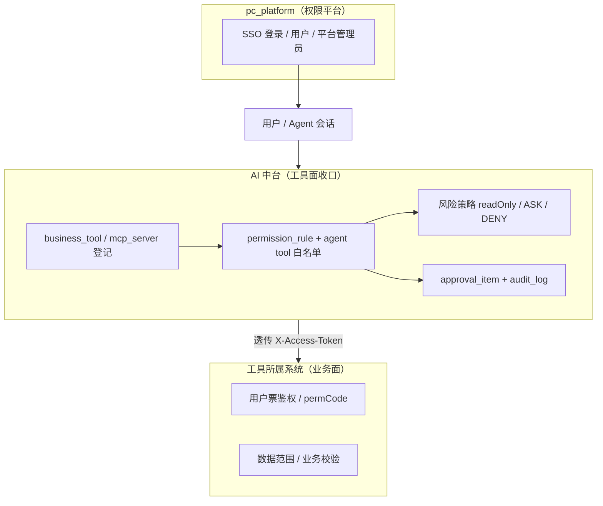
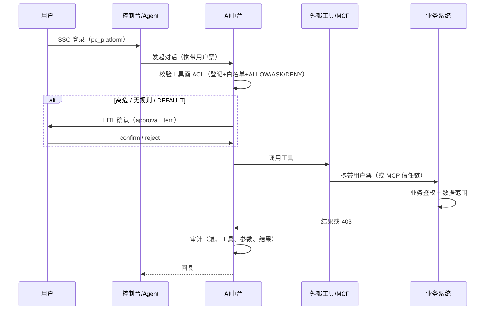
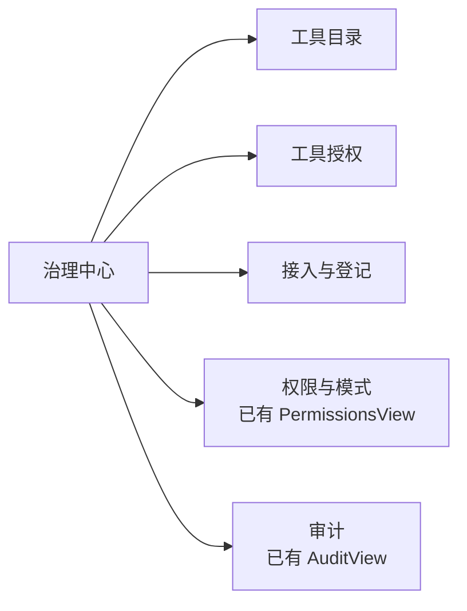

# 外部 MCP / HTTP 工具权限治理设计方案

> 范围：其他系统注册到 AI 中台的 **MCP Server** 与 **HTTP 业务工具** 的「谁能调、调用时以谁的身份、出事谁负责」。
> 身份与登录仍以 **pc_platform（权限平台）** 为唯一 IdP；本方案不改变登录链路。
> 关联：`docs/大一统智能体平台集成方案.md` §5、`AGENTS.md` 治理/HITL/HTTP 工具段落。

---

## 1. 问题与结论

### 1.1 问题

其他系统把接口/MCP 注册进中台后，权限放在哪一层？

| 候选 | 问题 |
| --- | --- |
| 全部塞进 pc_platform 按钮码 | 每加一个工具去平台建码；工具语义主平台不懂；迭代被卡死 |
| 全部业务系统自己管 | 中台无法收口「Agent 可调面」；提示词/工具可被滥用；审计不完整 |
| 中台只做登记不做鉴权 | 注册即暴露，违反最小权限 |

### 1.2 结论（推荐）

**三层分权，各管一段：**

| 层 | 归属 | 管什么 |
| --- | --- | --- |
| **身份与组织** | pc_platform | 谁登录、租户/用户、是否平台管理员 |
| **工具面（Agent 能力）** | **AI 中台** | 工具目录、Agent/角色可调白名单、ALLOW/ASK/DENY、HITL |
| **业务面（调用后）** | **工具所属系统** | 用**用户身份**再鉴权、数据范围、写操作校验 |

```text
Agent 可执行能力 = 用户在业务系统的权限
                 ∩ 中台工具面授权（注册 + ACL + 风险策略）
                 ∩ 环境策略（租户 / 只读 / 强制 ASK）
```

**硬约束：**

1. 未在中台登记的工具不得进入 Toolkit（`enableTools` 空不注入、`business_tool` 未 ENABLED 不挂载）。
2. 调用外部系统时**优先透传用户票**（X-Access-Token / Authorization），禁止默认用超管/固定高权 Key。
3. 高危写（删、改、导出、权限类）默认 **ASK** 或默认 **不进 Agent**。
4. 业务系统对无码/越权必须 **403**，不能只靠前端藏按钮。

---

## 2. 目标与非目标

### 2.1 目标

- 其他系统注册 MCP/HTTP 后，**中台 10 分钟内**可配置「哪个 Agent / 哪类用户能调」。
- Agent 工具面权限可审计、可回收、可灰度（ALLOW/ASK/DENY + HITL）。
- 保持「Agent 权限 ⊆ 用户权限」：用户无业务权限时，即使中台放行，业务侧也必须拒绝。
- 与现有 `permission_rule` / `agent_permission_mode` / `approval_item` 复用，不另起一套引擎。

### 2.2 非目标

- 不在中台重建业务数据权限（行级 SQL 仍在业务系统）。
- 不把每个工具 action 注册成 pc_platform 按钮码（仅可选映射，见 §5）。
- 不替代 MCP Server 自身的鉴权（传输层/工具层仍可有自己的 token）。

---

## 3. 角色与职责

| 角色 | 职责 | 系统 |
| --- | --- | --- |
| 平台管理员 | 工具登记审核、全局风险策略、租户级默认 | AI 中台管理台 |
| 所属系统负责人 | 声明工具元数据、`permCode`、风险级、是否允许透传用户票 | 注册时 |
| 智能体负责人 | 本 Agent 工具白名单、ASK 规则、提示词 | AI 中台 |
| 安全/审计 | 越权用例、审计抽检、强制 ASK/DENY | 中台 + 业务日志 |
| 最终用户 | 使用 Agent；权限来自 SSO 身份 | 业务系统 |

---

## 4. 分层模型



### 4.1 会话与调用时序



---

## 5. 权限点约定

### 5.1 三类权限码（不要混用）

| 类型 | 例子 | 归属 | 用途 |
| --- | --- | --- | --- |
| 身份/平台角色 | `tenant_admin`、`admin` | pc_platform + 中台 IAM | 能否进管理面、是否平台管理员 |
| **工具面权限** | 中台 `permission_rule` 的 toolName + ALLOW/ASK/DENY | **AI 中台** | Agent 能不能挂/调这个工具 |
| 业务权限码 | `order:delete`、`platform:user:setroles` | **业务系统**（可声明在工具元数据 `permCode`） | 调用后业务是否放行 |

### 5.2 工具元数据（登记时声明）

在 `business_tool.config` / MCP 登记扩展字段中约定：

```json
{
  "url": "http://order-svc/api/orders",
  "method": "GET",
  "readOnly": true,
  "risk": "low",
  "permCode": "order:query",
  "authMode": "user_token",
  "headers": {},
  "parameters": { "type": "object", "properties": {} }
}
```

| 字段 | 说明 | 默认 |
| --- | --- | --- |
| `risk` | `low` \| `medium` \| `high` \| `forbidden` | `GET/HEAD`→low，其余 medium |
| `permCode` | 业务权限码；可选 | 空=仅业务系统鉴权 |
| `authMode` | `user_token` \| `client` \| `none` | **`user_token`** |
| `readOnly` | 是否只读 | 随 method |

**风险策略（中台强制）：**

| risk | 默认 |
| --- | --- |
| low | 可 ALLOW |
| medium | 默认 ASK 或按 Agent 配置 |
| high | 默认 ASK + 审计加强；禁止默认 ALLOW |
| forbidden | 不注册 / 不注入 Toolkit |

### 5.3 与 pc_platform 的边界

- **要**：登录身份、平台管理员标记（如 `administratorsId`）、租户。
- **可选**：粗粒度码如 `agent:tool:use`（「允许使用智能体工具」）由平台角色控制。
- **不要**：每个 MCP/HTTP 的 action 都建平台按钮码。
- 若所属系统已有按钮码，可在 `permCode` **引用**，中台只透传校验结果，不解析业务码表。

---

## 6. 执行点（防绕过）

| 阶段 | 动作 | 失败 |
| --- | --- | --- |
| 注册/导入 | 校验 metadata、risk、enableTools 非空、URL 白名单 | 拒绝入库 |
| 实例构建 | 仅挂载 ENABLED + 白名单内工具；forbidden 剔除 | 少挂工具 |
| 模型出参 / 调用前 | `PermissionEngine` ALLOW/ASK/DENY；再验工具面 ACL | 403 / ASK |
| 外呼 | 注入用户票（`authMode=user_token`） | 业务 403 |
| 写/高危 | HITL `approval_item` | 不执行 |
| 结束 | `audit_log` + 工具结果摘要 | 告警 |

**实现注意（当前缺口）：**

- `HttpBusinessTool` 目前仅使用 `config.headers` **静态头**，**未透传登录用户票**。
- 设计要求：`authMode=user_token` 时，从会话上下文取 Jeecg/`X-Access-Token`（或平台换发的内部票）注入请求；`client` 模式才允许固定 `X-Api-Key`，且 risk 提升为 medium，禁止用于写接口默认 ALLOW。

---

## 7. 数据模型（复用 + 增量）

### 7.1 已有（不改语义）

| 表 | 用途 |
| --- | --- |
| `business_tool` | HTTP/IN_PROCESS/MCP 元数据 |
| `mcp_server` | MCP 连接与 `enableTools` |
| `permission_rule` | toolName + ALLOW/ASK/DENY（租户/Agent） |
| `agent_permission_mode` | DEFAULT / DONT_ASK |
| `approval_item` | HITL |
| `audit_log` | 管理面与工具审计 |

### 7.2 增量（一次做完）

| 变更 | 说明 |
| --- | --- |
| `business_tool.config` 增加 `risk`/`permCode`/`authMode`/`ownerSystem` | JSON 扩展，无需先改表结构 |
| 表 `tool_grant`（可选但推荐） | 主体（user/role/agent）× toolName × effect；与 `permission_rule` 并存时以「更严」为准 |
| `business_tool.owner_system` | 所属系统/联系人，便于追责（可先放 config） |

---

## 8. API 与治理流程

### 8.1 注册（所属系统）

1. 申请：POST `/api/v1/admin/business-tools` 或 `/mcp-servers`（admin / `orch:write`）。
2. 必填：name、description、kind、config（含 url 或 mcp 连接、enableTools、risk）。
3. 门禁：URL 内网白名单、enableTools 非空（MCP）、forbidden 拒绝。

### 8.2 授权（中台）

1. 管理台为 Agent 勾选工具（或 `permission_rule` ALLOW/ASK/DENY）。
2. 变更 → `evict` 实例缓存 + `SessionStateRuleScrubber` 重同步（沿用现有三步）。
3. 高危工具默认 ASK；可对「可信角色」批量 ALLOW（租户级，慎用）。

### 8.3 上线门禁（验收）

- [ ] 未登记工具不在 Toolkit
- [ ] 无中台授权 → 模型不可调 / 403
- [ ] 用户无业务 `permCode` → 业务侧 403（不是中台 200 空数据）
- [ ] 未登录票不得用高权 client 凭证代替
- [ ] high 风险默认 ASK；拒绝后无副作用
- [ ] 审计含 userId、toolName、参数摘要、结果状态

---

## 9. 安全要求

1. **禁止**工具配置里写死可写接口 + 超管 Token（登记审核必查）。
2. `authMode=client` 仅限只读目录类，且 risk≥medium。
3. MCP：`amp.mcp.require-explicit-tools=true` 保持；传输层 token 与用户票分离。
4. 提示词注入不得绕过 PermissionEngine（引擎在工具执行前，不信任模型）。
5. 导出/批量/删改类 `permCode` 必填，或 risk=high 强制 HITL。
6. 机器人/子 Agent **不新增用户权限**，只继承当前用户身份。

---

## 10. 前端页面设计（`platform-console-ui`）

> 对齐 `docs/前端UI优化设计方案.md`：Element Plus + 自研壳（PageHeader / StatusTag / JsonView / EmptyState）、靛蓝主色、治理中心分组。
> **一次做完**：注册、目录、授权矩阵、详情抽屉、审计联动，不拆版本。

### 10.1 信息架构与路由

在 **治理中心** 下把「MCP 与工具」拆成产品化三页（替换现 `ToolsView` 大杂烩，或作其 Tab 升级）：



| 路由 | 页面 | 菜单名 | 主用户 |
| --- | --- | --- | --- |
| `/governance/tools` | 工具目录（含风险/鉴权/启用） | 工具目录 | 平台管理员、所属系统 |
| `/governance/tools/grants` | 工具授权矩阵 | 工具授权 | 智能体负责人、管理员 |
| `/governance/tools/register` | 接入向导（HTTP / MCP） | 接入与登记 | 所属系统负责人 |
| `/governance/tools/:toolName` | 工具详情（抽屉亦可） | — | 全部治理角色 |
| `/governance/permissions` | Agent 权限规则（已有） | 权限与模式 | 管理员 |
| `/workbench/approvals` | HITL（已有） | 审批中心 | 最终用户/审批人 |

侧栏文案建议：`工具目录` · `工具授权` · `接入与登记`（同属「治理」）。

### 10.2 页面一：工具目录 `/governance/tools`

**任务**：一眼看清「有哪些外部工具、风险多高、以谁的身份调、是否进 Agent」。

**布局**

```
┌ PageHeader「工具目录」 ┌ 搜索 [工具名/所属系统] ┌ 筛选: Kind | Risk | Status | AuthMode ┐
│ [接入工具] 主按钮     [刷新]                                    │
├────────────────────────────────────────────────────────────────┤
│ 摘要条：全部 24 · 启用 18 · 高危 3 · 待授权 5 · MCP 2           │
├────────────────────────────────────────────────────────────────┤
│ 表格                                                            │
│ 名称 | 类型 | 所属系统 | 风险 | 鉴权 | permCode | 状态 | Agent数 │
│ order… | HTTP | 订单  | low  | 用户票 | order:query | 启用 | 2   │
│ …                                              [详情] [授权]   │
├────────────────────────────────────────────────────────────────┤
│ 空态：暂无工具 → [接入工具] / 说明三层权限模型                   │
└────────────────────────────────────────────────────────────────┘
```

**列与交互**

| 列 | 展示 | 操作 |
| --- | --- | --- |
| 名称 / 描述 | 主文案 + 次行描述截断 | 点击开详情抽屉 |
| 类型 | `HTTP` / `MCP` / `IN_PROCESS` Tag | — |
| 所属系统 | `ownerSystem` | 筛选 |
| 风险 | StatusTag：low 绿 / medium 橙 / high 红 / forbidden 灰 | 筛选 |
| 鉴权 | `用户票` / `客户端凭证` / `无` | — |
| permCode | 等宽小字，空显示 `—` | — |
| 状态 | 启用/停用 Switch（二次确认） | 即改 status |
| Agent 数 | 已授权 Agent 数量 | 点击跳授权页并预筛该工具 |

**批量**：勾选 → 「批量启用/停用」「批量设为 ASK」（写 `permission_rule`）。

**接入弹窗**：见页面三；目录页「接入工具」打开同一向导。

### 10.3 页面二：工具授权 `/governance/tools/grants`

**任务**：完成「哪个 Agent / 哪类主体可以调哪个工具」——方案核心交付面。

**布局（矩阵 + 侧栏）**

```
┌ PageHeader「工具授权」  [保存更改]  [导出矩阵 CSV]                │
├──────────────┬──────────────────────────────────────────────────┤
│ 左：筛选      │ 右：矩阵                                         │
│ Agent: [demo ▼]                                                  │
│ 风险: []     │        order.get  order.del  kb.search  …        │
│ 只看未授权   │ demo   [ALLOW]   [ASK]      [—]                   │
│              │ console-bot [—] [DENY]     [ALLOW]                │
│              │                                                  │
│ 主体级（若用 │ 批量条：对勾选单元格设 ALLOW / ASK / DENY / 清除   │
│ tool_grant） │                                                    │
│ 角色: developer                                                  │
│ 用户: stc…   │ 说明：单元格=租户级 permission_rule 的默认；       │
│              │ 主体级更严则覆盖（DENY > ASK > ALLOW）             │
└──────────────┴──────────────────────────────────────────────────┘
```

**单元格三态**（与 `permission_rule.behavior` 对齐）：

| 值 | 样式 | 语义 |
| --- | --- | --- |
| `ALLOW` | 绿 | 可调（仍受业务 403） |
| `ASK` | 橙 | HITL |
| `DENY` / 空 | 红 / 虚线框 | 禁止或未配置（走 `agent_permission_mode`） |

**交互**

1. 改单元格 → 脏标记 + 「保存更改」；保存后提示「已 evict 实例，下一轮生效」。
2. 列头显示风险；`forbidden` 列只读、不可授。
3. 「按工具授权」模式（切换视图）：选工具 × 主体列表，便于单工具上线。
4. 与 `PermissionsView` 互链：高级规则 JSON / ruleContent 在「权限与模式」维护，本页只管 tool 级行为。

### 10.4 页面三：接入与登记 `/governance/tools/register`

**任务**：所属系统自助注册 HTTP/MCP，门禁字段一次填全。

**向导步骤（el-steps）**

1. **类型**：HTTP 业务工具 | MCP Server  
2. **连接**：HTTP → url/method；MCP → transport/command|url + enableTools（必填）  
3. **安全**：  
   - `risk`（默认 GET→low，其他 medium）  
   - `authMode`（默认 `user_token`；`client` 时警告「写接口禁止」）  
   - `permCode`（risk≥medium 建议必填，见开放问题）  
   - `readOnly`  
   - `ownerSystem` / 联系人  
4. **参数 schema**（JSON 编辑器，HttpToolSpec.parameters）  
5. **预检**：连通性（MCP test / HTTP OPTIONS·GET）、风险结论、是否允许进 Agent；**确认提交**

**校验（前端即时）**

| 规则 | 提示 |
| --- | --- |
| MCP enableTools 空 | 阻止下一步 |
| risk=high + authMode=client + 非 GET | 阻止：高权凭证 + 写接口 |
| URL 非白名单主机 | 阻止 |
| risk=high 未填 permCode | 警告 + 默认 ASK |

### 10.5 工具详情抽屉（任意入口）

```
┌ 工具 order.delete  [停用] [去授权] [看审计] ──────────┐
│ 摘要：HTTP · 订单 · risk=high · 用户票 · order:delete │
│ 状态：启用 · Agent: demo(ASK), console-bot(未授)      │
├ 连接 ───────────────────────────────────────────────┤
│ DELETE /api/orders/{id}  · 超时 30s · 只读:否         │
├ 权限链路 ────────────────────────────────────────────┤
│ 登录身份(pc_platform) → 中台 ACL → 业务 permCode     │
│ 当前规则：ASK · 来源 platform · ruleContent=*        │
├ 参数 Schema ────────────────────────────────────────┤
│ JsonView                                            │
├ 最近调用（链审计）──────────────────────────────────┤
│ 时间 | Agent | 用户 | 结果 | [详情]                  │
└─────────────────────────────────────────────────────┘
```

### 10.6 与既有页面联动

| 从 | 到 | 行为 |
| --- | --- | --- |
| 工具目录 | 授权矩阵 | 预选工具列 |
| Agent 详情 | 工具授权 | 预选 Agent 行 |
| 审批中心 | 工具详情 | 打开 toolName 详情 |
| 审计 | 工具详情 / 会话 | 过滤 toolName |
| 权限与模式 | 授权矩阵 | 跳转并说明「本页=工具级，JSON=细规则」 |

### 10.7 组件与 API 绑定

| UI | 接口（已有或扩展） |
| --- | --- |
| 目录列表 | `GET /admin/business-tools`、`GET /admin/mcp-servers`（扩展 risk/permCode/authMode 字段） |
| 启用停用 | `POST /admin/business-tools` upsert / `DELETE` |
| 授权矩阵 | `GET/POST/DELETE /admin/governance/permissions`（toolName 行为） |
| 注册向导 | `POST /admin/business-tools`、`POST /admin/mcp-servers`、`POST .../mcp-servers/{name}/test` |
| 详情审计 | `GET /admin/audit?resource=tool`（或按 toolName 过滤） |

前端 `api/index.js` 增补：`listToolGrants` / `saveToolGrant` / `registerToolWizard` 等；错误码映射沿用 `http.js`（`TOOL_NAME_REQUIRED`、`HTTP_TOOL_URL_REQUIRED`、`PERMISSION_BEHAVIOR_INVALID`…）。

### 10.8 空态 / 权限态 / 错误态

| 状态 | 文案与下一步 |
| --- | --- |
| 无工具 | 「先接入所属系统工具」→ 向导 |
| 无权限（RBAC_DENIED） | 「需要工具治理权限」→ 联系租户管理员（读 IAM 当前身份） |
| MCP 未连通 | 列表黄条 + 「测试连接」 |
| 保存规则失败 | 保留脏数据 + Toast 重试 |
| forbidden | 列表置灰，不可授权 |

### 10.9 视觉约定

- 风险色：`ok` low · `warn` medium · `danger` high · 灰 forbidden（tokens.css）。
- 行为三态按钮组：Segmented（ALLOW / ASK / DENY），选中填色。
- 表格密度中等；JSON 一律 `JsonView`；长 URL 中间省略 + title。
- 中文文案，避免裸字段名（「用户身份票」而非仅 `authMode`）。

---

## 11. 完整交付范围（一次落地，无分期）

| # | 交付项 | 模块 |
| --- | --- | --- |
| 1 | 元数据 `risk` / `permCode` / `authMode` / `ownerSystem` + 注册校验 | runtime / governance |
| 2 | 高危默认 ASK、forbidden 拒注册、URL/enableTools 门禁 | governance |
| 3 | `HttpBusinessTool` 用户票透传（user_token） | runtime |
| 4 | MCP 调用注入用户头策略（与 3 一致） | governance |
| 5 | 工具目录页 | console-ui |
| 6 | 工具授权矩阵页 + 主体级 `tool_grant` | console-ui + channel/governance |
| 7 | 接入向导页（HTTP/MCP） | console-ui |
| 8 | 详情抽屉 + 审计/审批联动 | console-ui |
| 9 | 保存后 evict + 会话规则重同步（沿用现有三步） | runtime |
| 10 | 审计字段：userId、toolName、参数摘要、traceId | ops |
| 11 | 单测：门禁、矩阵、透传、越权 403 | 各模块 |
| 12 | 文档：本方案 + 所属系统接入一页纸 | docs |

---

## 12. 决策记录

| 决策 | 选择 | 理由 |
| --- | --- | --- |
| 工具 ACL 放哪 | **AI 中台** | 工具语义在中台；主平台按钮码不承载 Agent 工具面 |
| 业务鉴权放哪 | **所属系统** | 数据与写操作只有业务懂；满足 Agent⊆用户 |
| 是否映射 Jeecg 按钮码 | **可选引用 `permCode`，不强制建码** | 避免每工具动权限平台 |
| 高危默认 | ASK / 不进 Agent | 可逆、可审计 |
| 与现有 HITL | 复用 `permission_rule` + `approval_item` | 不重做引擎 |

---

## 13. 开放问题（需业务拍板）

1. `permCode` 是否强制：凡 `risk≥medium` 无码不得注册？
2. 用户票过期时工具调用失败策略：中断会话 vs 只影响该工具？
3. MCP Server 侧是否也要求用户票，还是 Server↔中台信任链 + 中台注入用户头？
4. 子系统「只藏按钮」存量接口是否一律 `forbidden` 直至补鉴权？（建议：**是**）
