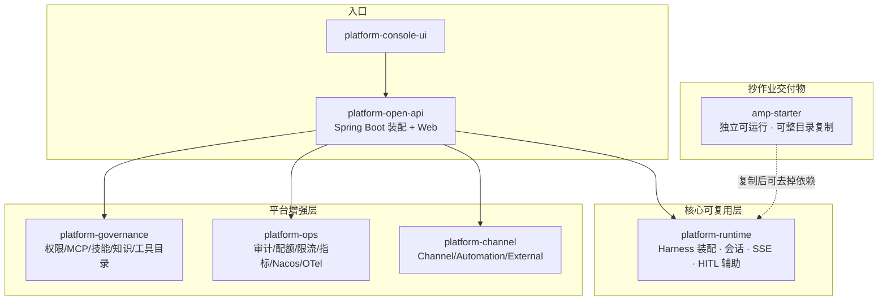
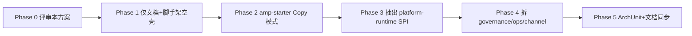

# 方案：amp-starter 金路径 + Maven 模块化

| 项 | 内容 |
| --- | --- |
| 文档类型 | **方案已定稿** · 不含代码变更 |
| 目标 | ① 抽出可抄写的 `amp-starter`；② 解决 Maven 模块过薄 |
| 约束 | **在途开发（另一 Agent）未完成前不动业务代码**；本方案只定边界与顺序 |
| 上游 | `AGENTS.md`、`docs/AI中台设计文档.md` §11、`docs/项目总体架构总结.md` |
| 读者 | 架构 / 后端 / 需要抄作业建 Agent 的业务研发 |

---

## 0. 一句话

**把「Harness 装配 + 对外契约 + 踩坑注释」抽成同事能抄的 `amp-starter`；同时把单体 `platform-open-api` 按领域切成清晰 Maven 模块，starter 与中台共用同一套核心写法。**

---

## 1. 背景与问题

### 1.1 双目标现状

| 目标 | 现状 | 问题 |
| --- | --- | --- |
| A. 最佳实践 + **抄代码** | 未交付独立 starter | 同事只能抄整个 `platform-open-api`（159 类 + 治理/计费/UI），无法下手 |
| B. 业务自助建 Agent 中台 | S0–S9 骨架已通 | 与 A 共用一仓，但形态不同 |

### 1.2 Maven 模块过薄

```text
现状 reactor：
  platform-common     （仅 ApiError，过薄）
  platform-open-api   （其余全部 ~159 类，过厚）
  platform-console-ui （不在 reactor）
```

- 领域边界只存在于**包名**，无模块强制，依赖方向无法校验；
- `AgentInstanceFactory` 同时拽治理/技能/知识/沙箱/模型/小助，**装配核心与平台服务缠死**，无法被 starter 干净复用；
- 设计文档 §11 建议的 infra/runtime/catalog/governance/ops 分层未落地。

### 1.3 非目标（本方案不做）

- 不拆微服务、不改对外 API 契约；
- 不重写 AgentScope 装配语义（HITL/权限/会话约定保持现状）；
- 不在本阶段做业务自助向导/模板库（另案）；
- **不在在途合入前改任何 `src/` 业务代码**。

---

## 2. 总体架构（目标态）



**关系定性：**

| 交付物 | 给谁 | 形态 |
| --- | --- | --- |
| `amp-starter` | 会 Java、要嵌 Agent 的同事 | **整目录复制**（或 archetype），默认自包含 |
| `platform-*` 模块 | 中台与进阶定制 | Maven 依赖复用 |
| 中台应用 | 业务自助 / 治理 | `platform-open-api` 启动 |

---

## 3. 方案 A：amp-starter（抄代码金路径）

### 3.1 定位

> **「AgentScope Java 2.0.3 在 Spring Boot 里的最小正确接法」**  
> 30 分钟：clone → 配 Key → curl SSE → 改提示词 → 挂一个工具 → 看 HITL。

不追求功能全，只追求：**抄了不会踩官方坑、结构不丑、能长成小应用。**

### 3.2 放置位置（三选一，推荐 R1）

| 方案 | 位置 | 优点 | 缺点 | 建议 |
| --- | --- | --- | --- | --- |
| **R1** | 仓内 `amp-starter/`，**进 reactor** 但独立坐标 | 与平台同版本演进、CI 可测 | 复制时仍见 monorepo 结构 | **推荐** |
| R2 | `examples/amp-starter`，不进 reactor | 与中台隔离 | CI 盲区 | 备选 |
| R3 | 独立仓库/Archetype | 最干净 | 两仓同步成本高 | 二期再考虑 |

**推荐 R1**：`amp-starter` 作为独立 Maven 工程挂在根 `modules`，依赖仅 `platform-runtime`（或零内部依赖，见 3.5）。

### 3.3 目录骨架（目标态）

```text
amp-starter/
├── README.md                      # 30 分钟教程 + 生产检查单（中文）
├── pom.xml                        # spring-boot + agentscope-harness + extensions-redis
├── docker-compose.yml             # 仅 redis（可选）
├── .env.example                   # DEEPSEEK_API_KEY / AMP_REDIS_URI
├── src/main/java/com/example/agent/
│   ├── StarterApplication.java    # @SpringBootApplication
│   ├── config/
│   │   ├── AgentProperties.java   # modelId / apiKey / workspace / redis
│   │   └── AgentConfiguration.java# 装配 HarnessFactory（或委托 runtime）
│   ├── runtime/
│   │   ├── HarnessFactory.java    # ★ 金路径：builder 装配（从平台精简）
│   │   ├── AgentSession.java      # 按 sessionId 懒加载/缓存实例
│   │   └── StopOnAllDeniedMiddleware.java
│   ├── web/
│   │   ├── ChatController.java    # ★ messages / messages:stream / confirm
│   │   ├── SseSupport.java        # 事件 → SSE 帧
│   │   └── dto/                   # 请求/响应最小 DTO
│   └── tool/
│       ├── SampleTools.java       # safe_lookup / dangerous_write（演示 ASK）
│       └── ToolUseFixtures.java   # ★ confirm 回填 content 辅助
├── src/main/resources/
│   ├── application.yml
│   └── prompts/default-system.md  # 默认系统提示词
└── src/test/java/.../
    ├── ChatHttpContractTest.java  # 对齐平台契约子集
    └── ChatConfirmContractTest.java # HITL 回填坑回归
```

### 3.4 必含「金路径」内容（从现有代码蒸馏）

| # | 能力 | 来源（现仓库） | starter 必须保留的坑点 |
| --- | --- | --- | --- |
| 1 | Harness 装配 | `AgentInstanceFactory` | Redis `AgentStateStore`、compaction 显式配置、workspace 路径 |
| 2 | 对话 + SSE | `ChatController` | 流式路径 **`messages:stream`（冒号）**；事件 JSON 可重建 |
| 3 | HITL confirm | `ChatController.confirm` | **回填 `ToolUseBlock.content`**；`toolInput` 须 `JSON.parse` 进 `input` |
| 4 | 权限三态 | `GovernanceService.normalizeRuleContent` | **`"*"` → null**，否则 ALLOW/ASK/DENY 全失效 |
| 5 | 全拒停止 | `StopOnAllDeniedMiddleware` | 官方配方，防止空转 |
| 6 | 会话规范 | `SessionContext` | `userId`+`sessionId` 强制；`[A-Za-z0-9_-]{1,128}` |
| 7 | 业务工具 | `SampleToolset` / `HttpBusinessTool` 精简 | 危险写默认 ASK |
| 8 | 测试 | `ChatHttpContractTest` / `ChatConfirmContractTest` 子集 | 抄走可回归 |

**刻意不放进 starter：** 目录/版本发布、技能市场、RAG、配额、审计、Nacos、Channel、Team、小助、管理 UI。

### 3.5 依赖策略（两条腿）

| 模式 | pom | 适用 |
| --- | --- | --- |
| **Copy 模式（默认）** | 只依赖官方 `agentscope-*` + Spring Boot；平台类**内联精简副本** | 同事整目录拷走、改包名即独立 |
| **Reuse 模式（可选）** | 依赖 `platform-runtime` | 在中台组织内、希望与平台同步修复 |

**建议 starter 默认 Copy 模式**，文件头注释标明「逻辑与 `platform-runtime` 对齐，坑点见 AGENTS.md」。避免同事被迫理解整个 monorepo。

### 3.6 README 结构（交付验收的一部分）

1. 这是什么 / 不是什么（5 行）  
2. 前置（JDK 21、Redis、模型 Key）  
3. 跑通：`mvn spring-boot:run` + curl SSE  
4. 场景一：改系统提示词  
5. 场景二：加一个工具（含 ASK）  
6. 场景三：HITL confirm（curl 闭环）  
7. 会话与多副本说明（State 在 Redis）  
8. **生产检查单**（密钥、drain、限流、日志）  
9. 和中台的关系（何时该上平台）  
10. 常见坑（content 回填、`*` 规则、stream 路径）

---

## 4. 方案 B：Maven 模块化

### 4.1 目标模块图（目标态）

```text
ai-middle-platform/                 # parent pom
├── platform-common/                # 错误码、通用 DTO、租户上下文（保持薄但“够用”）
├── platform-runtime/               # ★ Harness 装配、会话、SSE、HITL 辅助、实例缓存/drain
├── platform-governance/            # 权限、MCP、业务工具、技能、知识、模型凭证
├── platform-ops/                   # 审计、配额、限流、指标、Nacos/OTel/Loki、Release 总线
├── platform-channel/               # Channel、Automation、External、Workflow/Team（编排）
├── platform-open-api/              # Spring Boot 入口 + 全部 @RestController + 装配
├── amp-starter/                    # 可抄金路径（见 §3）
└── platform-console-ui/            # 前端（仍不进 reactor，或后续只做版本对齐）
```

不建议一次切到设计文档 §11 的 10+ 模块；**5 个业务模块 + 入口**对当前 159 类规模足够，避免模块爆炸。

### 4.2 依赖方向（硬约束）

```text
platform-common  ← 不依赖任何内部模块
platform-runtime → platform-common + agentscope-*
platform-governance → platform-common（+ runtime 仅接口，见 4.4）
platform-ops     → platform-common
platform-channel → platform-common / runtime / governance（按需）
platform-open-api → 以上全部
amp-starter      → 仅官方依赖（Copy 模式）
```

**禁止：** `runtime → governance/ops`；`governance → ops`；循环依赖。

### 4.3 包 → 模块映射

| 现包（`com.sinosoft.amp.openapi.*`） | 目标模块 |
| --- | --- |
| `agent`（工厂/缓存/drain/wakeup/中间件） | **platform-runtime** |
| `session`（Context/SSE/EventHub/AgentEventJson） | **platform-runtime** |
| `model`（凭证解析为装配服务） | runtime 或 governance（建议 **governance**，runtime 只留接口） |
| `governance` `skill` `knowledge` `tool` `fs` `sandbox` `memory` | **platform-governance** |
| `ops` `billing` `security`（Filter 可留入口） | **platform-ops** / 入口 |
| `channel` `automation` `external` `orchestration` `iam` | **platform-channel**（iam 若只服务 RBAC 可留 governance） |
| `web` 全部 Controller + `OpenApiApplication` | **platform-open-api** |
| `com.sinosoft.amp.common.*` | **platform-common** |

> `security`/`iam` 可拆：过滤器与 Boot 装配进 `open-api`，策略服务进 `governance`。落地时以「零循环依赖」为准，表内为倾向。

### 4.4 反向依赖解除（关键设计点）

`AgentInstanceFactory` 现直接构造：`GovernanceService`、`SkillCatalogRepository`、`KnowledgeService`、`McpConnectService`、`DockerSandboxService`、`ModelCredentialService`、`ConsoleBotSupport`…

**改为 SPI（平台注入，starter 用默认实现）：**

```text
platform-runtime 定义：
  ToolSource          # 列出/构建工具（Sample + Http + MCP + 业务）
  PermissionSource    # 规则/Mode → PermissionContextState
  KnowledgeSource     # 可选，挂 knowledge_search
  MemorySource        # 可选，Mem0
  CredentialSource    # modelId → apiKey/baseUrl
  WorkspaceLayout     # 路径/FS 模式

platform-governance 实现上述接口并 @Bean 注入；
amp-starter 提供仅 SampleToolset 的最简实现。
```

这样 **runtime 可单独被抄写**，平台增强是插件而非硬依赖。

### 4.5 「platform-common 加厚」范围

仅加入**真正共享**的类型，防止变垃圾抽屉：

- `ApiError` / `ErrorCode`（已有）
- `TenantId`、`SessionId` 校验工具（从 session/security 上移）
- `PageResult`、通用审计操作名枚举（若 ops+channel 同用）
- **不放**：业务 Entity、Controller DTO、AgentScope 类型包装

### 4.6 校验手段（防回潮）

| 手段 | 作用 |
| --- | --- |
| Maven `dependencies` 即约束 | runtime 无法再 import governance |
| （可选）ArchUnit 单测 | `runtime` 不得依赖 `governance/ops/channel/web` |
| CI | 继续 `mvn -B verify`；**增加 `amp-starter` 模块** |
| 契约测试 | 留在 `platform-open-api`；starter 自带子集 |

---

## 5. 实施阶段（与在途开发解耦）

> 原则：**先切边界、后搬文件；先 starter、后大搬家；每阶段可单独合并。**



### 执行状态（2026-09-30 · 已落地）

| 阶段 | 状态 | 结果 |
| --- | --- | --- |
| Phase 0 评审 | ✅ | S1–S6 已定稿（§9） |
| Phase 2 amp-starter | ✅ | Copy 模式金路径 + 11 测 |
| Phase 3–4 模块拆分 | ✅ | 六模块落地；装配类留 open-api；共享 ops 下沉 runtime（未做完整 SPI，以物理分层为主） |
| Phase 5 文档 | ✅ | AGENTS.md / README 已同步 |
| ArchUnit 防回潮 | ⬜ | 可选后续 |

**验证：** `mvn -B verify` → **208 测全绿**（runtime 77 / governance 35 / ops 34 / channel 23 / open-api 27 / starter 11 / common 1）。  
**联调：** 需先 `mvn -DskipTests install` 再启后端；管理 API / UI 16 路由 / 侧栏 / 对话发送已通过。

### Phase 0 · 评审（0.5 天）— **已完成（决议见 §9）**

- ~~确认 R1 放置、模块切分表、SPI 列表~~ → S1–S6 已定稿；
- 仍待执行：**冻结**在途 Agent 变更集列表，约定「谁先合入谁先」（Phase 2 可并行，Phase 3 前必须完成）。

### Phase 1 · 无风险准备（不改业务逻辑）

- 根 pom `modules` 预留注释或空模块骨架（若在途冲突则只出补丁计划）；
- 在 `docs/` 增加《抄作业手册》提纲（可与本文并行）；
- 从 `AgentInstanceFactory` / `ChatController` 做**依赖清单标注**（注释或文档表），不挪代码。

### Phase 2 · amp-starter Copy 模式（1–2 天）

- 新建 `amp-starter/`（新文件为主，**极少改** open-api）；
- 内联精简：`HarnessFactory`、`ChatController`、Session 校验、SampleTools、HITL content 回填、2 个契约测试；
- README + compose + `.env.example`；
- CI 增加 `mvn -pl amp-starter verify`（或整仓 verify 已覆盖）。

**完成标志：** 同事只拷 `amp-starter/` 仓库外目录，能跑通 SSE + confirm。

### Phase 3 · platform-runtime 抽出（2–3 天，需在途清空）

- 新建 `platform-runtime`，迁入 `agent` 装配相关 + `session` 核心；
- 引入 §4.4 SPI；`platform-open-api` / governance 提供 @Bean 实现；
- 全量 `mvn verify` 187 测试不降；行为不变。

**完成标志：** `platform-runtime` 单独可编译；starter 可选用 Reuse 模式。

### Phase 4 · 其余模块拆分（2–4 天）

- `platform-governance` / `platform-ops` / `platform-channel`；
- Controller 仍留 `platform-open-api`；
- 处理 `web` 对 service 的引用；SQL/`schema.sql` 仍随 open-api 或进 governance 资源（建议 **仍留 open-api** 以免碎片）。

### Phase 5 · 加固与文档

- ArchUnit；`AGENTS.md` 模块表更新；README 双入口（抄 starter / 上中台）；
- 设计文档 §11 与现状对齐（只增不改历史章节）。

### 在途协调（必读）

| 策略 | 做法 |
| --- | --- |
| 不抢锁 | 在途合入前 **只写文档与 amp-starter 新目录**；Phase 3+ 等绿灯 |
| 冲突面 | `AgentInstanceFactory`、`ChatController`、`pom.xml`——Phase 2 **只读复制**这些文件 |
| 回归 | 每阶段结束跑 `mvn -B verify` + `scripts/n4-check.ps1`（后端在线时） |
| 回滚 | 模块拆分按 commit 切片，单阶段可 revert |

---

## 6. 工作量与人力（粗估）

| 阶段 | 估时 | 产出 |
| --- | --- | --- |
| Phase 2 starter | 1–2 人日 | 可抄工程 + README |
| Phase 3 runtime | 2–3 人日 | 可编译 runtime + SPI |
| Phase 4 拆分 | 2–4 人日 | 4 模块边界清晰 |
| Phase 5 加固 | 1 人日 | ArchUnit + 文档 |
| **合计** | **约 6–10 人日** | 双交付物闭环 |

---

## 7. 验收标准

### amp-starter

- [ ] 外部目录复制后 `mvn -q verify` 通过（不依赖本 monorepo 源码）；
- [ ] README 按步骤 30 分钟内跑通 SSE；
- [ ] 含 HITL confirm 闭环示例，且注释写明 **content 回填** 坑；
- [ ] 含危险工具 ASK 示例与 `*`→null 权限说明；
- [ ] 契约测试 ≥2 个（messages / confirm）。

### Maven 模块化

- [ ] `platform-runtime` 无对 `governance/ops/channel/web` 的编译依赖；
- [ ] `mvn -B verify` 与拆分前测试集等价（允许包名变化）；
- [ ] 双副本/会话恢复路径不回归（n4-check）；
- [ ] `AGENTS.md` / 架构总结中的模块表已更新。

---

## 8. 风险与对策

| 风险 | 影响 | 对策 |
| --- | --- | --- |
| 在途 Agent 与 Phase 3+ 冲突 | 合并困难 | 严格分阶段；Phase 2 只新增目录 |
| SPI 过度设计 | 开发变慢 | Phase 3 最多 5 个接口，默认实现可为空对象 |
| starter 与 runtime 双份逻辑漂移 | 坑修不同步 | 注释互链 + 每次改装配坑同步改 starter；CI 同仓 |
| 模块拆了仍互相 import | 假模块化 | ArchUnit + 依赖分析进 CI |
| 同事抄了 starter 不用中台 | 平台目标偏离 | README「何时上中台」一节；两者定位写清 |

---

## 9. 决议（已定稿 · 按推荐方案）

> **定稿时间：** 2026-09-30 · **决议方式：** 评审确认按推荐项执行，无偏离。  
> **范围：** 仅锁定边界与顺序；**本方案阶段不改任何业务代码。**

| # | 议题 | **已定** | 备选/否决 | 一句话理由 |
| --- | --- | --- | --- | --- |
| **S1** | starter 放置 | **仓内 `amp-starter/`，进根 reactor**（R1） | R2 `examples/` 不进 reactor；R3 独立仓 | 与装配坑同仓演进，CI 盯得住；同事仍按目录拷贝 |
| **S2** | starter 依赖 | **Copy 模式自包含**（只依赖官方 `agentscope-*` + Spring Boot）；pom 预留 Reuse 注释 | 仅 Reuse 依赖 `platform-runtime` | 满足「直接抄代码」：拷走即编译，不绑内部私服 |
| **S3** | 模块粒度 | **六模块**：`common` / `runtime` / `governance` / `ops` / `channel` / `open-api` | 三模块（过粗）；十模块贴设计文档 §11（二期终态可再议） | 159 类规模下边界够用，避免模块爆炸 |
| **S4** | 装配解耦 | **SPI 五个**：`ToolSource` / `PermissionSource` / `KnowledgeSource` / `MemorySource` / `CredentialSource` | 合成单接口「AgentPlugin」；SPI&gt;5 | 打散 `AgentInstanceFactory` 上帝依赖；Knowledge/Memory 允许空实现 |
| **S5** | 实施顺序 | **Phase 2 starter → Phase 3 runtime+SPI → Phase 4 其余拆分 → Phase 5 加固**；在途未合入前 **不动 `src/`** | 先大搬家再 starter；与在途并行改 `src/` | 先交可抄金路径，再拆模块，降低合并冲突 |
| **S6** | 前端 | **`platform-console-ui` 仍不进 reactor**（npm 独立；CI 可加非阻断 `npm run build`） | frontend-maven-plugin 绑进 Maven | 本次解决 Java 模块过薄；前端与抄 starter 无关 |

### 9.1 执行约束（与决议同等效力）

1. **Phase 2 仅新增** `amp-starter/**`、docs、CI 配置；对 `AgentInstanceFactory` / `ChatController` 等**只读复制**。  
2. **Phase 3 开工门槛**：在途开发已合入且 `mvn -B verify` 绿，或负责人书面确认可动 `src/`。  
3. **starter 与 runtime 防漂移**：改装配协议/HITL/权限坑时，checklist 强制同步 starter 注释与代码。  
4. **依赖方向**（拆分后硬约束）：`common ← runtime ← governance`；`ops`/`channel`/`open-api` 按 §4.2；**禁止** `runtime → governance/ops/channel`。  
5. **不改对外 API 契约**、不拆微服务、不在此阶段做业务自助向导/模板库。

---

## 10. 附录

### 10.1 starter 与中台职责对照

| 能力 | starter | 中台 |
| --- | --- | --- |
| Harness + SSE + 会话 | ✅ | ✅ |
| HITL / 权限演示 | ✅ 最小 | ✅ 产品化 |
| 目录版本发布 | ❌ | ✅ |
| 技能市场 / RAG / 配额 | ❌ | ✅ |
| 多租户 Key / 审计 | ❌ 或最简 | ✅ |
| 控制台 / 小助 | ❌ | ✅ |
| 适合场景 | 业务系统内嵌单 Agent | 公司级多 Agent 治理 |

### 10.2 现有关键文件清单（Phase 2 复制源，只读）

| 复制源 | starter 去向 |
| --- | --- |
| `agent/AgentInstanceFactory.java` | `runtime/HarnessFactory.java`（删平台依赖） |
| `agent/StopOnAllDeniedMiddleware.java` | 原样/精简 |
| `web/ChatController.java` | `web/ChatController.java`（保留 content 回填） |
| `session/SessionContext.java` | 校验逻辑并入 runtime/web |
| `session/AgentEventJson.java` | `web/SseSupport.java` |
| `tool/SampleToolset.java` | `tool/SampleTools.java` |
| `web/ChatHttpContractTest.java` / `ChatConfirmContractTest.java` | 子集 |

### 10.3 本文状态

- **状态：方案已定稿（S1–S6 已决）· 零代码变更**  
- 后续按 §5 阶段执行；**Phase 3+ 等在途开发合入后再动 `src/`**。  
- 变更决议须更新 §9 表并注明日期。
