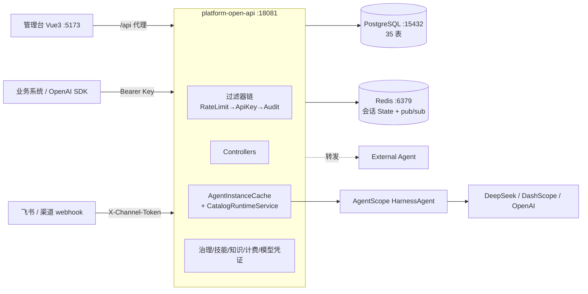
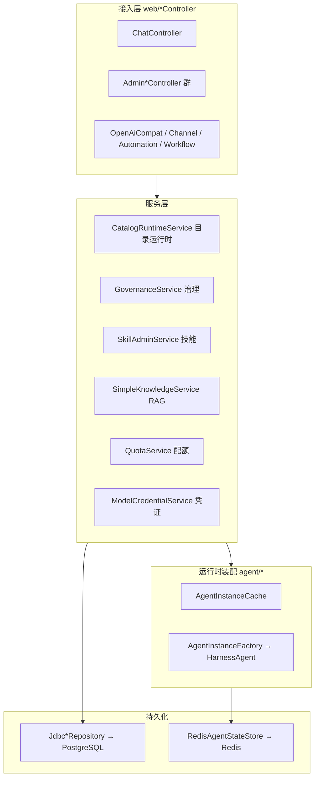
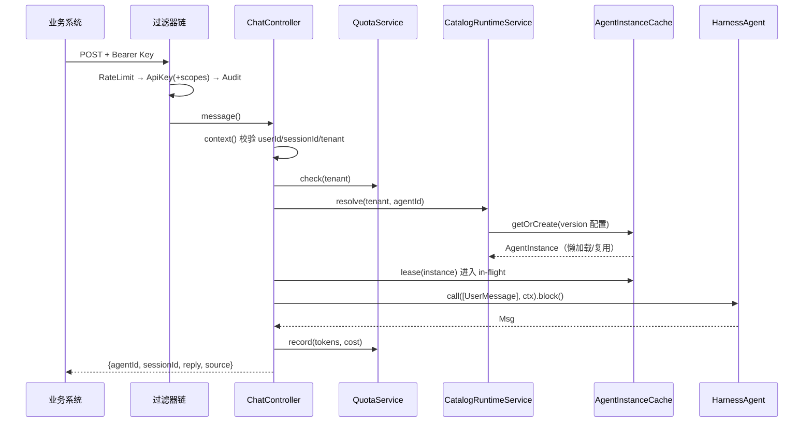
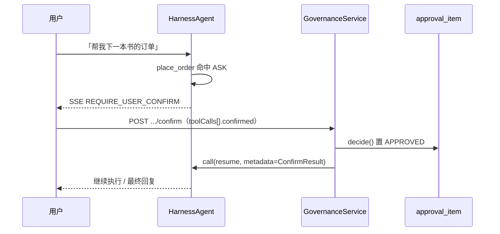
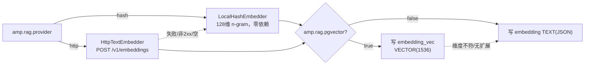

# AI 中台 · 源码导读

> 面向第一次接手本项目源码的开发者。目标：**读完这一篇，知道每一块代码在哪、为什么这样写、从哪下手改**。
>
> - 工程路径：`D:\sinosoft\江苏二期\基于JAVA的智能体应用平台`
> - 底座：**AgentScope Java 2.0.3**（`agentscope-harness` 提供 `HarnessAgent`）
> - 设计依据：[`AI中台设计文档.md`](AI中台设计文档.md)；可执行行为以代码/配置为准
> - 本文中所有 `file:line` 均以当前工作副本为准；行号会随改动漂移，**按类名+方法名定位更稳**

---

## 0. 阅读建议（先看这里）

| 你的目标 | 建议路线 |
| --- | --- |
| 只想跑起来 | §9 工程化与运行 → `README.md` 10 分钟跑通 |
| 想懂「一次对话怎么走完」 | §3.1 → §3.2 → §3.3 |
| 想加一个新接口 | §2 代码地图 → §7 API 地图 → 对应专题 |
| 想改治理/权限/技能/RAG | §4 专题 |
| 想看二期（编排/渠道/IAM） | §5 |
| 上线前 | §9 + §11 + `scripts/n4-check.ps1` |

**一条重要约定**：本项目「**定义即数据**」。Agent 的模型、提示词、权限、技能、知识都不写死在 Java 里，而是落 PG 表 + 管理台配置，运行时装配。所以读代码时请同时看 `db/schema.sql`。

---

## 1. 项目全景

### 1.1 一句话定位

把 AgentScope 的**推理循环、状态、权限、沙箱**当成底座复用；本项目只做中台增值部分：**目录与版本、Open API、治理、知识与技能、运营观测、多副本**。

### 1.2 技术栈

| 层 | 选型 | 版本/说明 |
| --- | --- | --- |
| 语言/构建 | Java + Maven | JDK **21**（`maven.compiler.release=21`），Maven 3.8+ |
| 框架 | Spring Boot | 3.5.5（`pom.xml:23`） |
| Agent 底座 | AgentScope Java | 2.0.3（harness / openai / dashscope / redis 扩展） |
| 关系库 | PostgreSQL | 宿主机 **15432**（容器 5432），库/用户 `amp`/`amp` |
| 会话状态 | Redis | 默认 `redis://127.0.0.1:6379`；Compose 映射 16379 |
| 前端 | Vue 3 + Vite + Element Plus | **不在 Maven reactor 内** |
| 指标 | Micrometer + Prometheus | `/actuator/prometheus` |
| 链路 | OpenTelemetry | `OtelBridge`，无 endpoint 时 logging 导出 |

### 1.3 工程结构

| 路径 | 角色 | 说明 |
| --- | --- | --- |
| `platform-common` | 公共 DTO | 仅 `ApiError`（`common/api/ApiError.java`），全项目最小的模块 |
| `platform-open-api` | 后端主工程 | 136 个 main 类 / ~11k 行；业务全在这里 |
| `platform-console-ui` | Vue3 管理台 | `App.vue` 单文件 ~1019 行 + 两个 api 模块 |
| `docs/` | 设计文档 + 本文 | |
| `scripts/` | 运维/演示脚本 | 启动、N4 自检、压测、External/ MCP mock |
| `docker-compose.yml` / `Dockerfile` | 全容器部署 | redis 16379、pg 15432、api 18081 |
| `.github/workflows/ci.yml` | CI | **只跑** `mvn -B -q verify`（不构建前端） |

### 1.4 代码规模（当前）

```text
platform-open-api/src/main/java   136 文件 · ~11,000 行
platform-open-api/src/test/java    36 文件 · ~ 2,400 行 · 123 个测试用例
platform-console-ui/src           App.vue(1019) api.js(212) api-extra.js(~240) style.css
db/schema.sql                     407 行 · 31 张唯一表（35 条 CREATE TABLE，含 2 处重复，见 §11）
```

### 1.5 运行时拓扑



---

## 2. 代码地图（后端包结构）

包根：`com.sinosoft.amp.openapi`（`platform-open-api/src/main/java/...`）。

| 包 | 文件 | 职责 | 代表类 |
| --- | --- | --- | --- |
| `web` | 17 | HTTP 入口：对话、管理台、运维、编排、OpenAI 兼容 | `ChatController`(712)、`OpenAiCompatController`(409)、`AdminCatalogController`、`AdminGovernanceController`、`WorkflowController` |
| `ops` | 21 | 观测与运维：指标、限流、审计、配置热更、多副本事件、日志 | `PlatformMetrics`、`RateLimitFilter`、`AuditFilter`、`RuntimeConfigService`、`ReleaseEventBus`、`OtelBridge`、`LokiLogClient`、`NacosConfigBridge` |
| `agent` | 11 | **运行时核心**：实例装配、缓存、切流、工具策略 | `AgentInstanceFactory`(259)、`AgentInstanceCache`(166)、`CatalogRuntimeService`(160)、`CatalogBootstrap`、`ToolPolicyApplier` |
| `catalog` | 8 | 目录与版本仓储 | `JdbcAgentCatalogRepository`、`AgentVersionRecord`、`EndpointRelease` |
| `orchestration` | 12 | 二期编排：Workflow/Team/Run | `WorkflowService`、`LocalWorkflowRunner`、`RuntimeWorkflowAgentInvoker`、`JdbcWorkflowRepository` |
| `channel` | 9 | 二期渠道：SPI + Mock + 飞书 | `ChannelAdapter`、`MockChannelAdapter`、`FeishuChannelAdapter`、`ChannelService` |
| `automation` | 3 | 二期定时/Webhook 触发 | `AutomationService`、`AutomationScheduler` |
| `iam` | 2 | 二期 RBAC | `IamService`、`RbacGuard` |
| `governance` | 7 | 权限三态、审批、MCP 登记与连通 | `GovernanceService`、`JdbcGovernanceRepository`、`McpConnectService`、`ApprovalItem` |
| `skill` | 8 | 技能市场与灰度 | `SkillAdminService`、`MarketplaceSkillRepository`、`SkillCanaryFilter`、`SkillRolloutService` |
| `knowledge` | 11 | RAG：切片、embedding、检索 | `SimpleKnowledgeService`(213)、`JdbcKnowledgeStore`、`HttpTextEmbedder`、`VectorCodec` |
| `billing` | 2 | 配额与用量 | `QuotaService`(228)、`AdminQuotaController` |
| `model` | 3 | 模型凭证 | `ModelCredentialService`、`JdbcModelCredentialStore` |
| `security` | 4 | API Key 鉴权与线程上下文 | `ApiKeyAuthFilter`、`AuthContext`、`AuthProperties` |
| `session` | 3 | 会话上下文与 SSE 缓冲 | `SessionContext`、`SseReplayBuffer` |
| `tool` | 4 | 进程内业务工具 | `OrderToolset`、`OrderBusinessTools`、`SandboxToolset` |
| `sandbox` | 2 | Docker 沙箱 | `DockerSandboxService` |
| `fs` | 3 | 远程文件系统（PG BaseStore） | `PgBaseStore`、`FsProperties` |
| `external` | 5 | 外部 Agent 注册/转发 | `ExternalAgentService`、`ExternalChatClient`(133) |

### 2.1 分层视图



**阅读顺序建议**：`ChatController` → `CatalogRuntimeService` → `AgentInstanceCache` → `AgentInstanceFactory`。这四个类走通，主链路就通了。

---

## 3. 核心链路走读

### 3.1 非流式对话

入口 `POST /api/v1/agents/{agentId}/messages`。



关键代码：

1. `ChatController.message` → `doMessage`（`web/ChatController.java:104` / `:116`）
2. 会话校验 `context()`（`:560`）→ `AuthContext.requireTenantId()` → `requireAgent()` → `SessionContext.require()`
3. 配额前置拦截 `quotas.check(tenant)`（`:120`）
4. **托管判定**：`catalogRuntime.resolve` 抛 `CatalogException` 即视为非托管，转而查 External 注册表（`:127`、`:132`）
5. 取实例 `catalogRuntime.resolve(tenant, agentId)`（`:141`）→ `instanceCache.lease(instance)`（`:142`）
6. 调模型 `lease.agent().call(List.of(new UserMessage(msg)), ctx).block()`（`:143`）
7. 收尾：`metrics.recordChat/recordTokens`（`:146`）+ `quotas.record`（`:153`）+ 会话日志 `sessionLogs.sessionEvent`（`:155`）
8. 响应体 `{agentId, sessionId, reply, source:"managed"}`（`:162`）

`CatalogRuntimeService.resolve`（`agent/CatalogRuntimeService.java:130`）解析顺序：
`requireActiveAgent` → `findRelease`（无则 `NO_RELEASE`）→ `findVersion`（archived 拒绝）→ draining 防御 → `instances.getOrCreate`。
**注意**：每次请求都读 PG 的 `endpoint_release` 指针，所以发布切流能立刻被所有副本感知。

### 3.2 流式对话（SSE）

入口 `POST /api/v1/agents/{agentId}/messages:stream`（**带冒号**，用 POST + fetch，不是 EventSource）。

差异点（`web/ChatController.java:174` 起）：

| 环节 | 非流式 | 流式 |
| --- | --- | --- |
| 调用 | `call(...).block()` | `streamEvents(...).subscribe(...)`（`:284`） |
| 返回 | JSON body | `SseEmitter`，帧 `id:{sessionId}:{seq}` |
| 事件 | 无 | 每帧转 JSON `buildEventJson`（`:576`） |
| 断线 | — | `Last-Event-ID` 续传（见 §4.4） |
| 收尾 | 直接 record | `releaseOnce`（`:267`）保证 lease/缓冲/指标恰好一次 |

帧写出发送：`sendFrame` 用 `.id(frame.id).name(frame.event).data(frame.data)`（`:617`）。

事件 JSON 结构（`buildEventJson`）：
- 固定 `type` / `id` / `source`
- `TextBlockDeltaEvent` → 追加 `delta`、`replyId`
- `RequireUserConfirmEvent` → 追加 `replyId`、`toolCalls[]`（HITL 用）
- 序列化失败兜底只发 `type`

### 3.3 实例缓存与版本切流（最核心的机制）

**为什么需要**：Agent 实例构建昂贵（要连模型、装工具、挂 MCP、建 FS），且必须并发安全。

`agent/AgentInstanceCache`：

| 机制 | 实现 | 位置 |
| --- | --- | --- |
| key | `tenantId:agentId:version` | `:39` |
| 懒加载 | 快路径 get → `synchronized` 双检 → 建实例 | `:46`-`:67` |
| 容量 | `max-instances` 默认 50，超限抛 `INSTANCE_CAPACITY` | `:157` |
| in-flight | `AgentInstance.inFlight`（`AtomicInteger`） | `agent/AgentInstance.java:19` |
| 租借 | `lease(instance)` → `Lease.close()` 保证 `exit()` 一次 | `:169`-`:192` |
| 排空 drain | `beginDrain` 标记 → `sweepDrained` 在 in-flight 归零或超时后 evict | `:83` / `:94` |
| 驱逐 | `evictTenant(tenant)` 按前缀清该租户全部实例 | `:130` |

排空超时 `drain-timeout-ms` 默认 **120000**，由 `AgentDrainScheduler.sweep` 每 `drain-sweep-ms`（默认 5000）扫描一次（`agent/AgentDrainScheduler.java:22`）。

**发布切流** `CatalogRuntimeService.publishAndSwitch`（`:84`）：

```text
1. 校验 agent active + version 存在（archived → VERSION_ARCHIVED）
2. 读当前 EndpointRelease 得 fromVersion
3. 先 getOrCreate(目标版本) —— build 失败就不切流（关键安全点）
4. upsertRelease 改指针（原子）
5. switchRelease：目标必须已 ready（否则 VERSION_NOT_READY），旧版 beginDrain
6. 目标置 PUBLISHED；旧版 PUBLISHED → DRAINING
7. sweepDrained 清一波
8. ReleaseEventBus 广播 release_switch 给其他副本
```

**多副本一致性**：`ops/ReleaseEventBus` 用 Redis pub/sub，channel `amp:events:runtime`（`:27`），消息带 `origin=replicaId`；本副本自己发的消息在 `handleMessage` 里跳过（`:157`）。
`ops/ReleaseEventHandler.onEvent`：`release_switch` → 本地 `beginDrain(from)`；`tenant_evict` → `evictTenant`。
副本名取 `AMP_REPLICA_ID`，开关 `amp.events.enabled`（默认 true）。

> 设计取舍：**指针存 PG**（强一致、每次请求可读），**缓存失效走 pub/sub**（最终一致、秒级）。这是「无状态运行时 + 分布式状态」原则的落地。

### 3.4 Agent 实例装配：`AgentInstanceFactory.create`

`agent/AgentInstanceFactory.java:153` 起，装配顺序与其容错策略：

| 步骤 | 内容 | 失败行为 |
| --- | --- | --- |
| 1 | 参数回退：model / sysPrompt / workspace（`blankTo`） | — |
| 2 | `RedisAgentStateStore`（keyPrefix 默认 `amp:session:`） | 抛错 |
| 3 | `HarnessAgent.builder()`：name/sysPrompt/model/workspace/stateStore/`stopOnReject(true)`/`enablePendingToolRecovery(true)`/`disableMemoryTools`/OTel 中间件 | — |
| 4 | 工具面收紧：按 `ToolPolicyProperties` 关 shell / filesystem / subagents | — |
| 5 | **模型凭证**：`modelResolver` ← `ModelCredentialService.resolveModel` | 回退环境变量 |
| 6 | `toolsConfig(new ToolPolicyApplier(policy).apply())` | — |
| 7 | `permissionContext(governance.buildPermissionContext(...))` | **try/catch warn，不挡 build** |
| 8 | MCP：注入已登记 server（`setMcpServers`） | **软失败**（短超时） |
| 9 | 技能：`MarketplaceSkillRepository` + `enableSkillPromotionGate(RejectAllGate, SkillCanaryFilter)` | — |
| 10 | Remote FS：`filesystem(RemoteFilesystemSpec)` + `distributedStore(State=Redis, Base=PG)` | 视 `amp.fs.mode` |
| 11 | `build()` 后按策略注册 `OrderToolset` / `KnowledgeToolset` / `SandboxToolset` | — |

**容错设计一句话**：模型/权限/MCP/技能全部「失败即降级或 warn」，**只有 `build()` 失败会向外交付错误**，进而让发布失败（不切流）。

`tenantId` 来源 `resolveTenant()`：系统属性 `amp.default.tenant`（由 `CatalogBootstrap` 启动时写入）→ 环境变量 `AMP_TENANT_ID` → 默认 `acme`（`:287`）。

### 3.5 启动播种 `CatalogBootstrap`

`agent/CatalogBootstrap.java`：应用启动时确保有可演示的初始数据——
`demo` agent + v1 版本 + `endpoint_release` 指针 + 权限规则（`place_order`=ASK / `query_orders`=ALLOW）+ 业务工具登记 + 示例知识文档。
空目录也能直接跑通 Demo，这就是「Walking Skeleton」的兜底。

---

## 4. 关键机制专题

### 4.1 鉴权：API Key + scopes

配置：`amp.auth.keys[*]`（`application.yml:73`）→ `security/AuthProperties.KeyEntry(key, tenantId, agents, scopes)`。

| Key | scopes | 用途 |
| --- | --- | --- |
| `s0-demo-key`（`AMP_API_KEY`） | `[open]` | 业务对话 / 会话接口 |
| `s0-admin-key`（`AMP_ADMIN_API_KEY`） | `[open, admin]` | 管理台 / 运维 / 审计 / 配额 |

过滤器 `security/ApiKeyAuthFilter`（`@Order(HIGHEST+10)`）：

| 规则 | 位置 |
| --- | --- |
| 覆盖范围：`/api/*` 与 `/v1/chat/*` | `:35`-`:46` |
| 放行：`/api/v1/health/**`、channel/automation `webhook`、`amp.auth.enabled=false` | `:39`-`:44` |
| 缺 Key → 401 `MISSING_API_KEY`；未知 Key → 401 `INVALID_API_KEY` | `:55` / `:61` |
| `/api/v1/admin/**` 需 `admin` scope，其余需 `open`；不满足 → **403 `INSUFFICIENT_SCOPE`** | `:66`-`:70` |
| scope 未配置时**不限制**（兼容旧配置/单测） | `AuthProperties:46` |

`security/AuthContext` 用 `ThreadLocal<KeyEntry>`，过滤器 `set` 后 `finally clear`（`:72`/`:75`）。提供 `requireTenantId` / `requireAgent` / `requireAdmin` / `actorLabel`（租户+Key 末 4 位打码）。

**两条硬约定**：
1. **tenantId 以 Key 为准**，请求体传了就必须一致，否则 400。
2. 管理面在 `/api/v1/admin/**` 下（不是裸 `/admin`），否则不会被过滤器保护——这是踩过的坑，见 §11。

过滤器顺序：`RateLimit(HIGHEST+5)` → `ApiKeyAuth(+10)` → `Audit(+30)`。

### 4.2 审计

`ops/AuditFilter`：
- 只审计**写方法**（POST/PUT/PATCH/DELETE）且命中：`/api/v1/admin`、`/confirm`、`/interrupt`、`/publish`、`:publish`（`:33`）
- action 映射 `resolveAction`（`:85`）：`HITL_CONFIRM` / `SESSION_INTERRUPT` / `VERSION_PUBLISH` / `SKILL_APPROVE|REJECT|ARCHIVE` / `HITL_DECIDE` / `CONFIG_UPDATE` / `PERMISSION_CHANGE` / `MCP_REGISTER` / `EXTERNAL_REGISTER` / `KNOWLEDGE_WRITE`，兜底 `ADMIN_{METHOD}`

落库 `ops/AuditLogService.record`（`:28`）写 `audit_log`：`tenant_id/actor/action/resource_*/method/path/detail/status_code/duration_ms/created_at`。**写失败只 warn，不阻断业务**（`:51`）。
查询：`GET /api/v1/admin/audit?limit=50`（`ops/AdminAuditController`，需 admin）。

### 4.3 会话上下文与错误码

`session/SessionContext.require`（`:13`）：
- tenant / userId / sessionId 均非空
- `sessionId` 正则 `[A-Za-z0-9_-]{1,128}`
- 用户作用域 = `tenantId_userId`

| 场景 | HTTP | code |
| --- | --- | --- |
| sessionId 非法 / 缺参 / userId 缺失 | 400 | `SESSION_CONTEXT_INVALID` |
| tenantId 与 Key 不符 | 400 | `SESSION_CONTEXT_INVALID` |
| 无 Key / Key 无效 | 401 | `MISSING_API_KEY` / `INVALID_API_KEY` |
| Key 无对应 scope | 403 | `INSUFFICIENT_SCOPE` |
| Key 不允许该 agent | 403 | `FORBIDDEN` |
| 重复确认审批 | 409 | `APPROVAL_ALREADY_RESOLVED` |
| 超额 | 业务错误 | `QUOTA_EXCEEDED` |
| 续传缓冲过期 | SSE ERROR 帧 | `SSE_RESUME_MISS` |
| 限流 | 429 | `RATE_LIMITED` |
| External 故障 | — | `EXTERNAL_UNHEALTHY` / `EXTERNAL_CHAT_FAILED` |

### 4.4 SSE 断线续传

`session/SseReplayBuffer`：

| 项 | 值 |
| --- | --- |
| 帧 id | `{sessionId}:{seq}`（`append` 自增 seq，`:73`） |
| 缓冲 TTL | `amp.sse.replay-ttl-ms` 默认 **30000ms** |
| 解析 | `parseSeq(lastEventId, sessionId)`：session 不匹配或非数字 → -1（`:120`） |

`ChatController.stream` 的续传分支（`:191` 起）：

```text
有 Last-Event-ID？
├─ parseSeq < 0            → SSE_RESUME_MISS（客户端应用 history 兜底）
├─ buffer 找不到            → SSE_RESUME_MISS
├─ after(lastSeq) 空且未完成 → SSE_RESUME_MISS
└─ 否则逐帧重放后 complete
```

`SSE_RESUME_MISS` 作为 `event=ERROR` 帧发送（`:628`）。**客户端兜底**：拿 history 补齐历史消息。

### 4.5 HITL：权限三态 → 审批 → 恢复

**数据模型**（`db/schema.sql`）：
- `permission_rule(tenant, agent, tool_name, rule_content, behavior)` — behavior ∈ ALLOW / ASK / DENY
- `agent_permission_mode(tenant, agent, mode)` — DEFAULT / 其他模式
- `approval_item` — 状态 PENDING / APPROVED / REJECTED / EXPIRED

**装配**：`governance/GovernanceService.buildPermissionContext`（`:34`）把表记录转成 AgentScope 的 `PermissionContextState`，分别 `addAllowRule` / `addDenyRule` / `addAskRule`（`:49`-`:55`）。

**流转**：



- 落库：流里收到 `RequireUserConfirmEvent` → `maybePersistApproval`（`ChatController:507`）建 `ApprovalItem(PENDING)`；`openApproval` 按 `idempotencyKey` 幂等（`GovernanceService:140`）
- 恢复：`POST .../sessions/{sid}/confirm`（`ChatController:363`）→ 组 `ConfirmResult`（优先显式 toolCalls → approvalId → 会话全部 pending）→ 写入 metadata `METADATA_CONFIRM_RESULTS` → `call(resume)` 续跑
- 幂等：重复确认 → 409 `APPROVAL_ALREADY_RESOLVED`（`decide:166`）
- 审批箱：`GET /api/v1/admin/inbox`、`POST /api/v1/admin/approvals/{id}/decide`

> **踩过的坑**：自定义 `AgentTool` 实现会绕过权限引擎；**必须用 `@Tool` 注解类**（`ReflectiveFunctionTool extends ToolBase`）才能命中 ASK。现有工具见 `tool/OrderToolset`、`tool/OrderBusinessTools`。

### 4.6 技能市场与灰度

**生命周期**：`DRAFT` → （人工审核）→ `APPROVED` / `REJECTED` → `ARCHIVED`。

`skill/SkillAdminService`：

| 方法 | 行为 |
| --- | --- |
| `upload` | 落 DRAFT，重名+版本则覆盖 |
| `approve` | 写 `skill_review` + 置 APPROVED + **驱逐实例缓存并广播** |
| `reject` / `archive` | 同理改状态 + 驱逐 |

**「审后下轮生效」的原理**（`evictAndBroadcast:41`）：
`instanceCache.evictTenant(tenant)` + `eventBus.publishTenantEvict(...)` → 下次请求会重建 `HarnessAgent`，重新加载技能列表 → 新技能自然生效。**不需要重启**。

**强制只读** `skill/MarketplaceSkillRepository`：
- `getAllSkills` 只取 APPROVED（`:58`）
- `save` / `delete` 直接返回 false 并 warn（`:69`/`:76`）
- `setWriteable` **锁死 false**（`:97`）——生产禁止 autoPromote / write-through

**灰度 Canary**（两层实现，注意区分）：

| 实现 | 位置 | 机制 |
| --- | --- | --- |
| 运行时过滤 | `skill/SkillCanaryFilter` | 读取技能 metadata（`environments`、`rolloutPercent`），按 `(userId\|skillName)` 稳定哈希取模 100 命中 |
| DB 驱动 | `skill/SkillRolloutService` + `skill_rollout` 表 | stage = CANARY / GA / ROLLBACK，CRC32 `%100 < percent` |

配置：`amp.skill.canary.environment` / `default-percent` / `percents.<name>` / `allowed-environments`。

### 4.7 RAG（知识与检索）

**入库**：`knowledge/SimpleKnowledgeService.ingest` → 切片 → embedding → 落 `knowledge_document` + `knowledge_chunk`。

| 参数 | 值 |
| --- | --- |
| `CHUNK_SIZE` | 360 字符（`:31`） |
| `CHUNK_OVERLAP` | 40 字符（`:32`） |
| 切分 | 优先在换行处回退切（`split:203`） |

**Embedding 三条路径**：



**检索**：`search`（`:91`）topK 默认 5 上限 10，用 `VectorCodec.cosine`，score > 0.01 保留；
pgvector 开启时走 `embedding_vec <=> CAST(:q AS vector)`，**任何异常都回退 JSON 全表余弦**（`JdbcKnowledgeStore.searchByVector:98`）。

**引用格式**：`[docId#chunkId]`（chunkId = `docId_{index}`），由 `KnowledgeToolset` 的 `knowledge_search` 工具返回给模型，便于审计追溯。

### 4.8 配额与计费

| 表 | 字段 |
| --- | --- |
| `tenant_quota` | `monthly_token_limit`、`monthly_request_limit`（**0 = 不限**） |
| `usage_ledger` | `prompt_tokens`、`completion_tokens`、`cost_micros`、`source` |

时机：**调用前** `check`（超额抛 `QUOTA_EXCEEDED`），**成功后** `record`（失败只 warn，`QuotaService:53`）。
本月用量按 **UTC 月初**统计（`monthUsed:227`）。

成本口径（雏形）：
`costMicros = totalTokens * tokenCostPer1k / 1000`，`estimateTokens = 字符数 / tokenCharsPerToken`（`ops/PlatformMetrics:82`/`:90`）。
默认 `chars=3`、`costPer1k=2`，可通过 `ops/RuntimeConfigService` 或管理 API **热更**。

Admin：`GET/POST /api/v1/admin/quotas`、`GET /api/v1/admin/usage`、`/usage/report?year=&month=`、`/usage/export?from=&to=`（CSV）。

### 4.9 模型凭证

- 表 `model_credential(tenant, provider, api_key, base_url, enabled)`，PK = tenant + provider
- provider 从 modelId 冒号前解析：`deepseek:deepseek-flash` → `deepseek`（`ModelCredentialService.providerOf:34`）
- **打码**：≤8 位返回 `****`，否则 `****` + 末 4 位（`mask:43`）；列表只回 `apiKeyMasked`
- 运行时注入：`resolveModel`（`:101`）组 `ModelCreationContext(apiKey, baseUrl)` → `ModelRegistry.resolve(modelId, ctx)`；库内优先，环境变量回退
- 装配点：`AgentInstanceFactory:187` 的 `modelResolver`

> **与 toolPolicy 正交**：凭证只决定「用什么 Key 调模型」，`amp.tools.*` 只决定「给模型哪些工具」。

### 4.10 沙箱 / 远程 FS / External

**Docker 沙箱**（默认**关**，`amp.sandbox.enabled=false`）：
`DockerSandboxService.buildRunArgs`（`:43`）安全边界——`--network=none`、`--read-only`、`--tmpfs /tmp:size=32m`、`no-new-privileges`、`--cap-drop ALL`、`--user 65534`、内存/CPU/pids 限额；超时强杀并 `docker rm -f`。
`IsolationScope` 只允许 USER / SESSION，**GLOBAL 自动降级 USER**（`:141`）。工具名 `sandbox_exec`，默认 ASK。

**远程 FS**：`fs/PgBaseStore` 实现 AgentScope `BaseStore`，落 `base_store(path_key, item_name, payload, version)`；
`putIfVersion` 乐观锁（`:84`）；装配为 `RemoteFilesystemSpec` + `DistributedStore`（**State=Redis，Base=PG**），默认 `amp.fs.mode=remote` → 双副本共享工作区。

**External Agent**：

| 能力 | 端点/约定 |
| --- | --- |
| 注册 | `POST /api/v1/admin/external-agents`（name + baseUrl + callbackKey） |
| 心跳 | `POST .../{id}/heartbeat`；超时 90s → `UNHEALTHY` |
| 非流式转发 | 平台 POST `{baseUrl}/api/v1/messages`，接受 `reply` / `text` / `message` |
| 流式转发 | 平台 POST `{baseUrl}/api/v1/messages:stream`，逐行透传 SSE |
| 鉴权 | 注册了 `callbackKey` 时带 `X-Callback-Key` |

路由判定在 ChatController：**托管目录没有该 agentId** 且 External 已注册且健康 → 转发（`:132`、`:229`）。演示脚本：`scripts/external-sse-mock.py` + `scripts/demo-external-stream.ps1`。

---

## 5. 二期模块

### 5.1 编排 Workflow

**模型**：`WorkflowDefinition`（含 `steps`）→ `WorkflowStep(id, type, agentId, input, prompt, next)`，类型 `ECHO | AGENT | HUMAN_GATE`（`orchestration/WorkflowDefinition.java:35`），构造时即校验非法类型；`next` 为空即终态。

**四张表**：`workflow_def`（定义）→ `workflow_revision`（发布快照）→ `workflow_run`（一次运行）→ `workflow_step_run`（每步记录）。

**仓储双实现**：
- `JdbcWorkflowRepository`（生产，PG upsert）
- `InMemoryWorkflowRepository`（单测，ConcurrentHashMap）

**执行**：`LocalWorkflowRunner`（P2-B1 降级路径）
- `start` → 置 RUNNING → `advance`（`:121`）按 `next` 循环
- `executeStep`（`:151`）分派：ECHO 回显；AGENT 调 `agentInvoker.invoke`；HUMAN_GATE 记 `pendingGates` 并置 `WAITING_CONFIRM`
- 每步先写 RUNNING、后写 SUCCEEDED/FAILED **两条**记录

**Agent 调用抽象** `WorkflowAgentInvoker`：
- `EchoWorkflowAgentInvoker` — 占位（`@ConditionalOnMissingBean`）
- `RuntimeWorkflowAgentInvoker` — **`@Primary` 真实实现**（`:26`）：配额 check → 托管则 lease 实例 `call`，非托管走 External → 收尾 `metrics` + `quotas.record(source="workflow")`

**状态机**（`WorkflowService:23`）：`PENDING → RUNNING → WAITING_CONFIRM → SUCCEEDED / FAILED / CANCELLED`。
`confirm`（`:65`）从 `pendingGates` 取门闩；**进程重启后**按 `current_step` + revision 定义恢复（`:71`-`:87`）。`cancel` 幂等。

`RunEventBus`（`:16`）是**进程内**短窗事件表（runId → 最多 200 条），只为 SSE/轮询展示，**未接 Redis** → 跨副本看不到对方的事件。

### 5.2 Team

表 `team`（leader_agent_id / status）+ `team_member`（role_name 默认 member）。
`TeamService` 提供 upsert / get / list；`createTask`（`:89`）是**占位实现**，返回 `engine=local-placeholder`，**未真正调度**。按设计决议，Team 的长期路线是「对接 AgentScope Service」，不自研。

### 5.3 Channel（渠道接入）

**SPI** `ChannelAdapter`：`channelType` / `verifySignature` / `parseInbound` / `deliver`（`channel/ChannelAdapter.java:6`）。

| 适配器 | type | 校验 | 说明 |
| --- | --- | --- | --- |
| `MockChannelAdapter` | `mock` | `X-Channel-Token`（默认 `mock-channel-token`） | deliver 只存内存 |
| `FeishuChannelAdapter` | `feishu` | `amp.channel.feishu.verify-token`，兼容 challenge/url_verification | 解析 `event.message.content`、`sender.sender_id.open_id`；deliver 走 `FeishuMessageSender` |

`FeishuMessageSender`：`tenant_access_token` + `im/v1/messages?receive_id_type=open_id`，带 token 缓存；**未配 app-id 时降级为打日志**。

**鉴权特殊**：webhook **不走 API Key**——`ApiKeyAuthFilter.shouldNotFilter` 显式放行 `/api/v1/channels/**/webhook` 与 `/api/v1/automations/**/webhook`（`:39`-`:44`），改由适配器校验渠道 token。这是有意的（渠道方无法持有平台 Key）。

`ChannelService.handleInbound`（`:43`）流程：verify → parse → 拼 sessionId（`ch-` + threadId/userId）→ 解析租户 → `bindings.resolveAgent`（默认 `demo`）→ invoke → deliver。
`ChannelBindingService` 管理 channel ↔ agent 绑定（表 `channel_binding`），secret 输出打码。

### 5.4 Automation（定时 / Webhook 触发）

表 `automation_trigger(type=WEBHOOK|CRON, cron_expr, secret, target_workflow_id, next_due_at, last_fired_at)`。

`AutomationScheduler.sweep`（`@Scheduled`，`amp.automation.sweep-ms` 默认 30000）→ 找出到期的 CRON 触发器 → `fire`（`:58`）。
**注意**：fire 时会合成一个 `KeyEntry(tenant, scopes=[open,admin])` 塞进 `AuthContext`，然后 `workflows.startRun(...)`——所以定时任务具备启 Run 的权限。
Webhook 版走 `POST /api/v1/automations/{id}/webhook`（头 `X-Automation-Secret`），**本身不启 Run**，只记录触发。
多副本无 DB 锁 → 属 **best-effort**，可能重复触发。

### 5.5 IAM / RBAC

`iam/IamService` 内置 6 角色：`tenant_admin`（全权）、`ops`、`skill_reviewer`、`auditor`、`developer`、`agent_caller`（`:36`-`:52`）。
权限点命名 `域:动作`，如 `orch:read|write|run`、`iam:admin`、`billing:read|write`、`skill:review`、`agent:call`。

`iam/RbacGuard.require(permission)`（`:32`）判定顺序：

```text
1. API Key 含 admin scope → 直接放行（运维/管理台路径）
2. userId ← 请求头 X-User-Id（缺省用 AuthContext.actorLabel）
3. roles  ← 请求头 X-User-Roles（逗号分隔）→ 否则 iam.rolesOf(userId) → 否则 agent_caller
4. hasPermission（tenant_admin 全通过）
```

**两层鉴权是独立的**：`ApiKeyAuthFilter` 管「Key 有没有 admin scope」，`RbacGuard` 管「这个用户在租户内有没有该权限点」。

> ⚠️ **已知不一致**：schema 里有 `iam_user` / `iam_role` / `iam_user_role` / `iam_role_permission` 四张表，但 `IamService` 实际用 **内存 `ConcurrentHashMap`**（`:32`/`:34`）——**角色与授权未落库，重启即丢**。生产化需要补齐（见 §11）。

### 5.6 OpenAI 兼容入口

`web/OpenAiCompatController`：`@RequestMapping({"/api/v1/chat", "/v1/chat"})` + `POST /completions`
→ 即 `POST /api/v1/chat/completions` 与 `POST /v1/chat/completions`（后者覆盖 OpenAI SDK 默认 base_url）。

| 项 | 处理 |
| --- | --- |
| `model` | 映射为 agentId（`resolveAgentId:85`），空则 404 `model_not_found` |
| 取 user 文本 | 最后一条 `role=user`（`extractLastUserText:100`） |
| sessionId | `X-Session-Id` 头，否则随机 |
| 非流式 | `buildChatCompletion`（`:162`），含 `usage` |
| 流式 | 先发 role chunk，逐 `TextBlockDeltaEvent` 发 content chunk，末尾 `finish_reason=stop` + `data: [DONE]`（`:334`） |
| 错误体 | OpenAI 风格 `{error:{message,type,code,param}}`（`:218`）；`CatalogException` → 404/429/409/400（`:366`） |

> 过滤器覆盖 `(?:/api/*, /v1/chat/*)`——`/v1/chat/*` 是**为这个控制器专门加的**，否则 OpenAI 风格路径会绕过鉴权。

---

## 6. 数据模型（PostgreSQL，31 张唯一表）

`db/schema.sql` 由 `spring.sql.init` 启动执行（`mode: always`），全部 `IF NOT EXISTS` / `ON CONFLICT`，可重复执行。
（该文件共 35 条 `CREATE TABLE`，其中 `automation_trigger`、`skill_rollout` 各重复 3 次 → 实际 31 张表，见 §11 第 2 条。）

| 分组 | 表 | 说明 |
| --- | --- | --- |
| **目录** | `agent`、`agent_version`、`endpoint_release` | 版本 + 切流指针（指针是切流真相源） |
| **治理** | `permission_rule`、`agent_permission_mode`、`approval_item` | 权限三态 + 审批单 |
| **工具** | `mcp_server`、`business_tool` | MCP 登记、业务工具登记 |
| **技能** | `skill`、`skill_review`、`skill_rollout` | 市场 + 审核记录 + 灰度 |
| **知识** | `knowledge_document`、`knowledge_chunk` | 文档与切片（含 `embedding` / `embedding_vec`） |
| **外部** | `external_agent` | 注册 / 心跳 / 状态 |
| **存储** | `base_store` | 远程 FS（path_key + item_name + version） |
| **审计/计费** | `audit_log`、`tenant_quota`、`usage_ledger` | 审计、配额、用量流水 |
| **凭证** | `model_credential` | provider 级 API Key（打码对外） |
| **编排** | `workflow_def`、`workflow_revision`、`workflow_run`、`workflow_step_run`、`team`、`team_member` | 二期 Workflow / Team |
| **IAM** | `iam_user`、`iam_role`、`iam_user_role`、`iam_role_permission` | ⚠️ 建表但代码未用（见 §5.5） |
| **渠道/自动化** | `channel_binding`、`automation_trigger` | 渠道绑定、定时/Webhook 触发 |

Redis 侧：

| 用途 | key / channel |
| --- | --- |
| 会话状态 | `amp:demo:session:` 前缀（`amp.agent.state-key-prefix`），由 `RedisAgentStateStore` 管理 |
| 多副本事件 | channel `amp:events:runtime`（`ReleaseEventBus`） |

**会话续聊能跨副本**是因为 State 在 Redis 而非进程内存——S8 演练「杀一副本会话不丢」就靠这条。

---

## 7. API 地图

除 `/api/v1/health/**` 与渠道 webhook 外，均需 `Authorization: Bearer <key>`。

**业务 Open API（open scope）**

| 方法 | 路径 | 说明 |
| --- | --- | --- |
| GET | `/api/v1/agents` | 当前 Key 可访问的 agent 列表 |
| GET | `/api/v1/agents/{id}/versions` | 版本列表 + 当前 release |
| POST | `/api/v1/agents/{id}/messages` | 非流式对话 |
| POST | `/api/v1/agents/{id}/messages:stream` | **流式 SSE**（注意冒号） |
| GET | `/api/v1/agents/{id}/sessions/{sid}/history` | 历史 |
| POST | `/api/v1/agents/{id}/sessions/{sid}/interrupt` | 打断 |
| GET | `/api/v1/agents/{id}/sessions/{sid}/approvals` | 待确认工具 |
| POST | `/api/v1/agents/{id}/sessions/{sid}/confirm` | 批准/拒绝后恢复 |
| GET | `/api/v1/health/ready` · `/replica` | 就绪探针（**免 Key**） |
| POST | `/api/v1/chat/completions`、`/v1/chat/completions` | OpenAI 兼容 |

**管理台（admin scope）** —— 全部在 `/api/v1/admin/**`：

| 域 | 端点 |
| --- | --- |
| 目录 | `POST /agents`、`POST /agents/{id}/versions`、`POST .../versions/{v}/publish`、`GET /runtime/instances` |
| 治理 | `/governance/permissions`、`/governance/permission-mode`、`/mcp-servers`、`/business-tools`、`/inbox`、`/approvals/{id}/decide` |
| MCP | `POST /mcp-servers/{name}/test`、`GET /mcp-servers/{name}/tools` |
| 技能 | `/skills`、`/skills/visible`、`/skills/{id}/approve|reject|archive`、`/skills/rollouts`、`/skills/{id}/rollout/canary|ga|rollback` |
| 知识 | `POST /knowledge/documents`、`GET /knowledge/documents`、`GET /knowledge/search` |
| 外部 | `/external-agents`、`/external-agents/{id}/heartbeat` |
| 运维 | `/config`、`/metrics/summary`、`/audit`、`/nacos`、`/otel`、`/loki/*`、`/fs/*`、`/sandbox/*` |
| 配额 | `/quotas`、`/usage`、`/usage/report`、`/usage/export` |
| 凭证 | `/model-credentials`（GET/POST/DELETE） |
| IAM | `/iam/roles`、`/iam/users`、`/iam/users/{uid}/roles/{role}` |

**二期（混合 scope）**：`/api/v1/workflows/**`、`/api/v1/runs/**`、`/api/v1/teams/{id}`、`/api/v1/channels/{type}/webhook`（渠道 token）、`/api/v1/automations/{id}/webhook`、`/api/v1/admin/channel-bindings`、`/api/v1/admin/automations`。

**Prometheus**：`GET /actuator/prometheus`（`management.endpoints.web.exposure.include`，`application.yml:22`）。

---

## 8. 前端结构（platform-console-ui）

**职责**：管理台 / 调试台。**不参与 Maven 构建**，也不在 CI 里。

| 文件 | 说明 |
| --- | --- |
| `src/App.vue` | ~1019 行单文件；`<script setup>` + 全部页面模板 |
| `src/api.js` | 一期核心 API：agents/versions/sessions/skills/knowledge + **`streamChat`** |
| `src/api-extra.js` | 二期与运维 API：治理/MCP/配额/审计/凭证/编排等，复用 `api.js` 的 `headers()` |
| `src/main.js` | 挂 Element Plus + 全量注册图标 |
| `src/style.css` | 蓝白浅色壳层 + 控件宽度统一 |
| `vite.config.js` | dev :5173，`/api` 代理 → 127.0.0.1:18081 |

**8 个工作区**（`App.vue:35`-`:44`）：
`对话 Playground` · `目录与版本` · `HITL/External` · `技能市场` · `知识库 RAG` · `治理/MCP/工具` · `编排 Workflow` · `运维观测`。

**双 Key 设计**（`:27`/`:29`）：顶栏两个输入框，Open Key 用于对话，Admin Key（`akey()`）用于所有管理接口——与后端 scopes 一一对应。

**SSE 客户端实现**（`api.js:173` `streamChat`）：用 `fetch` POST + `ReadableStream` 手工解析 `id:` / `event:` / `data:` 帧，支持 `Last-Event-ID` 续传。
⚠️ **不能用 `EventSource`**——它不支持 POST。

**前端尚未接入**：Channel / Automation（仅后端 + 脚本暴露）；Team / Workflow 已接（`orch` 页签）。

---

## 9. 工程化与运行

### 9.1 依赖前置

| 组件 | 默认地址 | 备注 |
| --- | --- | --- |
| JDK | 21 | `pom.xml` `maven.compiler.release=21` |
| PostgreSQL | `127.0.0.1:15432`，`amp`/`amp` | **缺 PG 应用起不来**（`spring.sql.init` 要建表） |
| Redis | `redis://127.0.0.1:6379` | Agent 会话 State |
| 模型 Key | `DEEPSEEK_API_KEY` / `DASHSCOPE_API_KEY` / `OPENAI_API_KEY` | 也可用管理台模型凭证覆盖 |

### 9.2 常用命令

```powershell
mvn -B verify                                      # 构建 + 单测（CI 同款）
mvn -pl platform-open-api -Dtest=ChatHttpContractTest test
mvn -pl platform-open-api -am spring-boot:run       # 起后端 :18081
cd platform-console-ui; npm install; npm run dev    # 起前端 :5173
```

**单测不依赖 Redis/PG/模型**——仓库刻意让 `mvn verify` 能独立跑通（内存仓储 + mock）。

### 9.3 脚本一览（`scripts/`）

| 脚本 | 用途 |
| --- | --- |
| `run-api-18081.cmd` / `run-api-18082.cmd` | 双副本启动（配 `AMP_REPLICA_ID`） |
| `restart-18081.ps1` | 重启后端 |
| `n4-check.ps1` | **上线自检**：ready / Open Key 被拒 admin / 审计 / 凭证打码 / 默认 Key 是否已轮换 |
| `smoke-load.ps1` | 冒烟压测，输出 p50/p95/p99，p95>5s 警告（退出码 0/1/2） |
| `external-sse-mock.py` + `demo-external-stream.ps1` | External 流式透传演示（mock :19099） |
| `mcp-demo-server.py` | MCP 演示 Server（工具 `echo_time`） |
| `start-open-api.ps1` / `.cmd` | ⚠️ **内含硬编码模型 Key，勿抄进代码/文档** |

### 9.4 CI 与容器

- `.github/workflows/ci.yml`：JDK 21 + `mvn -B -q verify`。**不构建前端**，**无 lint**（仓库未配 Spotless/ESLint）。
- `docker-compose.yml`：redis 16379→6379、postgres 15432→5432、open-api 18081→8080；loki / nacos 默认注释掉。

---

## 10. 三条阅读路线

**A. 主链路（约 2 小时）**
`ChatController` → `SessionContext` → `CatalogRuntimeService` → `AgentInstanceCache` → `AgentInstanceFactory` → `db/schema.sql`（前 30 行）

**B. 治理链路（约 2 小时）**
`ApiKeyAuthFilter` → `AuthContext` → `AuditFilter`/`AuditLogService` → `GovernanceService`（权限三态）→ `ChatController.confirm`（HITL 闭环）→ `ToolPolicyApplier`

**C. 二期链路（约 2 小时）**
`WorkflowDefinition` → `WorkflowService` → `LocalWorkflowRunner` → `RuntimeWorkflowAgentInvoker` →（对比）`ChannelService` + `AutomationScheduler` + `RbacGuard`

---

## 11. 已知不一致与技术债（读代码时请留意）

以下均经源码核验，**不是猜测**：

| # | 问题 | 证据 | 影响 |
| --- | --- | --- | --- |
| 1 | **IAM 未落库**：`IamService` 用内存 `ConcurrentHashMap`，而 schema 有 4 张 `iam_*` 表 | `iam/IamService.java:32`/`:34` vs `schema.sql:327-359` | 重启丢角色授权；多副本不一致 |
| 2 | **schema 重复 DDL**：`automation_trigger`、`skill_rollout` 各出现 **3 次** | `schema.sql` 计数核验 | 因 `IF NOT EXISTS` 无害，但属迁移残留，应清理 |
| 3 | **Team.createTask 是占位** | `orchestration/TeamService.java:89` 返回 `engine=local-placeholder` | 界面/接口能调，但不会真调度 |
| 4 | **RunEventBus 仅进程内** | `orchestration/RunEventBus.java:13` 注释 + 无 Redis | 跨副本看不到对方 Run 事件 |
| 5 | **Automation 无分布式锁** | `AutomationScheduler` 无 DB 锁 | 多副本可能重复触发 |
| 6 | **`RuntimeWorkflowAgentInvoker` 重复 resolve** | 对 `catalogRuntime.resolve` 调了两次 | 非 bug，但每步多一次 PG 查询 |
| 7 | **pgvector 仅 1536 维**：128 维 hash 向量写不进 `VECTOR(1536)` | 维度不符 → 自动回退 JSON | 用 hash 时 pgvector 实际不生效，需配 http embedding |
| 8 | **Token 为粗估**：`字符数 / 3`，非真实 tokenizer | `ops/PlatformMetrics.java:82` | 计费仅供雏形，不可直接对账 |
| 9 | **管理面路径必须在 `/api/v1/admin/**`** | `ApiKeyAuthFilter.isAdminPath:79` | 裸 `/admin` 不会被保护，新增管理接口务必挂对前缀 |
| 10 | **`scripts/start-open-api.*` 含硬编码 Key** | — | 勿抄进代码/文档；生产用 `AMP_API_KEY` / `AMP_ADMIN_API_KEY` 注入 |

**运行期踩坑速查**（历史上真实遇到过）：

- 自定义 `AgentTool` 绕过权限引擎 → 必须用 `@Tool` 注解类才命中 ASK
- `element-ui` 只支持 Vue2 → 本项目必须用 `element-plus`
- PG JDBC 不接受 `java.time.Instant` → 要转 `Timestamp`
- MCP 必须先 `initialize()` 再 `listTools()`
- PowerShell 变量**大小写不敏感**：`$H` 会被 `$h` 覆盖 → 脚本里用 `$headers`
- 用 PowerShell 改含中文的源文件易产生 BOM/乱码 → 本项目**已因此损坏过一次文件**，改中文文件请用编辑器工具而非 `Set-Content`
- 会话接口强制 `userId` + `sessionId`，且 `sessionId` 必须匹配 `[A-Za-z0-9_-]{1,128}`

---

## 附：一页速查卡

```text
后端 :18081  UI :5173  PG :15432  Redis :6379
Open Key  s0-demo-key   → 对话 / 会话（scopes=[open]）
Admin Key s0-admin-key  → 管理台 / 运维 / 审计（scopes=[open,admin]）

对话      POST /api/v1/agents/{id}/messages
流式      POST /api/v1/agents/{id}/messages:stream   ← 冒号
兼容      POST /api/v1/chat/completions  或  /v1/chat/completions
就绪      GET  /api/v1/health/ready       ← 免 Key
指标      GET  /actuator/prometheus

核心四类  ChatController → CatalogRuntimeService → AgentInstanceCache → AgentInstanceFactory
真相源    切流指针在 PG(endpoint_release)；会话状态在 Redis；缓存失效走 Redis pub/sub
```
