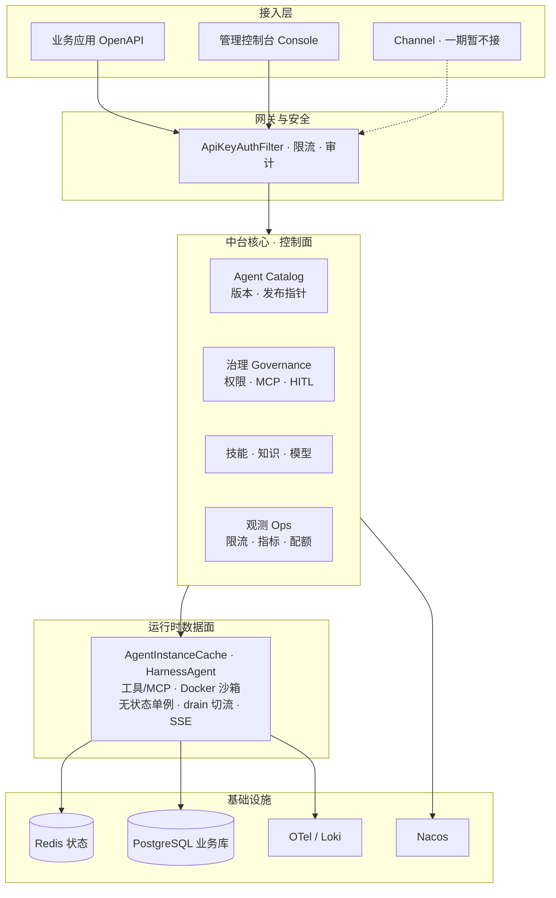

# 项目总体架构总结

> 基于 AgentScope Java 2.0 的 AI 中台（智能体应用平台）  
> 文档性质：架构总览 · 对应仓库 walking skeleton S0–S8  
> 来源综合：`docs/AI中台设计文档.md`、`AGENTS.md`、`pom.xml`、`application.yml`、`db/schema.sql` 与后端包结构

---

## 1. 项目定位

这是 **江苏二期 · 基于 AgentScope Java 2.0 的 AI 中台**（智能体应用平台）walking skeleton，**S0–S8 已全部落地**。

核心目标：让业务系统用标准 API 接入智能体能力，实现智能体的**统一注册、配置、编排、运行、审计与运营**，避免各业务线重复造轮子。

| 目标 | 说明 |
| --- | --- |
| G1 统一接入 | OpenAPI / SSE / Channel，一次接入即可调用平台智能体 |
| G2 统一治理 | 模型、工具、技能、知识、权限、密钥集中配置与版本管理 |
| G3 统一编排 | 一期：单 Agent + 子 Agent；二期：Team 协作、固定 Workflow |
| G4 生产就绪 | 多副本、会话恢复、沙箱隔离、可观测、灰度发布 |
| G5 可扩展 | 模型 Provider、RAG、Skill Repository、Channel、协议均可插拔 |

---

## 2. 技术栈与工程结构

| 层次 | 选型 |
| --- | --- |
| 语言 / 运行时 | **JDK 21** + **Spring Boot 3.5.5** |
| 智能体底座 | **AgentScope Java 2.0.3**（Harness + Service 参考架构） |
| 会话状态 | **Redis**（`AgentStateStore`，跨副本恢复） |
| 关系数据 | **PostgreSQL**（目录 / 治理 / 技能 / 知识 / 审计 / 计费；含 pgvector 位） |
| 前端 | **Vue3 + Vite** Playground（`platform-console-ui`，不在 Maven reactor） |
| 可选设施 | Nacos、OpenTelemetry、Loki、Docker 沙箱、外部 Embedding |

```text
ai-middle-platform (pom)
├── platform-common      # 公共 DTO（如 ApiError）
├── platform-open-api    # Spring Boot 后端入口 OpenApiApplication
└── platform-console-ui  # 管理台 / 调试 UI（独立 npm）
```

后端包根：`com.sinosoft.amp.openapi`，按职责拆成：

`web` · `security` · `session` · `agent` · `catalog` · `governance` · `tool` · `skill` · `knowledge` · `ops` · `external` · `model` · `billing` · `fs` · `sandbox`

---

## 3. 分层架构（控制面 / 数据面）



| 平面 | 职责 | 主要组件 |
| --- | --- | --- |
| **控制面 Control Plane** | Agent 注册、配置版本、Endpoint 发布、技能审核、审批流、权限、配额 | Agent Catalog、Governance、Skill Admin、Model Credential、Quota |
| **数据面 Data Plane** | ReAct/Harness 执行、工具调用、沙箱、状态读写、事件流出 | Agent Runtime、HarnessAgent、Sandbox、SSE |
| **数据层** | 会话状态、业务元数据、技能、审计、大对象 | Redis、PostgreSQL、（可选 OSS/向量） |

---

## 4. 核心运行时模型

围绕 **AgentScope HarnessAgent** 组装：

- **无状态单例**：每个已发布 `(tenantId, agentId, version)` 懒构建 1 个实例，缓存在 `AgentInstanceCache`。
- **发布切流（决议 B2）**：新版本 build 成功 → 改 Endpoint 指针 → 旧版 `drain` → in-flight 归零/超时后 evict；多副本经 **Redis 发布/订阅** 同步 release 事件。
- **会话隔离**：强制 `userId` + `sessionId`；State 存 Redis，杀副本会话不丢。
- **并发语义**：同 `(userId, sessionId)` FIFO 串行；不同会话并行。
- **工具面**：业务工具（`query_orders` / `place_order`）、RAG `knowledge_search`、MCP 登记、可选 Docker `sandbox_exec`；策略 `deny/allow` + HITL 三态（ALLOW / ASK / DENY）。
- **对外协议**：
  - `POST .../messages` 与 `POST .../messages:stream`（SSE，路径带冒号）
  - SSE 帧 `id={sessionId}:{seq}`，支持 `Last-Event-ID` 短窗续传
  - OpenAI 兼容入口、External Agent HTTP Chat 转发
- **认证**：除 `/api/v1/health/**` 外 `/api/*` 均需 `Authorization: Bearer <key>`；`tenantId` 以 Key 为准；管理接口在 `/api/v1/admin/...`。

HarnessAgent 能力面（设计）：

```text
HarnessAgent
├── Workspace          → AGENTS.md / knowledge / skills / subagents / tools.json
├── AgentStateStore    → Redis（跨副本）
├── Memory             → MEMORY.md + memory/YYYY-MM-DD.md
├── Compaction         → 对话压缩 + 大工具结果落盘
├── SkillRepository    → PostgreSQL 只读分发为主
├── Filesystem         → Remote / Sandbox / Local 三模式
├── Permission         → DEFAULT / EXPLORE / DONT_ASK + 规则
├── PlanMode           → 只读规划 + HITL 批准后执行
├── Channel/Gateway    → 会话、并发、路由、SSE
└── Middleware          → OTel / 限流 / 审计 / 自定义
```

---

## 5. 领域模块一览（代码包 → 能力）

| 包 | 能力 |
| --- | --- |
| `catalog` | Agent / Version / Endpoint 发布目录（JDBC + `CatalogBootstrap` 播种 demo） |
| `agent` | 实例工厂、缓存、drain、工具策略、运行时配置 |
| `security` | API Key 认证、租户/agent/scope 鉴权 |
| `session` | SessionContext 校验、SSE 重放缓冲 |
| `governance` | 权限规则、MCP 服务器、业务工具登记、审批收件箱 |
| `tool` | 订单业务工具、沙箱工具集 |
| `skill` | 技能上传/审核/只读市场、灰度 canary |
| `knowledge` | 文档/分块、Embedding（hash / HTTP）、`knowledge_search` |
| `model` | 模型凭证存储与管理 |
| `billing` | 租户配额、用量台账 |
| `external` | External Agent 注册/心跳/Chat 转发 |
| `fs` | 远程工作区（PG BaseStore）/ 本地 FS |
| `sandbox` | Docker 沙箱执行 |
| `ops` | 限流、审计、指标、Nacos、OTel、Loki、发布事件总线、就绪检查 |
| `web` | Chat / Admin / Health / OpenAI 兼容控制器 |

### 纵向能力切片（S0–S8 对应）

| 阶段 | 能力 |
| --- | --- |
| S0–S2 | OpenAPI Chat、会话上下文、目录播种、基础 Demo |
| S3 | PG 目录表、版本与 Endpoint 发布 |
| S4 | HITL 审批、权限三态、业务工具、MCP 登记 |
| S5 | 技能市场（DRAFT→APPROVED）与灰度 |
| S6 | RAG 知识库与 `knowledge_search` |
| S7 | 限流、指标、运行时配置、会话日志 |
| S8 | 多副本就绪检查、External Agent、SSE 续传、远程 FS |

---

## 6. 数据模型（PostgreSQL 核心表）

| 类别 | 表 |
| --- | --- |
| 目录发布 | `agent` · `agent_version` · `endpoint_release` |
| 治理 | `permission_rule` · `agent_permission_mode` · `mcp_server` · `business_tool` · `approval_item` |
| 技能 | `skill` · `skill_review` |
| 知识 | `knowledge_document` · `knowledge_chunk` |
| 接入扩展 | `external_agent` |
| 平台运营 | `base_store` · `audit_log` · `model_credential` · `tenant_quota` · `usage_ledger` |

建表脚本：`platform-open-api/src/main/resources/db/schema.sql`（PG `ON CONFLICT` upsert，启动时 `spring.sql.init` 执行）。

---

## 7. 设计原则与一期边界

### 设计原则

1. **底座复用、中台增值**：推理循环、状态、权限、沙箱等复用 AgentScope 2.0；中台聚焦目录、编排、API、运营。
2. **无状态运行时 + 分布式状态**：Agent 实例单例化；会话状态一律走 `AgentStateStore`；关系数据统一 PostgreSQL。
3. **定义即数据**：人格/知识/技能/子 Agent 以 Workspace 文件或管理台配置表达。
4. **默认安全**：权限三态、危险路径不可绕过、密钥集中管理、不可信代码进沙箱。
5. **事件驱动对外**：统一暴露 `AgentEvent` 流（SSE），消息可由事件重建。

### 一期 / 二期（评审决议）

| 范围 | 一期（已落地） | 二期（接口预留） |
| --- | --- | --- |
| 托管形态 | Managed 完整；External 最小集（注册/心跳/Chat 转发） | External 完整编排、Hosted 评估 |
| 编排 | 单 Agent、子 Agent | Team / Workflow（倾向对接 AgentScope Service） |
| 接入 | OpenAPI 非流式 + SSE、管理台调试；Channel 暂不接 | Channel、A2A/AG-UI、`chat/completions` 完整兼容 |
| 治理 | 模型凭证、技能只读市场、基础权限、会话内 HITL | 技能灰度全链路、计费账单、完整 RBAC |
| 沙箱 | Docker（默认关，按需开） | 默认开启 + 快照 |

**非目标（本期不做）**：自研大模型训练平台、通用 BPM 低代码画布、自研 Team/Workflow 引擎、Hosted Coding Agent、跨云多活、进程内第三方 Tool Plugin 热加载。

---

## 8. 运行拓扑与常用命令

### 本地推荐拓扑

```text
业务应用 / Console
        │  Bearer API Key
        ▼
platform-open-api :18081
        │
   ┌────┴────┐
   ▼         ▼
 Redis:6379  PG:15432 (amp)
```

全容器：`docker compose up --build` → 宿主机 **18081** / PG **15432** / Redis **16379**。

### 常用命令

```powershell
# 构建 + 单测（与 CI 一致）
mvn -B verify

# 只跑一个测试类
mvn -pl platform-open-api -Dtest=ChatHttpContractTest test

# 本地起后端（默认 http://127.0.0.1:18081）
mvn -pl platform-open-api -am spring-boot:run

# 前端（需后端已在 18081）
cd platform-console-ui
npm install
npm run dev    # :5173，/api 代理 → 18081
npm run build  # 产出 dist/
```

### 关键环境变量

| 变量 | 默认 / 说明 |
| --- | --- |
| `AMP_SERVER_PORT` | 18081 |
| `AMP_PG_URI` | `jdbc:postgresql://127.0.0.1:15432/amp` |
| `AMP_REDIS_URI` | `redis://127.0.0.1:6379` |
| `AMP_API_KEY` / `AMP_ADMIN_API_KEY` | 业务 Key / 管理 Key（scope 含 admin） |
| `AMP_MODEL_ID` | `deepseek:deepseek-flash`（或 DASHSCOPE/OPENAI） |
| `AMP_FS_MODE` | `remote`（PG Base）/ `local` |
| `AMP_SANDBOX_ENABLED` | 默认 `false` |
| `AMP_REPLICA_ID` | 多副本标识 |

---

## 9. API 约定速查

- 除 `/api/v1/health/**` 外，`/api/*` 均需 `Authorization: Bearer <key>`。
- 默认 Demo Key：`s0-demo-key` → 租户 `acme`、可访问 agent `demo`；**tenantId 以 Key 为准**。
- 会话接口强制 `userId` + `sessionId`；`sessionId` 匹配 `[A-Za-z0-9_-]{1,128}`。
- 流式路径为 **`POST .../messages:stream`**（冒号）；SSE 用 fetch POST（EventSource 不支持 POST）。
- 管理面统一前缀：`/api/v1/admin/...`（catalog / governance / skills / knowledge / config / sandbox / fs / external / quotas 等）。
- 错误体：`{"code":"..."}`，如 `RATE_LIMITED` / `SESSION_CONTEXT_INVALID` / `APPROVAL_ALREADY_RESOLVED` / `SSE_RESUME_MISS` / `EXTERNAL_UNHEALTHY` 等。

---

## 10. 一句话总结

以 **AgentScope Harness** 为执行内核，**Spring Boot Open API** 做网关与中台控制面，**Redis** 管会话状态、**PostgreSQL** 管目录与治理数据，形成「**统一接入 → 目录版本发布 → 受控工具/技能/知识执行 → 可观测审计**」的智能体中台骨架；S0–S8 已打通多副本、RAG、HITL、MCP、沙箱、配额与 External 接入等生产就绪路径。

---

*本文档为架构总览导出，细节以 [`AI中台设计文档.md`](./AI中台设计文档.md) 与代码/配置为准。*
